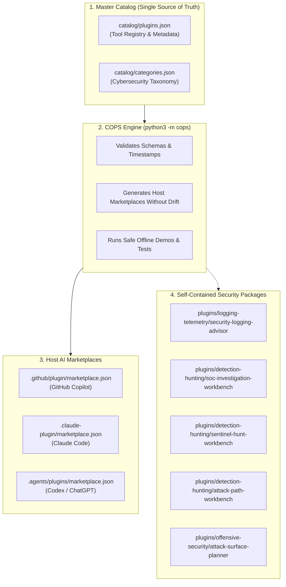

# System Architecture of COPS

Welcome to the architectural overview of **COPS (Copilot Operations Plugins for Security)**!

At its core, COPS solves a fundamental challenge in modern AI-assisted engineering: **How do we build production-grade, defensive cybersecurity tools that work seamlessly across multiple AI assistants without duplicating code or creating vendor lock-in?**

To answer this, COPS uses a **catalog-driven, offline-first architecture** where each security capability is completely self-contained, and configuration files for specific hosts (like GitHub Copilot, Claude Code, and Codex) are automatically generated from a single canonical registry.

---

## The Five Core Architectural Pillars

### 1. The Master Catalog (`catalog/`)
Instead of each AI assistant maintaining its own separate list of plugins, COPS maintains **one canonical inventory**:
- **`catalog/plugins.json`**: Records every plugin's unique ID, display name, semantic version, primary category, and feature tags.
- **`catalog/categories.json`**: Defines our stable cybersecurity taxonomy (`logging-telemetry`, `detection-hunting`, `offensive-security`). Every package is assigned exactly one primary category to keep the repository well-organized as it grows.
- **`catalog/schemas/`**: Strict JSON schemas defining what a valid package, finding, or evidence record looks like.

### 2. The Universal Host Adapter Engine (`cops`)
Different AI assistants expect different directory structures and configuration keys:
- **GitHub Copilot** uses `.github/plugin/marketplace.json` and root `plugin.json` files conforming to the Agent Plugins standard.
- **Claude Code** expects `.claude-plugin/marketplace.json` and `.claude-plugin/plugin.json`.
- **Codex / ChatGPT** requires `.agents/plugins/marketplace.json` and `.codex-plugin/plugin.json` with declared interface capabilities.

Rather than hand-editing three different files every time a plugin changes, `python3 -m cops generate` reads the master catalog and **automatically builds all three marketplace indexes**. Our CI test suites verify that generated files never drift out of sync with the master catalog.

### 3. Self-Contained Packages (`plugins/<category>/<plugin-id>`)
Every security tool in COPS is completely modular and lives in its own dedicated directory:
- **Zero Third-Party Runtime Dependencies**: Core plugin scripts run using only the standard Python library (`json`, `re`, `pathlib`, `urllib`).
- **Complete Package Boundary**: Each package owns its skills, scripts, test cases, and practitioner playbooks. A developer can inspect or test one package without needing to understand the rest of the repository.
- **Built-in Safe Demos**: Every package declares a safe demonstration command that executes with synthetic data in a matter of seconds.

### 4. Deterministic Verification & Evidence Boundaries
Security tools require trust. We separate what is verified locally from what remains unverified in a live environment:
- **Local Validation (`validated`)**: The package's scripts parse, schemas pass validation, and deterministic tests catch known attack simulations.
- **Live Integration (`unverified`)**: The package has not been granted live cloud credentials, and no external tenant API was called.
This separation ensures operators know exactly what has been proven locally versus what requires staging validation in a live cloud tenant.

### 5. Script-First Determinism & Token Efficiency
COPS follows a strict separation of responsibility: **scripts do the heavy data processing; agents do the cognitive reasoning**.

When analyzing high-volume security artifacts—such as raw audit logs, entitlement graphs, repository trees, or multi-file Git diffs—we never stream raw payloads directly into an LLM context window. Instead, self-contained Python modules parse schemas, compute cryptographic hashes, evaluate constraints, and filter noise on the local workstation CPU.

The AI agent interacts with tools through structured command-line interfaces and receives compact, high-signal summaries (Markdown tables, diagnostic flags, and pruned JSON reports). This pattern delivers:
- **100% Deterministic Execution**: Mathematical evaluations, schema validation, and graph traversals are reproducible and free from probabilistic hallucinations.
- **Dramatic Token Reduction**: Offloading bulk parsing preserves the agent's context window, slashes token usage by 90%+, and avoids context truncation on large datasets.
- **Local Privacy & Secret Scrubbing**: Credentials, tokens, and sensitive customer data are scrubbed locally before any summary is passed to a model provider.
- **Headless CI/CD Portability**: Security checks remain fully testable and runnable via standard CLI tools in automated environments without requiring an active LLM connection.

---

## Package Responsibilities at a Glance

1. **Security Logging Advisor** (`logging-telemetry`): Inspects local repositories to identify missing audit events, flags sensitive variable leakage, and verifies CVE call-path reachability.
2. **SOC Investigation Workbench** (`detection-hunting`): Models competing hypotheses and inquiry dependency graphs to guide analysts through complex alert triage without confirmation bias.
3. **Sentinel Hunt Workbench** (`detection-hunting`): Develops, adapts, and stress-tests 12 defensive threat-hunting workflows across Microsoft Sentinel, Defender XDR, and Data Lake.
4. **Attack Path Workbench** (`detection-hunting`): Evaluates multi-hop identity and permission graphs from local cloud exports to identify critical lateral movement choke points.
5. **Attack Surface Planner** (`offensive-security`): Translates human-signed rules-of-engagement scopes and local exports into passive, bounded review plans.

---

## Shared Evidence SDK (`cops.evidence`, `cops.connectors`)

For tools that need to collect or store evidence from cloud APIs (such as Azure Resource Graph or Microsoft Graph), the repository includes an opt-in **Evidence SDK**:
- **Tamper-Evident Envelopes**: Evidence items are wrapped with SHA-256 content hashes, collection timestamps, and query fingerprints.
- **Bounded Connectors**: Built-in limits on maximum response size, pagination limits, and request timeouts prevent runaway API costs or memory exhaustion.
- **Transaction Checkpoints**: Supports resumable state and interruption recovery during long-running collection jobs.

See the **[Shared Evidence SDK Guide](docs/EVIDENCE_SDK.md)** for detailed implementation examples.

---

## Specialist Agent Profiles & Dynamic Routing (`cops.routing`, `agents/`)

COPS centralizes **21 specialist cybersecurity agent profiles** in `agents/` and provides a deterministic, zero-token routing engine:
- **Centralized Profiles Inventory**: `agents/registry.json` and `agents/profiles/*.agent.md` govern callable personas across offensive security, defensive detection, incident response, digital forensics, cloud identity, and compliance.
- **Dynamic Selection Engine (`cops.routing`)**: Fast local Python classifier that maps natural language requests and artifact types to the most qualified specialist profile and recommended skills without model hallucinations.
- **Model Advisor (`cops.routing.model_advisor`)**: Opt-in offline task classification and model/effort ranking against a bounded, fresh operator-supplied catalog. Exact availability, access, capabilities, tier, and supported efforts determine eligibility. Output is advisory and cannot change host settings or authorize execution. The workbench plugin ships the skill and guide; commands require the separate COPS checkout runtime. See [model routing](docs/model-effort-routing.md).
- **Triad Orchestration Topology**: For critical tasks (e.g. penetration testing, adversary emulation, active containment, or privilege escalation audits), the engine automatically assembles a three-agent team:
  1. *Primary Specialist*: Conducts the core assessment or planning.
  2. *Domain Skeptic*: Challenges assumptions, identifies benign alternatives, and stress-tests transition constraints.
  3. *Evidence Auditor*: Verifies cryptographically signed authorization receipts and validates SHA-256 evidence envelopes.
- **Interactive Authorization Gate (`cops.authorization`)**: High-consequence profiles enforce mandatory operator authorization, supporting interactive terminal approval and pre-signed cryptographic receipts while failing closed in non-interactive environments.

---

## Delegation authorization laboratory

The Foundry Agent Harness `auth-plan` command compiles a versioned Action Plan
binding the selected synthetic cases, fixture identities, source digests, and
aggregate limits. `auth-lab` verifies and atomically consumes one signed COPS
assessment receipt, then launches fixed stdio peer and target processes from a
private snapshot of the approved source bytes. The target independently checks
its synthetic grant; a COPS receipt cannot grant target-service authority.

Correlated requests, decisions, and a directly observed disclosure and write
ledger establish the local result. The observer child retains an ephemeral
Ed25519 private key while the runner verifies challenge-bound readiness,
session, sequence, and effects with the public key only. This provides
process-level key separation inside the same runner-controlled host and source
snapshot, not independently administered external attestation.
`evidence_complete`, `expectation_met`, and
`security_pass` distinguish complete observations from an expected inconclusive
test. Admission, response and ledger byte limits, cancellation, and observed
cleanup bound the batch. A later exception preserves completed results and usage,
reports uncertain effects, and stops admission. Snapshot failures and ordered
recovery actions remain visible together. The report goes to stdout; accounting
covers received fixture responses and new ledger bytes. This fixture provides
neither provider evidence nor durable crash recovery. See the [laboratory specification](specs/agent-mcp-laboratories.spec.md)
and [operator playbook](plugins/offensive-security/foundry-agent-harness/docs/PLAYBOOK.md).

## Contributor & Quality Assurance Spine

The repository maintains strict quality guardrails:
- **`AGENTS.md`**: Canonical instructions for contributors and automated agents.
- **`Makefile` & `scripts/agent/check.py`**: Runs pre-commit validation, including syntax checks, contract verification, adapter synchronization, and pytest-bdd scenarios.
- **`make check`**: The universal gate that must pass before any change is merged.
- **Catalog playback acceptance**: The portable operator scenario reads the
  canonical plugin catalog and runs every manifest-backed demo through `cops demo`
  twice, then runs exported playbacks with an isolated copy of `cops/` and
  `catalog/`. Package runners verify domain results and failure cases; the shared
  runner checks public entry points and exported runtime completeness. Documentation validation requires each
  README to link its runnable playbook and checks local documentation links.
  See [Runnable Plugin Workflows](docs/plugin-playbacks.md).

To get started with development, explore the **[Contributing Guide](CONTRIBUTING.md)** and **[Repository Layout](docs/REPOSITORY_LAYOUT.md)**.

## Local execution cost accounting

The [plugin-run-cost skill](.agents/skills/plugin-run-cost/SKILL.md) layers explicit
run membership, dated request pricing, bounded input profiles and employee/tool
economics over the existing session-usage-audit parser. This is contributor tooling,
not a distributed product package or telemetry service. The adapter exports only
normalized request metadata on opt-in; ledgers stay outside Git. See its
[accounting contract](.agents/skills/plugin-run-cost/references/accounting.md) for
privacy, missing evidence, pricing expiry and forecast limitations.

## Operator gateway assessment boundary

The optional provider assessment has a separately versioned live plan and
bounded, text-only request envelopes for OpenAI, Azure OpenAI, Bedrock, and
Vertex. Its local emulator path reserves a shared budget, verifies a signed
one-use gateway dispatch grant against the exact request and provider scope,
and records normalized, redacted evidence. Provider usage remains an estimate
until an independent billing reconciliation exists.

The versioned egress broker permits a bounded `POST` only to a configured
operator gateway origin, path, and authenticated SPIFFE identity. The gateway
owns provider credentials and independently verifies each dispatch grant.
The repository does not wire this route into a production worker or provision
a gateway, provider credentials, or a paid canary. The remaining operational
gate is recorded in [the execution audit](docs/EXECUTION_GATE_AUDIT.md) and
[gateway operator guidance](docs/PROVIDER_GATEWAY.md).
