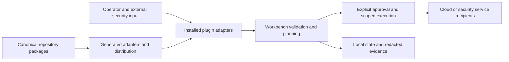

# copilot-operations-plugin-for-security detailed threat-model baseline

## Status and scope

Original source baseline: `42cb017012934839702ce0b939a5cbc9193271ea`. Adoption: 2026-10-08.
Status: source-based initial model; independent human security review pending.
This model contains attack hypotheses, not validated vulnerability findings.
Existing canonical security documentation and stricter acceptance gates remain
applicable. The E16.01 implementation entry identifies its later source revision;
the original baseline does not establish newer behavior.
The E16.01 local agent/MCP fixture source and pre-existing tests were inspected
at `843e0ed1bcd2eadb167491ba7539713d19748b9b` (merged PR #276). The exact
bundled-case inventory assertion was added at
`50da6d6df8ff89774db89fb33d598ec47d7af754` in PR #293.

COPS distributes security operations plugins and skills, local validation/marketplace tooling and execution/approval support. Capabilities vary by component: the Sentinel hunt workbench is offline and credential-free; other integrations can reach live APIs. No global offline or harmless-execution assumption applies.

## Assets, actors and assumptions

Assets: Plugin package and marketplace integrity; approval/checkpoint records; cloud/Sentinel credentials; tenant/resource identifiers; security telemetry and hunt results; generated report-set integrity and completion evidence; agent execution authority; synthetic laboratory case, MCP fixture state and effect-report integrity; CI and distribution credentials.

Actors: Authorized security operator and laboratory case author; malicious telemetry/tool-output or laboratory text author; laboratory runner and separate agent/MCP fixture processes; untrusted plugin contributor; compromised dependency/marketplace source; local user manipulating approval state; attacker controlling a configured API endpoint.

Assume an authorized operator, a trusted host and reviewed checkout. Treat input,
remote responses and imported content as untrusted. Repository access or a local
host administrator can bypass controls inside that same authority domain. Live
IAM, network controls, secret backend behavior and release protection require
operating evidence; they are not inferred from configuration files. Credentials,
private payloads and real identifiers must never be copied into this document.

## Components, data flows and trust boundaries

| Flow | Boundary and effective authority |
| --- | --- |
| Plugin source → validators/generator → marketplace → installed agent | Content and metadata become agent instructions and advertised capabilities. |
| Operator decision → approval store → tool execution | Approval must be bound to action, effective resource and current revision, atomically consumed. |
| Cloud integration → remote API / telemetry → agent | Credentials go only to intended recipients; telemetry remains untrusted even from authenticated services. |
| Canonical hunt skills → generated host adapters | Hashes and deterministic generation establish consistency, not trust in malicious canonical content. |
| Operator model catalog → offline advisor → host model selection | Catalog records are bounded, untrusted assertions about exact model capabilities, access and supported effort. Advice cannot establish entitlement or authorize a model switch, agent launch or security operation. |
| Approved scan plan and IP scope → live active scanner → network and durable checkpoint | Target names, DNS answers, scope files, received banners, imported observations, and checkpoint contents are untrusted. The CLI bounds and canonically validates scope, target-list, and offline synthetic fixture JSON before planning or dispatch; an explicitly named fixture must exist and contain an object. The full Cartesian plan must fit the cumulative probe budget and a 131,070-key in-memory materialization cap; the cap does not guarantee that variable-size evidence will fit the checkpoint document limit. The scanner binds TCP and UDP selections, including opted-in DNS queries, plan, and IP scope to a checkpoint; applies one cumulative time/probe budget; and reserves each probe before dispatch. Offline fixtures distinguish TCP and UDP, classify missing or timed-out UDP evidence as unknown, and require exact selected-probe provenance before a positive DNS result. Masscan and Nmap imports accept only TCP and UDP and maintain separate protocol ledgers. UDP sends can affect service state; silence is inconclusive. A generic UDP reply does not identify a service; a matching response to an explicitly selected DNS query identifies only DNS, without authenticating the responder. The scanner retains UDP response length and a hash of a bounded prefix, not the UDP body. For non-TLS TCP, it may retain up to 512 raw banner bytes and a decoded display form in the checkpoint. These bytes can contain sensitive or hostile content and self-reported product claims; operators must protect checkpoint storage and must not treat a banner as authenticated identity or host-OS proof. Uncertain effects stop automatic retries. Lock identity is revalidated immediately after advisory-lock acquisition. Advisory locking cannot prevent a process with the same filesystem authority from replacing the lock pathname later in the run, so operators must protect the checkpoint directory from all other writers for the full controller lifetime. A same-authority local writer can replace both plan and checkpoint, so the engagement controller must protect and independently authorize them. |
| Handoff proposal → specialist acceptance → auditor completion | A proposed skill ID and capability must resolve to the recipient's registered specialist profile and local skill file; acceptance records the resolved target and checksum. Skeptic review and audit re-resolve the current target. Completion is a reviewed handoff record, not tool execution. |
| Attack Path input → descriptor-anchored report writer → operator-selected output directory | Output paths and concurrent filesystem names remain untrusted; a report set is complete only when the completion marker and recorded hashes validate. |
| Laboratory operator observation → signed receipt → controller case classification | Execution requires fresh `observed` verification from an explicitly configured provider; `simulated` verification cannot authorize execution. The controller atomically reserves the authorization ID before dispatch, validates the returned identity before treating a result as trusted, and stores exact-byte-hashed evidence in a separately configured owner-only directory. These controls remain inside the local owner's trust boundary. |
| Plugin demo → source playback / isolated export → semantic acceptance | Every declared synthetic demo runs twice from source and twice from a Git-index export with source-only package files omitted. Acceptance checks the final JSON contract and rejects an exit-zero no-op; it does not establish behavior of an installed release artifact or live integration. |
| Canonical Microsoft Sentinel package → explicit local Git sync → locked SOC snapshot → playback | The lock records a fixed upstream, subdirectory, revision, source state, file inventory hashes, license and policy. Validation establishes repository consistency, not upstream authorship, freshness, vulnerability status or legal approval. |
| AI inventory import → bounded evidence graph/report → authorized operator | Imported provider records remain untrusted; strict projection rejects raw trace content, canonical source/tenant identities and engagement-bound references prevent cross-engagement conflation, and bounded traversal reports coverage limits. |
| Offline LangSmith response → strict selected-field parser → AI inventory registry → `ExportBoundary` → caller sink | The parser accepts one versioned envelope, discards user-defined names and cursors, and never fetches provider data. A report reaches a registered report sink only after the concrete privacy boundary transforms it. |
| Evidence copy → `ExportBoundary` → declared external/durable sink | `cops.evidence.assessment.export_provider_assessment`, `export_assessment_telemetry`, and `export_assessment_report` derive a local assessment; `cops.diagnostics.export_diagnostic_report` serializes a `DiagnosticReport`. Each transforms its copy then calls the caller-provided sink immediately afterward. The repository supplies no recipient backend. |
| Operator canary policy → messaging collector → synthetic fixture or TCP endpoint | A canary route requires an explicit destination allowlist and, for mail, a recipient allowlist, active retention window and bounded message count. Synthetic fixture claims remain fixture evidence; TCP reachability proves no delivery or cleanup. |
| Telemetry Proof Pack exports → offline correlator → Markdown/JSON report | Supplied marker records, timestamps and IDs remain untrusted. The report hashes content for comparison but cannot authenticate exports or enforce collection, access, or retention policy. |
| Offline Entra export manifest and files → identity graph and exposure report → analyst | Export content and collector claims of completeness or collection time are untrusted. Hashes establish file integrity only; per-source coverage determines whether a path can support a current exposure claim. Reports can repeat private identifiers. |
| Scoped offline Active Directory export → bounded relationship graph → analyst | Collector identity, scope, completeness, collection time, and relationship support are untrusted input. Candidate paths are structural observations; reports can contain sensitive relationship identifiers and do not establish current privilege. |
| Local Linux or Windows host export, or bounded native Windows metadata → host-assessment-workbench importer → operator | Offline imports remain untrusted source assertions. The opt-in Windows collector reads fixed or bounded metadata for seven capability surfaces and records access failures explicitly; its assessment-owned lifecycle canary proves only local creation and cleanup. A separate validator binds that cleanup receipt to the exact export bytes and an empty canary root. Neither path demonstrates privilege crossing or authenticates the host. Opaque IDs must remain free of secrets. |
| Operator assessment budget → owner-controlled ledger → fixture assessment dispatcher | The controller must reserve before callback dispatch. Agent and provider content cannot expand the budget or release an uncertain attempt. The offline provider-shaped fixture importer uses this ledger; live provider dispatch remains unavailable. |
| Authorized service-validation action → durable assessment ledger → loopback provider → fixture-owned passive audit | Each approval is consumed once at durable dispatch. Controlled proof consumes the exact durable candidate prerequisite. The audit binds exact identities, digest, correlation, one-use reference, and times while ignoring provider-authored claims. The fixture and verifier share one process and administrative authority. |
| Active scan checkpoint → offline service handoff → specialist proposal | Checkpoint approval lists, fingerprints, and response content are untrusted observations. Separately validated scope must match the exact host, resolved IP, port, transport, and vantage; resolution quarantine removes candidates. The proposal is neither execution authority nor evidence of a vulnerability. A worker must recheck identity, authorization, budgets, and effects before any follow-on action. |
| Caller-supplied baseline and retest reports, observations, cleanup receipts, and owner assertions → offline retest comparator → private review report → human reviewer | Inputs and report strings remain untrusted. Versioned validation, exact identity and evidence joins, aggregate bounds, and fail-closed closure gates constrain local interpretation. The report does not authenticate sources, authorize execution, prove cleanup, or close findings. |

| Approved local corpus → private Linux worker workspace → offline research adapter → run result | The signed plan binds corpus, inventory, isolation, and executable digests. The worker checks a fresh namespace observation before approval consumption and before each external adapter starts; its own measurements do not independently attest host controls. |
| Operator-supplied synthetic case → runner → agent fixture proposal → authorization gate → MCP stdio fixture → observed state/report | Case text and MCP tool output are untrusted data. The agent child proposes but has no MCP pipe; only the runner can forward a proposal after case-scoped checks. The separate child processes share the host's OS authority, so their stdio boundary is not an OS network sandbox. |
| Trusted stdio profile and untrusted MCP request → bounded Action Plan compiler → later worker | The compiler binds one exact read-only request to a registered adapter version, source revision, executable digest and no-egress plan assertion. It does not launch a process, authenticate a profile author, attest the executable on a worker, or enforce OS isolation. |
| Synthetic provider plan and response fixture → exact plan gate → assessment budget ledger → normalized content-free report | Provider-shaped input remains untrusted. Exact environment, scope, endpoint, model, canary, tool and request-digest binding precede reservation and fixture processing. The importer makes no network request and executes no proposed tool. |
| Ordinary-language goal plus Engagement → exact target resolver → selection result | Goal text is untrusted intent, not authority. The resolver accepts one exact included target or a recorded engagement selection, rejects quoted examples and ambiguity, and reports that no executable path or assessment exists. Engagement review remains unverified. |
| Approved dispatch grant → worker egress broker → operator gateway → provider handler | The opt-in v2 broker accepts a bounded POST only to one configured gateway origin and path with an exact TLS SPIFFE identity. It verifies the signed grant against the plan, worker identity, provider scope, and request digest, then durably consumes the one-use dispatch and authorization IDs before sending. The gateway independently verifies those bindings and owns provider credentials. Repository tests use an emulator; no production gateway or credential path is provisioned. |
| Local asset context and service attack notice registry → bounded offline matcher → applicability report | Asset claims and notice content remain untrusted. Exact allowlists and prerequisite evidence produce conservative classifications, not vulnerability or exploitability findings. The matcher performs no network access or input-directed execution. |
| Authorized local exposure bundle → intake and evaluator → private report | A bundle can contain asset, owner, subscription, and vulnerability details. The installed skill resolves the package locally and writes a new report in a private operator-selected directory; explicit stdout is limited to synthetic or sanitized data. Intake validation does not establish source completeness or exploitability. |
| Caller-supplied engagement, plan, run, finding, and evidence records → offline assessment report → operator | All records and free text are untrusted. Contract and semantic checks constrain scope, provenance, evidence links, and coverage claims; hashes establish internal integrity, not source authenticity or authorized execution. Reports can still disclose identifiers or repeat false source assertions. |
| Operator-supplied reproduction plan and local artifacts → offline preflight → private report | Plan fields, HTTPS source URIs, acquisition receipts, artifact bytes, version claims, and lab references are untrusted declarations. Descriptor-relative, no-follow reads and bounded streaming hashes check local consistency; they do not authenticate sources, authorize execution, or bind bytes after preflight. The report is a local metadata result, not lab evidence. |

The flow table defines the project-specific boundaries behind this overview.
Authentication of an upstream service does not make its content trusted. Review
the effective filesystem path, subprocess arguments, network recipient, cloud
account and credential recipient rather than only their user-supplied labels.

### Local agent and MCP fixture boundary

The Foundry Agent Harness laboratory loads versioned JSON cases from an
operator-selected file or directory. A case author supplies the task,
`untrusted_text`, tool permissions, `approved_call`, and control profile. The
`approved_call` is the case's test oracle, not an independently authenticated
operator approval. Case validation restricts tools, tenant, arguments, resources
and destination to fixed synthetic values; it does not establish the author's
identity or the truth of the task description. The loader does not limit file
bytes, directory case count or JSON nesting before parsing. Large or hostile
case inputs can exhaust local memory or CPU; use only vetted synthetic inputs.

For each case, the runner starts fixed local Python agent and MCP fixture scripts
as separate child processes, in a temporary working directory with a reduced
environment. It exchanges bounded JSON lines over pipes and checks response
deadlines. The MCP pipe belongs to the runner, not the agent fixture. The runner
checks the MCP protocol version, tool inventory and response shape, reads initial
state, and, for a tool-response case, obtains the injected text through an MCP
lookup. Case text can claim higher priority or impersonate a peer. The
deterministic agent fixture is not a live model: it can turn an untrusted
`TOOL_CALL:` marker into a proposed call. Agent text and MCP responses are data,
not authority to execute.

The runner checks each proposal against case tool permission, tenant and exact
synthetic argument, resource and destination allowlists. The `strict` profile
also requires the proposal to equal the case's `approved_call` before the runner
forwards it to MCP. The `permission_only` profile deliberately omits that task
binding to demonstrate a permitted but off-task effect; it is not a safe
authorization profile for live tools. Denied calls are not forwarded. The runner
derives effects from MCP state before and after execution, then requests reset
and compares the final state with the initial state. A tool's success text or
agent proposal alone does not prove an effect or cleanup. Malformed responses,
timeouts, protocol mismatches and unverifiable state fail the case; child
processes are terminated on exit. Report fields such as `environment_verified`
and `cleanup_verified` describe these fixture checks only.
`all_expectations_met` summarizes only the selected cases; a custom `--cases`
run is not evidence that all 13 bundled cases ran. Check the report's case IDs
when asserting bundled-suite coverage.

Python `-I`, a reduced environment and a temporary working directory constrain
the launched scripts but do not provide OS process, filesystem or network
isolation. The children run with the invoking user's host authority; compromised
same-authority code or a modified checkout could bypass the runner's intended
MCP gate or access host resources. The bundled fixture performs no real network
operation and accepts no case-selected command or endpoint, but the OS does not
block network access. Run only trusted checkout code with synthetic data and no
real credentials or live targets. These local results do not establish live
model prompt-injection resistance, host containment or independent authorization.

The separate offline stdio profile compiler accepts a trusted, versioned profile
and an untrusted request. It requires an exact tool and argument match, one
registered adapter with a pinned revision, executable digest, and command-template
digest, and bounded request, duration and output sizes. It rejects recognizable
credential material in request arguments before encoding the inert Action Plan;
unknown credential formats remain a caller responsibility. Its
`egress_allowed: false` field is a contract assertion. A worker must
independently verify the executable, authorization and no-egress isolation before
dispatch. No disposable worker or independent observer is available for this
phase, so the compiler tests are not laboratory containment evidence.

### Offline AI provider fixture boundary

The Foundry Agent Harness provider assessment reads a versioned synthetic plan
and case file through a bounded JSON loader. The plan permits only
`offline_fixture` mode with paid execution disabled. It binds each case to an
exact provider environment, account or tenant, project or subscription, region,
`.invalid` HTTPS endpoint, model, canary, tool allowlist and canonical request
digest. A mismatch is denied before budget reservation or response processing.

Approved cases reserve against the shared assessment budget ledger before their
inline response is validated. Only admitted responses reach the strict schema
for their provider; malformed, cross-provider, unknown-field and inconsistent
tool-use envelopes fail before normalization. OpenAI and Azure status, AWS stop
reason and GCP finish reason then map into a common outcome vocabulary. An AWS `tool_use` response
becomes a `tool_proposal`; there is no executor. Partial or unknown terminal
state becomes `no_effect` with unknown usage, leaving the ledger conservative.
Synthetic prices and token counts exercise local accounting and are not provider
usage or billing evidence.

The report uses fixed allowlisted fields and replaces source case IDs with stable
SHA-256 references from `report_case_id`. These pseudonymous correlators do not
provide anonymity. It excludes prompts, response text, endpoint URLs, account
identifiers, canary values and credentials. An over-budget snapshot remains in
the emitted report and makes the completed command exit nonzero. Its cleanup
receipt covers only the temporary local budget ledger. The importer has no
provider client, credential lookup, network operation, live mode or paid mode.
It cannot authenticate a response, verify tenant identity, establish actual
usage or cost, prove remote cancellation or cleanup, or measure model behavior.
The default shared egress broker permits only `GET` and `HEAD`. An opt-in v2
gateway route supports a bounded POST to an operator-configured gateway, as
described below. The offline importer does not use that route. Neither component
establishes production worker readiness or authorizes a paid provider request.

### Operator gateway dispatch boundary

The v2 broker accepts a signed dispatch grant and a bounded body only when the
operator has configured the exact action plan and digest, worker SPIFFE identity,
gateway HTTPS origin and path, gateway SPIFFE identity, trust store, and durable
replay store. The grant binds the provider, account or project, region, model,
gateway endpoint, provider request target, body digest and byte count. The
broker rechecks the grant immediately before consuming its one-use dispatch and
authorization IDs. TLS checks the gateway hostname and configured SPIFFE URI;
redirects and automatic retries are denied. A legacy replay database missing
the authorization ID constraint fails closed until its history is migrated.

The gateway emulator independently verifies the signed grant and worker identity
and consumes it before invoking a provider-shaped handler. The handler can return
only a bounded JSON response. These tests establish local protocol behavior, not
the identity, credentials, isolation, or retention of a deployed gateway. A
production gateway would own scoped provider credentials and must compare the
grant to its configured provider endpoint before any provider call. The worker
must not receive those credentials. A consumed grant followed by a disconnect
has an uncertain outcome and must not be replayed automatically. Provider usage,
billing, remote cancellation, and deletion require independent evidence.

### Opt-in provider assessment emulator boundary

The separate live plan requires explicit paid-execution intent but only drives
synthetic, local dispatch in this increment. A signed grant and matching body
digest do not make arbitrary provider JSON safe. The runner admits only narrow
text canaries with an exact provider path, model, output limit, and retention or
streaming settings; it rejects tool declarations, attachments, extra keys, and
direct provider destinations. The gateway endpoint origin and verification time
must come from trusted configuration and the gateway's own clock, not claims in
the case or grant. A forged scope, worker identity, or gateway origin is denied
before budget reservation.

Budget reservation precedes dispatch. A committed dispatch intent remains
charged when a send or ledger update has an ambiguous outcome, and no automatic
replay follows a timeout, disconnect, cancellation, malformed response, or
missing usage. Tool-use output is an inert proposal requiring a separate
authorization. Public evidence omits raw prompts, provider output, tool
arguments, endpoint, account, and canary; its case hashes are correlators,
not anonymity controls. Synthetic gateway usage is an estimate, not independent
billing. Local cancellation and cleanup do not prove remote cancellation,
deletion, residency, or retention. A compromised checkout or absent production
network isolation remains outside the emulator's protection. See the
[live gateway contract](../specs/ai-provider-live-gateway.spec.md) and
[operator guidance](PROVIDER_GATEWAY.md).

### Service attack notice boundary

The service attack notice command reads a versioned local registry and one
bounded local asset JSON document. Its parser accepts regular UTF-8 files only,
limits bytes and nesting, rejects duplicate keys and non-finite values, and
validates exact fields. It rejects non-regular paths before opening and uses
no-follow and nonblocking open flags where the host supports them. A local
actor who can replace paths during the open remains an unresolved file-integrity
risk on hosts without those flags. Registry sources must use allowlisted HTTPS primary
source hosts, but URLs are metadata: the command never fetches them. Input is
data and cannot select code, commands, paths, or network destinations.

Assessment uses exact product, operating-system, and version allowlists. A
candidate additionally requires source-scoped service reachability,
configuration, and contextual prerequisites. A port observation alone is
insufficient. Missing or unlisted versions, missing evidence, and stale notices
remain unknown. Withdrawn and superseded notices cannot become candidates.
Candidate means only that a targeted investigation may be appropriate; it does
not establish a vulnerability, exploitability, initial access, or authorization
to scan. The matcher labels asset input as unverified. It cannot authenticate
either the asset claims or the source research and depends on human monthly
and high-impact review.

## Implementation evidence inventory

- `cops/execution/store.py`: inspect at the baseline revision; evidence scope is limited to this component.
- `plugins/AGENTS.md`: inspect at the baseline revision; evidence scope is limited to this component.
- `plugins/detection-hunting/sentinel-hunt-workbench/huntwb/adapters.py`: inspect at the baseline revision; evidence scope is limited to this component.
- `plugins/detection-hunting/attack-path-workbench/attackpath/azure/report.py`: descriptor-anchored report-set writes and completion-marker publication.
- `plugins/detection-hunting/attack-path-workbench/attackpath/windows_io.py`: Windows handle-relative traversal, reparse-point rejection, bounded input reads and exclusive report publication.
- `plugins/detection-hunting/attack-path-workbench/tests/test_workbench.py`: negative tests for output-path replacement, publication races, durability failures and cleanup behavior.
- `plugins/detection-hunting/attack-path-workbench/scripts/run_demo.py`: native Windows playback and rejection of input and output-parent junctions in operator CI.
- `docs/SECURITY_MODEL.md`: inspect at the baseline revision; evidence scope is limited to this component.
- `scripts/agent/check.py`: inspect at the baseline revision; evidence scope is limited to this component.
- `cops/laboratory/harness.py`, `evidence.py`, `receipts.py`, and `journal.py`: source evidence for fresh observed-versus-simulated execution gating, exact stored-byte durable evidence, atomic authorization reservation, cleanup/result digest binding, and best-effort unknown recovery after dispatch. Live host isolation, key custody and observer independence remain unverified.
- `tests/test_laboratory_harness.py`, `tests/test_laboratory_evidence.py`, `tests/test_laboratory_journal.py`, and the scenario-laboratory skill tests: synthetic coverage for provenance, concurrent replay, symlink and relocation handling, storage failures, and post-dispatch recovery.
- `cops/portable.py`, catalog demo declarations, and `tests/step_defs/test_portable_operator_workflow.py`: every declared synthetic demo runs twice from source and twice from an isolated Git-index export with user-site imports disabled. Acceptance checks semantic final JSON and rejects an exit-zero no-op; it does not test an installed release artifact or live service.
- `plugins/detection-hunting/soc-investigation-workbench/investigationwb/vendor.py`, `vendor-lock.json`, and `tests/step_defs/test_soc_investigation.py`: explicit local Git synchronization and fail-closed validation of the fixed Sentinel upstream, subdirectory, revision, source state, exact-byte inventory hashes, license and policy. These checks establish snapshot consistency only.
- `cops/evidence/ai_inventory.py`: schema-validated bounded import, source/tenant namespaces, content-free errors, provenance/lineage records, scoped references, bounded graph reporting and conservative removal comparison.
- `tests/test_ai_inventory.py`: negative coverage for malformed imports, identity collisions and aliases, scoped snapshots, bounded graph paths, permission/destination differences, and partial, inaccessible or stale source evidence.
- `cops/evidence/langsmith_inventory.py`: bounded selected-field parser, deterministic graph mapping and mandatory concrete `ExportBoundary` integration.
- `cops/evidence/schemas/langsmith-query-runs-v2.schema.json`: fixed offline envelope and response projection.
- `tests/test_langsmith_inventory.py`: malformed envelope, tenant collision, duplicate conflict, missing parent, truncation, provenance and fail-closed export tests.
- `cops/evidence/ai_components.py` and `tests/test_ai_components.py`: offline component verification and focused negative fixtures.
- `cops/evidence/export_policy.py`: generic v1 pre-sink boundary, including structured-payload, stream, and attachment bounds.
- `cops/evidence/assessment.py`: supported caller-provided provider, telemetry, and report assessment adapters, each invoking the boundary immediately before its sink.
- `cops/diagnostics/export.py`: the supported caller-provided diagnostic-report adapter, which invokes the boundary immediately before its sink.
- `tests/test_export_policy.py`: synthetic field, stream, attachment, sink-failure, retry/cancellation, adapter, and corpus-metric checks.
- `plugins/identity-access/entra-identity-workbench/entrawb/ingestion.py`, `validation.py`, and `tests/test_workbench.py`: per-source freshness decisions, cross-field evidence checks, and synthetic negative tests for offline Entra artifacts; proposed issue #197 controls pending exact-revision human review.
- `plugins/identity-access/ad-assessment-workbench/adwb/inventory.py` and `tests/test_inventory.py`: strict bounded offline input validation, scoped provenance-linked path analysis, coverage labels, and synthetic negative tests; live directory state and collector assertions remain unverified.
- `plugins/offensive-security/host-assessment-workbench/host_assessment_workbench/core.py`, `windows.py`, and `windows_bridge.py`: bounded, exact-schema Linux and Windows imports, prerequisite matching, coverage classification, and strict validation of a SHA-256-bound native Windows cleanup receipt.
- `plugins/offensive-security/host-assessment-workbench/scripts/collect-windows.ps1`: opt-in Windows-only collection of fixed or bounded read-only service, scheduled-task, token, registry, filesystem, local-credential-reference, and version-family metadata. It records `access_denied` or `not_assessed` instead of inferring safety, and creates then removes a harmless assessment-owned lifecycle marker without attempting privilege crossing.
- `tests/test_host_assessment_workbench.py`, `tests/test_host_windows_assessment.py`, and host-assessment-workbench playback tests: synthetic Linux positive, negative and fixed canaries; Windows vulnerable, protected, remediated and unsupported exports; malformed-import and mismatch tests; and native bridge/receipt contract tests. These local tests do not establish execution on Windows or live privilege-boundary behavior. The exact-revision `windows-latest` workflow is the separate native execution gate.
- `cops/execution/offline_research.py`, `sandbox.py`, and `worker.py`: profile validation, bounded descriptor-based corpus staging, gated Linux namespace observations, and per-invocation result records.
- `tests/test_offline_research.py`: synthetic rejection tests for altered corpora, profile substitutions, stale or mismatched isolation, and unsupported operations; no live Linux host attestation.
- `cops/engagement/goals.py` and `tests/test_engagement_goal.py`: exact offline target resolution, engagement-selection checks, early scope-count cap, equivalent-target deduplication during selection, and ambiguity and illustrative-example rejection. These checks do not authenticate the Engagement, bind an executable operation, or authorize execution.
- `plugins/offensive-security/foundry-agent-harness/foundryharness/laboratory.py` at `843e0ed1bcd2eadb167491ba7539713d19748b9b`: per-case validation after unbounded file loading, fixed child-process launch, MCP protocol checks, runner-owned authorization, state comparison and reset verification.
- `plugins/offensive-security/foundry-agent-harness/foundryharness/fixture_agent.py` and `mcp_fixture_server.py`: deterministic proposal and synthetic MCP state fixtures; neither establishes live model or host isolation behavior.
- `plugins/offensive-security/foundry-agent-harness/tests/test_laboratory.py` and `specs/agent-mcp-laboratories.spec.md`: exact bundled-case inventory, synthetic case behavior, untrusted-config rejection, reset coverage and the local laboratory contract; malformed-protocol, timeout and reset-failure tests remain pending. No live endpoint or OS network-isolation evidence.
- `cops/provider_assessment.py`, the Foundry Agent Harness `provider_fixtures/` and provider schemas, `tests/test_provider_assessment.py`, and `specs/ai-provider-assessment.spec.md`: bounded offline import, exact request binding, provider-specific state normalization, shared budget-ledger behavior, fixed report projection, and synthetic negative coverage. No provider request, credential, tool execution, billing, or remote cleanup evidence.
- `catalog/service_attack_notices.json`, `cops/service_notices.py`, and `tests/test_service_notices.py`: versioned primary-source metadata, bounded parsing, exact allowlist assessment, lifecycle suppression, and synthetic positive and negative tests; no live asset or source verification.
- `cops/reporting/assessment.py`, `cops/contracts/validation.py`, `tests/test_engagement_reporting.py`, and `specs/features/engagement_reporting.feature`: offline contract and semantic validation, scope and coverage joins, conservative evidence-strength labels, private report writes, and synthetic abuse-case tests. These do not authenticate supplied records or establish native execution.
- `cops/reporting/retest.py`, the retest input and report schemas, `tests/test_engagement_retest.py`, and `tests/step_defs/test_engagement_retest_and_closure_steps.py`: bounded offline retest comparison, canonical asset and evidence joins, cleanup receipt projection, fail-closed closure gates, and executable synthetic acceptance coverage. These do not authenticate supplied records, prove cleanup, or authorize closure.

## Threat register and prioritization

Impact High means private-data/credential exposure, authority escalation, material
integrity loss or substantial operational harm. Medium means bounded disclosure,
misleading results or recoverable disruption. Likelihood Medium means an exposed
or routinely supplied input could reach the boundary; Low needs stronger local
access or multiple prerequisites. P1 requires review/remediation or explicit human
risk acceptance before the affected capability is released; P2 requires scheduled
hardening and validation before expanding exposure. These are qualitative planning
priorities, not CVSS scores or proof of exploitability.

For every entry below, the human accountable owner is **maintainer/security
reviewer, assignment pending**. Triage within 30 days of adoption; complete P1
validation before the affected release/capability expansion and schedule P2 within
90 days. Existing controls do not close the hypothesis without validation.

### T01: Approval replay/race

- Attack path / prerequisite: Concurrent workers or stale configuration reuse an approval for a different action/resource.
- Inherent impact: High; likelihood: Medium; priority: P1.
- Existing evidence / limitation: store.py implements SQLite-backed approval state with transactional operations and bounded busy timeout.
- Proposed mitigation and validation: Review compare-and-transition semantics; test replay, competing consumers, changed action/recipient and expired approval.
- Residual risk / status: unverified; human review and evidence pending. Retain
  this entry until a reviewer records outcome, exact revision and remaining risk.

### T02: Approval-store tampering

- Attack path / prerequisite: Another local principal edits or replaces stored authorization evidence.
- Inherent impact: High; likelihood: Low; priority: P2.
- Existing evidence / limitation: store.py restricts directory and database modes and rejects insecure existing state.
- Proposed mitigation and validation: Test symlink/path replacement, insecure permissions and crash recovery; distinguish file integrity from hostile-host resistance.
- Residual risk / status: unverified; human review and evidence pending. Retain
  this entry until a reviewer records outcome, exact revision and remaining risk.

### T03: Telemetry prompt injection

- Attack path / prerequisite: Retrieved logs or plugin output instruct an agent to broaden scope or leak credentials.
- Inherent impact: High; likelihood: Medium; priority: P1.
- Existing evidence / limitation: Hunt router explicitly treats telemetry as untrusted and requires authorized defensive purpose.
- Proposed mitigation and validation: Review each live integration capability; test malicious telemetry against scope and credential boundaries with synthetic evidence.
- Residual risk / status: unverified; human review and evidence pending. Retain
  this entry until a reviewer records outcome, exact revision and remaining risk.

### T04: Credential/tenant confusion

- Attack path / prerequisite: Integration executes against wrong tenant or sends credentials to attacker-chosen endpoint.
- Inherent impact: High; likelihood: Medium; priority: P1.
- Existing evidence / limitation: Components have different capability contracts; offline workbench must receive no credentials.
- Proposed mitigation and validation: Inventory live endpoints and effective tenant IDs per plugin; prove recipient binding, least privilege and scoped approval.
- Residual risk / status: unverified; human review and evidence pending. Retain
  this entry until a reviewer records outcome, exact revision and remaining risk.

### T05: Adapter instruction drift

- Attack path / prerequisite: Generated host instructions diverge from canonical content or silently broaden permissions.
- Inherent impact: High; likelihood: Medium; priority: P1.
- Existing evidence / limitation: adapters.py deterministically builds host adapters and bundle hash manifest.
- Proposed mitigation and validation: Run byte-for-byte drift checks; human review canonical and generated changes, including contribution-only policy boundaries.
- Residual risk / status: unverified; human review and evidence pending. Retain
  this entry until a reviewer records outcome, exact revision and remaining risk.

### T06: Distribution compromise

- Attack path / prerequisite: Malicious package metadata or CI changes ship executable instructions without appropriate review.
- Inherent impact: High; likelihood: Medium; priority: P1.
- Existing evidence / limitation: Repository has package/marketplace validators and CI checks.
- Proposed mitigation and validation: Protect release authority and pin/review dependencies; inspect provenance at exact release head, not just validator pass.
- Residual risk / status: unverified; human review and evidence pending. Retain
  this entry until a reviewer records outcome, exact revision and remaining risk.

### T07: Operational evidence overclaim

- Attack path / prerequisite: Offline validation is reported as tenant validation or successful live remediation.
- Inherent impact: High; likelihood: Medium; priority: P1.
- Existing evidence / limitation: Hunt router expressly disallows production-readiness and detection-effectiveness claims.
- Proposed mitigation and validation: Separate offline, hosted, deployed and live evidence in PRs and release records; require authorized real-target verification.
- Residual risk / status: unverified; human review and evidence pending. Retain
  this entry until a reviewer records outcome, exact revision and remaining risk.

### T08: Build or dependency compromise

- Attack path / prerequisite: A compromised dependency, image or workflow obtains developer or release authority.
- Inherent impact: High; likelihood: Medium; priority: P1.
- Existing evidence / limitation: Repository validation is evidence of local checks, not proof of dependency provenance or hosted policy.
- Proposed mitigation and validation: Inventory and pin applicable dependencies/actions/images; review changes, scan known issues and verify exact release artifact provenance.
- Residual risk / status: unverified; human review and evidence pending. Retain
  this entry until a reviewer records outcome, exact revision and remaining risk.

### T09: Incident recovery failure

- Attack path / prerequisite: Credentials, data or service availability cannot be recovered after compromise or accidental change.
- Inherent impact: High; likelihood: Low; priority: P2.
- Existing evidence / limitation: Operational checkpoints preserve code history; data and credential recovery require separate procedures.
- Proposed mitigation and validation: Human owner must document detection signals, restricted incident evidence, credential revocation, backups and a disposable restore exercise.
- Residual risk / status: unverified; human review and evidence pending. Retain
  this entry until a reviewer records outcome, exact revision and remaining risk.

### T10: Attack Path report-set race or false completion

- Attack path / prerequisite: A concurrent local process replaces an output path or staging name, or a filesystem failure interrupts publication, so incomplete output appears complete or a foreign file becomes the completion marker.
- Inherent impact: High; likelihood: Medium; priority: P1.
- Existing evidence / limitation: On POSIX, the writer anchors traversal to directory descriptors, synchronizes directories and reports, creates the staging marker exclusively and publishes the open staging inode without replacement. On Windows, held directory handles anchor traversal, reparse points are rejected, each report and staged marker is flushed, and the open marker is renamed into the held output directory without replacement. The Windows writer checks output-path identity before and after publication but does not promise POSIX directory-entry durability. Both writers require a trusted private parent; Windows access controls are inherited from that parent. The marker binds the run ID and report hashes.
- Proposed mitigation and validation: Keep negative tests for parent/output swaps, mid-walk renames, report and synchronization failures, competing marker creation, staging substitution and cleanup failure. Run native Windows playback and input/output junction rejection checks in operator CI. Require consumers to validate marker schema, run ID and hashes, then record exact-revision human review and applicable filesystem evidence before release.
- Residual risk / status: A same-authority process can mutate reports or rename ancestors. A Windows rename after the prepublication check can move the held directory; the marker remains bound to that directory and the postpublication check reports failure. Automated checks do not establish crash durability, hostile-administrator resistance or behavior on every filesystem. Independent human release review remains pending.

### T11: Provenance decision or guidance mapping drift

- Attack path / prerequisite: A contributor or malformed generated registry assigns a licensing review to a different source or license, or maps supporting guidance or an applicability decision to an unregistered identifier.
- Inherent impact: Medium; likelihood: Medium; priority: P2.
- Existing evidence / limitation: The provenance schema requires review fields and the integrity validator rejects duplicate guidance or decision IDs, unregistered guidance or decision targets, and review records that do not match their enclosing source and license. Guidance must resolve to an exact local registry-table entry. These controls validate metadata consistency only.
- Proposed mitigation and validation: Run the registry integrity tests and `make check` after source changes; maintainers must review changed source terms and intended reuse before accepting a disposition.
- Residual risk / status: automated checks do not determine authorship, license compatibility, whether material was copied, or the sufficiency of authorization for a particular reuse. Human review remains required.

### T12: AI inventory evidence overclaim or source conflation

- Attack path / prerequisite: A provider record is malformed, conflicting, stale, partial or inaccessible, or an attacker causes a source/tenant identifier collision; the imported graph is treated as trusted or an absent later record is reported as a confirmed removal.
- Inherent impact: High; likelihood: Medium; priority: P1.
- Existing evidence / limitation: `cops/evidence/ai_inventory.py` accepts only bounded, versioned documents; canonical source/tenant identity and engagement/namespace checks scope records; aliases retain lineage and each observation carries provenance/completeness. Strict projection excludes raw trace payloads, and graph traversal bounds queue work and output paths while disclosing truncation. Comparisons use caller-supplied time and classify partial, inaccessible, stale, freshness-unknown and freshness-not-evaluated absence as uncertain removal rather than confirmed absence.
- Proposed mitigation and validation: Retain `tests/test_ai_inventory.py` coverage for malformed content, collisions, merge/split aliases, scoped access, bounded traversal, trust-boundary reporting, permission/destination differences and conservative stale/partial/inaccessible removal handling. Admit provider adapters only with authorized, tenant-scoped evidence and review exact source completeness before operational use.
- Residual risk / status: A complete and fresh source can still be false, mis-scoped or incomplete at the provider. The local importer does not establish upstream authentication, tenant completeness or live provider truth; human review and authorized integration evidence remain pending.

### T13: LangSmith trace disclosure or misleading graph

- Attack path / prerequisite: An untrusted, malformed or partial offline export embeds sensitive trace content, collides run IDs across tenants, forges parent lineage, or is treated as complete provider coverage; an export path bypasses the privacy policy and writes a report directly.
- Inherent impact: High; likelihood: Medium; priority: P1.
- Existing evidence / limitation: The adapter accepts one strict selected-field envelope, caps the document at 512 KiB and 240 runs, tenant-qualifies generic run records, rejects extra trace fields and conflicting records, validates present parent context and cycles, discards run names and cursors, and marks missing parents or pages unknown. LLM, embedding and tool records produce operation edges only; all records retain unknown trust and do not claim provider resources or privilege. Export requires the concrete `ExportBoundary`, rejects a non-report sink, and passes a restricted source reference into the boundary before the caller-provided sink. Local tests cover transformed delivery and refusal with synthetic fixtures.
- Proposed mitigation and validation: Keep the field projection pinned to the documented provider response; add a new schema version for provider changes. Retain concrete boundary tests for transformed delivery, unregistered and mismatched sinks, and invalid boundary objects. Treat the source reference as restricted, apply retention/deletion policy to the original export, and require authorized source-specific checks before making coverage, identity, trust, permission or tool-effect claims.
- Residual risk / status: Source authenticity and export completeness are not verified; omitted response fields can hide relationships; run types and semantic operation edges do not prove a model endpoint, retrieval store, MCP registration, target resource, provider identity, privilege or authorization; an authorized caller controls the reviewed policy, pseudonym key and sink; local parsing tests do not establish hosted LangSmith behavior. Human review of the exact integration revision and residual privacy risk is pending.

### T14: AI evidence export policy bypass or data disclosure

- Attack path / prerequisite: An unintegrated provider or telemetry adapter, or an assessment or diagnostic caller that bypasses its supported adapter, sends an evidence copy without the policy boundary, registers an overly broad destination, or releases an incomplete stream, attachment, secret, personal identifier, or model reasoning.
- Inherent impact: High; likelihood: Medium; priority: P1.
- Existing evidence / limitation: `ExportBoundary` requires an exact registered destination and purpose, applies the most specific matching field rule, rejects equal-specificity wildcard overlaps at policy construction, refuses unknown destinations and unsupported/bounded inputs before sink delivery, and records only version/count/digest audit fields. `export_provider_assessment`, `export_assessment_telemetry`, `export_assessment_report`, and `export_diagnostic_report` are caller-provided sink adapters that reject a mismatched destination class. Synthetic end-to-end tests prove transformed assessment delivery for typed provider, telemetry, and report fake sinks; transformed textual attachments; transformed `DiagnosticReport` delivery; and refusal for unregistered or mismatched sinks. Provider and telemetry paths are offline contracts only: the repository has no concrete recipient backend.
- Proposed mitigation and validation: Require every new export adapter to call the boundary immediately before send, review its versioned policy and sink tuple, test nested tool input/result fields, rule precedence and ambiguous overlaps, chunk boundaries, errors, retries, cancellation, and supported attachment types with synthetic data, and retain policy-versioned corpus metrics for sensitive omissions and unnecessary transformations of benign fields.
- Residual risk / status: The boundary is not a universal DLP system and does not establish caller-supplied classification accuracy, provider retention, downstream copies, arbitrary-secret detection, raw data recovery, anonymization, or coverage for adapters that have not integrated it. Assessment and diagnostic delivery use fake caller-provided sinks, so recipient behavior and durable retention remain unverified. Human review and adapter-specific evidence are pending.

### T15: AI component substitution or review-state rollback

- Attack path / prerequisite: A mutable tool description, schema, prompt bundle, model alias or evidence record changes after assessment, or a restored prior component is presented as silently reapproved.
- Inherent impact: High; likelihood: Medium; priority: P1.
- Existing evidence / limitation: The offline verifier canonicalizes declared behavior, reports invocation substitution, separates integrity from signer/provenance/approval evidence, and retains stale baselines after restoration. A manifest claim of a verified signature is accepted only when its ID and canonical identity match a caller-supplied trusted receipt. It consumes supplied observations only and does not execute, fetch, or cryptographically verify a signature or receipt.
- Proposed mitigation and validation: Require versioned manifests, bounded revocation evidence, exact registered provenance references, review and retest after baseline invalidation, and separate authorized runtime enforcement. The focused verifier fixtures reject absent, invalid, revoked, untrusted, or receipt-mismatched observations; none can be reported as `live-validated` or runtime-verified. Exercise changed MCP schemas/descriptions, prompt digests, signers, opaque aliases and inventory references with local fixtures.
- Residual risk / status: caller-supplied receipts can be false, and local checks cannot establish live invocation coverage, signature validity, source licensing, inventory completeness or human review. These require engagement-scoped evidence and approval.

### T16: Laboratory observation spoofing or incomplete dispatch accounting

- Attack path / prerequisite: A worker-controlled result claims isolation, a clean reset, or canary detection without independent measurement; alternatively, a controller crash or lost dispatch response obscures whether a case ran.
- Inherent impact: High; likelihood: Medium; priority: P1.
- Existing evidence / limitation: Execution requires fresh `observed` verification from a configured provider; `simulated` verification cannot execute, and unsupported real verification or reset fails closed. The harness checks owner-provisioned Ed25519 observation receipts against operation nonces and result identity, validates returned authorization, plan and worker identity before trusted persistence, hashes the exact bytes stored in a separately configured owner-only evidence directory, and binds the cleanup-receipt digest to the result. Durable evidence references use content-addressed paths relative to that configured directory, omit controller absolute paths, and must be resolved through the owning evidence store. The SQLite journal uses `BEGIN IMMEDIATE` and a unique authorization ID to reserve before dispatch, so controllers sharing one journal cannot concurrently reuse an authorization. Migration fails closed when an attempted historical row lacks a recoverable authorization identifier. Post-begin failures attempt to mark the case `unknown`, preserve available result or cleanup references, and leave the authorization consumed.
- Proposed mitigation and validation: On the intended host, verify observation-key custody, observer separation from the worker and controller, effective network isolation and egress denial, canary baseline and reset behavior, evidence-directory retention and backup, and reconciliation of unknown dispatches against worker audit evidence. Test crash, storage failure and recovery with the actual filesystem and supervisor before enabling live cases.
- Residual risk / status: Durable evidence remains until the operator or a separately configured retention process deletes it; the repository provides no automatic expiry, deletion or backup. A same-authority actor can alter or delete the journal and evidence, and a digest provides integrity comparison rather than authenticity or an external timestamp. Replay protection covers controllers sharing the same database; a copied or relocated database is a distinct replay domain, and journal relocation requires a new journal object. If storage remains unavailable, even best-effort unknown recording can fail. Live host isolation, key custody, observer independence, cleanup and exact-revision human security review remain pending.

### T17: Specialist handoff target confusion

- Attack path / prerequisite: A proposal names a nonexistent, mismatched or changed workflow skill and is treated as connected or completed; a completed handoff is mistaken for proof of execution.
- Inherent impact: Medium; likelihood: Medium; priority: P2.
- Existing evidence / limitation: Acceptance checks the recipient profile, registered specialist capability and local skill file, then records the target and a checksum. Skeptic review and audit re-resolve the current target and compare it with the record. These checks depend on a trusted local checkout and do not inspect skill behavior or run the skill. The JSON checksum detects partial record edits but cannot authenticate a coordinated rewrite of the target and checksum.
- Proposed mitigation and validation: Test missing, mismatched and modified targets and keep handoff status separate from execution evidence. Review the selected skill content and any later execution contract at its exact revision before use.
- Residual risk / status: The handoff JSON is operator-controlled input; independent human review and execution-path evidence are pending. A complete record rewrite requires an external trust anchor to detect and is outside this contract.

### T18: Messaging canary route or cleanup overclaim

- Attack path / prerequisite: A canary targets an unintended mailbox, channel or queue; stale canary evidence or an inflated message count is accepted; or a synthetic cleanup flag is mistaken for a live purge.
- Inherent impact: Medium; likelihood: Medium; priority: P2.
- Existing evidence / limitation: The messaging collector requires explicit destination and mail-recipient allowlists, an active retention window of at most one day, and a positive canary message budget of at most five. Synthetic fixture evidence must match the requested identifier and route, stay within budget, and place delivery and cleanup timestamps inside the retention window. Imported validated canaries and verified synthetic cleanup receipts require a nonempty matching canary identifier; future-dated cleanup evidence is rejected. A cleanup receipt requires explicit fixture confirmation and hashes its retention start and duration with its delivery and cleanup timestamps. Report import rechecks those bounds. That hash detects changes to a report; it does not authenticate the fixture. The socket collector checks TCP reachability and sends no canary message.
- Proposed mitigation and validation: Keep negative tests for unauthorized routes, expired, stale or future-dated evidence, budget exhaustion, missing cleanup confirmation, malformed receipt hashes, canary identifiers and boolean fields. Before any future live delivery capability, require separate authorization, effective recipient validation, retention/deletion verification and protocol-level cleanup evidence.
- Residual risk / status: Local fixture checks do not establish live delivery, external retention or deletion. A fixture cleanup receipt is evidence about the fixture only; human review of this boundary is pending.

### T19: Telemetry proof ambiguity or report disclosure

- Attack path / prerequisite: An incomplete export, duplicate marker, misleading timestamp, or sensitive value in a supplied record produces a false health conclusion or is copied into a report.
- Inherent impact: Medium; likelihood: Medium; priority: P2.
- Existing evidence / limitation: The offline correlator marks duplicate, invalid-time, and out-of-window stages unresolved and retains hashes and matching IDs. It redacts Cribl metric details only; the report does not authenticate source records or verify export completeness.
- Proposed mitigation and validation: Keep synthetic duplicate/delay tests and package checks; collect all scoped matches using approved read rights, verify indexing timestamps and provenance separately, sanitize exports before use, and restrict report access and retention.
- Residual risk / status: operator-supplied records and IDs can still be misleading or sensitive. Human review of the export and report is required before operational conclusions.

### T20: Stale or incomplete Entra export overclaim

- Attack path / prerequisite: An old, missing, partial, or future-dated source is presented as current, or a graph/report artifact cites unknown coverage as support for a fresh exposure.
- Inherent impact: Medium; likelihood: Medium; priority: P2.
- Existing evidence / limitation: The offline workbench checks hashes, applies a 24-hour per-source freshness window, marks uncertain coverage and dependent paths unknown, and validates fresh graph/report claims against fresh source provenance. The v2 export guard rejects manually assembled graphs without complete coverage and assessment times more than five minutes ahead of the validating host clock; historical v1 schemas remain available. Synthetic tests exercise stale, missing, incomplete, future-dated, and contradictory artifacts. A matching hash or local clock check cannot prove tenant scope, pagination, collector honesty, or that an export reflects live tenant state.
- Proposed mitigation and validation: Require tenant-approved read-only collection, recorded completion times and completeness checks; review coverage and provenance before acting on a report. Keep negative tests and `make check` at the exact revision; obtain human review before accepting the control.
- Residual risk / status: Collector assertions and live tenant state remain unverified by offline tests. Exact-revision human review and any authorized tenant validation are pending.

### T21: Host import false crossing or sensitive identifier disclosure

- Attack path / prerequisite: An exporter supplies false host context, coverage, canary access, or cleanup assertions; an operator treats a reported positive as independently demonstrated. An exporter may also put sensitive information in an ID that the report echoes.
- Inherent impact: High; likelihood: Medium; priority: P1.
- Existing evidence / limitation: The Linux and Windows importers reject unknown fields, duplicate keys, oversized or deeply nested input, invalid prerequisites, and contradictory canary sequences. Windows imports additionally require declared bridge capabilities and build, architecture, token, and protection context before selecting a check. They distinguish configuration candidates, unselected observations, and reported canary results. The opt-in native Windows collector has fixed or bounded read-only probes for all seven declared surfaces, records access failures explicitly, and emits an independently validated SHA-256-bound receipt for an assessment-owned create/remove lifecycle marker. The marker demonstrates cleanup only. Strict opaque-ID syntax reduces exposure but cannot determine whether an allowed token is sensitive or whether a host assertion is true.
- Proposed mitigation and validation: Keep synthetic positive, negative, fixed, mismatch, malformed-input, native bridge, and cleanup-receipt tests. Run the exact revision through the bounded `windows-latest` job and preserve its export/import/receipt evidence before accepting the native path. Require a separately authorized disposable-host privilege-crossing exercise, independent before/after access evidence, and human security review before any real crossing claim.
- Residual risk / status: Offline fixtures establish classification behavior only. Until the exact revision passes the Windows job, native collector execution and cleanup remain unverified. Even after that job passes, the read-only collector cannot establish privilege crossing, exhaustive host coverage, source identity, or behavior on a protected enterprise host; inaccessible and over-limit surfaces remain `access_denied` or `not_assessed`.

### T22: Aggregate assessment budget bypass or double release

- Attack path / prerequisite: Concurrent children or retries check separate counters; a crash, duplicate receipt, stale lease, cancellation, or forged usage report frees allowance for another call while the original remains in flight. Incorrect price assumptions or underestimated tokens/cost can also understate actual billing.
- Inherent impact: High; likelihood: Medium; priority: P1.
- Existing evidence / limitation: The issue #240 ledger is an owner-controlled, engagement-scoped local admission boundary with SQLite transactions, durable dispatch intent, idempotent receipts, and conservative unknown usage. The opt-in #150 gateway emulator reserves provider calls under a controller-selected parent attempt in that same ledger. Four provider envelope tests cover shared agent/tool/provider limits and concurrent admission. The emulator does not independently attest provider usage, pricing, billing, cancellation, or cleanup.
- Proposed mitigation and validation: Exercise concurrent admission, recursion/fanout, retries, receipt replay/conflict, late responses, restart, active callback cancellation, denied-action clock rollback, deadline and unavailable storage with deterministic fixtures. Record cancellation request, observed stop and final usage separately. Before production use, require every provider/tool path to reserve at its effective dispatch boundary, validate usage/price sources, independently reconcile unknown in-flight calls and actual billing, and obtain exact-revision security review.
- Residual risk / status: A caller can bypass an opt-in wrapper; local accounting cannot prevent provider billing overage or prove remote cancellation. Same-authority ledger tampering, host clock manipulation, dishonest receipts, and production provider integration remain unverified.
### T23: Active Directory collection or path overclaim

- Attack path / prerequisite: A spoofed, partial, or stale collector record is presented as complete; an inferred or cross-forest relationship is treated as current privilege; or private identity relationships are shared beyond the approved review scope.
- Inherent impact: Medium; likelihood: Medium; priority: P2.
- Existing evidence / limitation: The offline importer validates a bounded, versioned scope and requires collection provenance on each relationship. It rejects duplicate JSON fields, excessive nesting, and noncanonical timestamps; host collector edges require a typed host endpoint. A bounded search reports `search_incomplete` even when it has found candidate paths. It distinguishes observed from inferred support and reports complete, partial, or unknown forest and host coverage. Synthetic tests cover malformed inputs, scope boundaries, and incomplete collection. Local validation cannot authenticate a collector, prove export completeness, or confirm effective privilege.
- Proposed mitigation and validation: Use approved read-only collection with independently recorded scope and collection times; review trust and relationship semantics with an AD specialist; restrict report access and retention. Keep negative tests and the repository gate at the exact revision before accepting the control.
- Residual risk / status: Collector assertions, live directory state, and host configuration remain unverified. Candidate paths need analyst validation and exact-revision human security review.

### T23: Offline research isolation substitution or false assurance

- Attack path / prerequisite: A plan substitutes another worker, corpus, adapter binary, or stale isolation digest; an inherited socket, route, or network namespace difference gives an ostensibly offline tool outside access. A same-authority host actor may alter local evidence or corpus provisioning.
- Inherent impact: High; likelihood: Medium; priority: P1.
- Existing evidence / limitation: The signed profile binds inventory, corpora, executable pin, and isolation digest. The worker checks bounded regular files with held descriptors, measures a fresh gated bubblewrap probe before approval consumption, and measures each external adapter sandbox before releasing its executable. Synthetic tests cover rejection paths; no independent deployed-host observation is present.
- Proposed mitigation and validation: Keep profile and race rejection tests, repeat Linux integration checks on the intended worker image, and obtain independent host evidence for namespace, network, account, and journal boundaries before real-data use. Require exact-revision human security review for the implementation.
- Residual risk / status: Worker self-observation cannot prove independent host isolation or the provenance of mounted corpora. A privileged or same-UID host actor can interfere with local state; live isolation and human review remain pending.

### T24: Model capability or access misclassification

- Attack path / prerequisite: A forged, stale or future-dated catalog, ambiguous task description, or model brand is treated as proof of capability or access. An operator may select an unsuitable model or incur unintended effort cost based on that advice.
- Inherent impact: Medium; likelihood: Medium; priority: P2.
- Existing evidence / limitation: The offline advisor bounds input, rejects duplicate JSON fields and unknown schema fields, and requires fresh, nonfuture evidence with exact model IDs, independent capability tags, granted access and supported effort. Family names carry no routing authority. Automatic suggestions are limited to low, medium and high; the advisor performs no discovery, provider calls, model changes or agent launches. Synthetic regression tests cover these boundaries.
- Proposed mitigation and validation: Verify catalog assertions against the intended host and provider documentation, correct ambiguous task classification, and inspect current settings and exclusions before implementation. Keep malformed-input, freshness, access, effort and CLI compatibility tests at the exact revision; obtain independent human review before accepting the control.
- Residual risk / status: Operator assertions, host clocks, native effort mappings and coarse task heuristics can be wrong. Offline validation cannot authenticate an entitlement or demonstrate actual model performance; host verification and human review remain pending.

### T25: Local agent/MCP proposal or subprocess-boundary confusion

- Attack path / prerequisite: Untrusted case text or an MCP tool response impersonates a higher-priority instruction or peer and induces an off-task proposal. A malformed or stalled child response can disrupt observation; a compromised fixture or same-authority host process can bypass the runner's intended gate, alter state or report data, or use host network access. A report disclosed beyond its intended audience can expose case content.
- Inherent impact: High if this pattern is extended to live tools or private data; likelihood: Low under the current synthetic-only, trusted-checkout assumptions; priority: P1 before any live expansion.
- Existing evidence / limitation: The fixture agent only proposes calls and has no MCP pipe. The runner validates each parsed case, MCP handshake and responses, restricts tool/tenant/arguments/resource/destination, binds strict-profile proposals to the case's `approved_call`, observes state effects, and verifies reset. The permission-only profile intentionally permits an off-task synthetic effect. Case approval is supplied by the same case author. Case-file bytes, case count and JSON nesting are not bounded before parsing; Python process flags and temporary storage do not enforce OS network or same-authority isolation.
- Proposed mitigation and validation: Retain paired strict/permission-only injection cases and existing foreign-tenant, disallowed-tool and destination checks. Add focused malformed-protocol, timeout and reset-failure tests and bound case-file loading before expanding exposure. Restrict case/report access and retention. Before any live model, MCP server, credential or target is connected, design an independently authenticated approval boundary and verify effective subprocess identity, filesystem and network controls on the intended host; obtain exact-revision human security review.
- Residual risk / status: Fixture tests establish only local runner behavior. Unbounded case input can exhaust local resources; the three failure-path tests above remain pending. The fixtures do not prove author identity, independent approval, resistance of a live model, containment of compromised child code, host network isolation or trustworthy state under same-authority interference. Human review and live-use controls are pending.

### T26: Synthetic provider response overclaim or content disclosure

- Attack path / prerequisite: A substituted endpoint, tenant/account, project/subscription, model, request digest, canary, or tool request is accepted as the authorized case; a forged completed response or usage record is reported as provider truth; nested prompt or response content reaches the report; or a tool proposal is confused with tool execution.
- Inherent impact: High if fixture evidence is used to authorize or describe live provider activity; likelihood: Medium; priority: P1 before any live expansion.
- Existing evidence / limitation: The offline importer accepts only bounded, strict plan, case, and provider-shaped response documents. It requires exact binding before ledger reservation and response normalization, uses reserved `.invalid` endpoints, treats tool requests as proposals only, and reports partial responses as `no_effect` with unknown usage while keeping the reservation conservative. The report is assembled from allowlisted fields and excludes response text, prompts, endpoint URLs, account identifiers, canary values, and credentials. Synthetic tests exercise each supported provider family plus binding, budget, tool, partial-response, and malformed-input paths. The default egress contract permits only `GET` and `HEAD`; the opt-in v2 gateway route is separately scoped and has only emulator evidence.
- Proposed mitigation and validation: Keep provider-specific parsing and negative binding tests pinned to versioned schemas. Before adding live capability, separately authorize an exact provider origin, path, method, body class, credential identity, tenant/account and model; integrate export redaction at the send boundary; reconcile provider usage and billing independently; record cancellation request, observed stop and final usage separately; and verify remote cleanup and retention with provider evidence. Require exact-revision human security review.
- Residual risk / status: Offline fixtures cannot authenticate a provider response, establish tenant or project ownership, prove usage or billing, verify remote cancellation or cleanup, or evaluate model and tool safety. A same-authority actor can rewrite fixtures and expected results together. No live or paid provider evidence is present.

### T27: Delegated agent and MCP authorization overclaim

- Attack path / prerequisite: A delegated or autonomous agent presents a grant for the wrong audience, tenant, operation, resource, tool, or delegation depth; a confused deputy accepts a COPS assessment receipt as target permission; a tool response is mistaken for an independently observed effect; or package validation imports tampered assessment code before approval.
- Inherent impact: High; likelihood: Medium; priority: P1.
- Existing evidence / limitation: The issue #236 bootstrap verifies and atomically consumes signed COPS assessment authorization before importing a fresh controller or launching fixed observer, peer, and MCP target processes from seven captured approved source files in private storage. The installed CLI, bootstrap, COPS data-only planner, verifier and store, Python, and operating system remain trusted components. Planning validates all case fields without importing any of the seven execution files; admission rebuilds and compares the entire manifest before consumption. The immutable plan binds cases, source hashes, identities, protocol, complete MCP capabilities and tool descriptors, and aggregate limits. A paginated tool inventory fails admission because this fixture does not implement pagination. Bounded regular-file reads and strict JSON reject duplicate fields, excessive nesting, nonfinite numbers, malformed encodings, and oversized input. Peer requests, target authentication and authorization decisions, and a separately read disclosure and write ledger produced by the local observer process share plan, test, case, principal, tool, request, attempt, and canary bindings. The observer child generates and retains an ephemeral Ed25519 private key; the runner receives only a fresh challenge-bound readiness record and public key, then verifies the session, sequence, and every effect. Missing, forged, and stale records fail closed. The runner still controls the trusted observer source, launch, and same-host work directory, so this is process-level key separation rather than independently administered external authority. Positive controls cover both tenants; cross-tenant denials run in both directions, alongside peer tenant and operation mutation, missing-tenant, and receipt-substitution probes. A missing tenant request is denied with zero effects; missing identity telemetry or a positive disclosure or effect witness is inconclusive. All 22 default cases require complete passing evidence. Expected inconclusive cases cannot make the security result or CLI status pass. No live bearer, provider, OAuth flow, or remote effect is assessed.
- Proposed mitigation and validation: Test competing receipt consumption, changed code rejection before import, a differently signed controller despite a preloaded controller, checkout substitution after verification, malformed inputs, expiry while waiting for the approval-store lock, insufficient cleanup time, aggregate byte and duration stops, real CLI SIGTERM during startup, exchange, and cleanup, SIGINT interruption, missing identity, observer failure, timeout, and independently verified cleanup of all three processes and temporary storage. Apply remaining byte limits before response and ledger reads; report accounting as observed fixture bytes, not report size or process memory. Emit the report on stdout without an arbitrary output-file write. Return redacted failed reports with a consumed receipt and independently checked source cleanup when controller initialization raises an exception or `SystemExit`. Retain simultaneous initialization and cleanup failures and require the ordered recovery actions before another approval. Preserve partial results and pending work. Require a separately approved provider adapter with observed identity, permissions, effects, and revocation bounds before claiming a live boundary. Keep exact-revision artifact validation and require native provider evidence before expanding the claim.
- Additional validation: The package gate reads bounded data without importing assessment modules or launching fixtures; inert execution-marker regressions cover that gate and the normal COPS package check. Invalid schemas, cases, strict JSON, symlink inputs, and missing default authorization controls fail the gate. Schema admission checks all nodes, including unused definitions, rejects unsupported vocabulary, and bounds local reference traversal. Capability or descriptor drift and any pagination cursor fail before a tool call. A synthetic target can persist a canary write and exit without a response; the runner retains independently correlated effects, stops the batch, marks the interrupted case pending and its effects uncertain, and rejects replay of the consumed receipt. Later case exceptions likewise preserve completed results and their accounting. Reconcile uncertain effects before new approval; never automatically retry a failed case with its consumed receipt.
- Residual risk / status: Target authority comes from the synthetic grant, never the COPS receipt. A local logical-time revocation decision does not measure propagation; a reusable grant may legitimately be reused. Provider enforcement remains unverified, and missing telemetry is inconclusive. The runner-controlled observer source and launch do not establish an external administrative boundary; a live adapter needs an observer identity and verification key provisioned outside caller control. POSIX approval-store ownership checks do not establish Windows support. Declared no-egress and subprocess separation do not enforce OS network isolation. SIGKILL or host loss cannot run cleanup and leaves effects to reconcile. Interrupted batches need a new plan; durable headless recovery belongs to #283.

### T28: Service notice scope or applicability overclaim

- Attack path / prerequisite: A forged asset document, broadened product or version scope, stale notice, or port-only observation is treated as evidence of vulnerability or permission to investigate a live target.
- Inherent impact: Medium; likelihood: Medium; priority: P2.
- Existing evidence / limitation: Bounded strict parsing, exact product and version allowlists, mandatory reachability, configuration and contextual prerequisites, and lifecycle suppression constrain the offline matcher. Candidate output explicitly proposes investigation only. The tool cannot authenticate asset claims or independently refresh source research.
- Proposed mitigation and validation: Keep malformed, insufficient-evidence, stale, withdrawn, fixed-version and wrong-product tests. Review primary sources monthly and after high-impact publications. Require separate authorization and live evidence before any target interaction or finding.
- Residual risk / status: A same-authority actor can change the registry, asset fixture, and expected result together. Human source review and downstream interpretation remain trust boundaries; no live asset state, vulnerability, exploitability, or authorization is established.

### T29: Synthetic playback or vendored snapshot overclaim

- Attack path / prerequisite: A source-only dependency hides a broken exported package, an exit-zero no-op is treated as a successful demo, or a validated vendored snapshot is described as trusted, current or safe.
- Inherent impact: High if synthetic or snapshot evidence is used as release or live-operating evidence; likelihood: Medium; priority: P1 before the affected release.
- Existing evidence / limitation: Every declared demo runs twice from source and twice from an isolated temporary runtime exported from the Git index. Export rejects symlinks and excludes source-only package files; acceptance validates a final semantic JSON contract rather than process status alone. The SOC vendor lock records and validates a fixed canonical upstream, subdirectory, revision, source state, exact-byte inventory SHA-256 values, license and policy. Synchronization is an explicit local Git operation that verifies origin, path and revision before safe replacement, with focused synthetic fault coverage.
- Playback boundaries: The attack-surface playback stages only bounded, declared regular source files. Engagement evidence records a stable dispatcher identifier and allowlisted flags without raw process arguments. Patch-review Git commands discard inherited Git environment settings and disable hooks, external attributes and filesystem monitors; synthetic repository creation also uses an empty template and disables signing. The SOC playback removes default temporary artifacts on success or failure and returns its assessment inline; explicit output directories retain artifacts for inspection. Threat-intelligence playback success requires the exact expected provider request counts, including retry exhaustion. Focused regressions exercise each boundary.
- Proposed mitigation and validation: Rebuild and test release artifacts independently, review the exact release revision, inspect upstream provenance and license terms, and keep synthetic playback results separate from authorized live-integration evidence.
- Residual risk / status: The isolated playback uses the framework and test runtime copied from the same checkout, not an installed release artifact. Synthetic inputs make no live-service claim, and a same-authority actor can alter implementation, fixtures and expectations together. Vendor digests establish consistency, not upstream authenticity, freshness, vulnerability status or legal license approval. Installed-release validation and native provider evidence remain pending where those claims are required.

### T29: Gateway dispatch replay, identity substitution, or credential scope escape

- Attack path / prerequisite: A worker or gateway accepts a forged, expired, reused, or mismatched dispatch grant; a redirected POST reaches a direct provider destination; a gateway uses credentials outside the approved account, project, region, or model; or an uncertain request is automatically retried and charged twice.
- Inherent impact: High; likelihood: Medium before deployment controls are verified; priority: P1.
- Existing evidence / limitation: The v2 broker binds a bounded POST body to a signed plan-scoped grant, exact gateway URL and TLS SPIFFE URI, rechecks authorization immediately before sending, and consumes both dispatch and authorization IDs in a durable replay store. The emulator independently checks plan, worker, provider scope, and request digest before its handler runs. An optional gateway-local handler binds opaque credential references to exact verified endpoints and resolves them only after grant consumption. Synthetic tests cover replay, scope and identity mismatch, direct egress, oversized bodies, malformed responses, uncertain outcomes, credential scope mismatch, and redacted resolver failure. The repository does not provision the production gateway, provider credentials, worker route, or provider-side billing and deletion evidence.
- Proposed mitigation and validation: Verify production worker isolation, SSH host key, gateway TLS identity, signer custody, replay-store durability, credential resolver scope, provider endpoint mapping, retention, and log redaction on the intended host. Exercise cancellation, timeout, duplicate delivery, and reconciliation with a separate engagement authorization and exact-revision human security review before a real canary.
- Residual risk / status: A compromised gateway or same-authority replay store can bypass local checks. An authorization consumed before a disconnect may have produced an effect or charge; local cleanup cannot establish provider cancellation, billing, or deletion. Live execution remains disabled by default and no paid provider call has been made.

### T30: Exposure report disclosure or misleading intake result

- Attack path / prerequisite: Missing source collections silently become empty, malformed data is interpreted as a complete assessment, an installed skill streams real identifiers to the conversation, or a report write follows/replaces a pre-existing path.
- Inherent impact: High for private inventory disclosure or misleading prioritization; likelihood: Medium; priority: P1 before real-data use.
- Existing evidence / limitation: The CLI checks the supported version, bundle ID, and required fields in records that are present; absent evidence collections can pass intake. It reports malformed JSON and version errors without source values or paths, requires an explicit report destination or stdout opt-in, and creates a new file with exclusive creation and POSIX mode `0600`. Focused tests cover private output and existing-file/symlink refusal. The published JSON Schema is not enforced at runtime; some malformed fields can pass intake or raise errors.
- Proposed mitigation and validation: Resolve the installed package root in each host adapter; keep inputs and outputs in owner-controlled directories with retention and deletion procedures. Enforce the published schema in a separate scoped change before relying on untrusted bundles. Verify Windows ACLs and host skill behavior with real installation evidence before claiming private operational capability. Independently compare priorities with a sanitized expected queue.
- Residual risk / status: POSIX file mode does not protect against same-user or host-admin access, backup copies, or a shared parent directory. Windows privacy depends on the parent ACL. The synthetic CLI tests do not establish installed-host behavior, complete inventory, exploitability, or real-data retention.

### T31: Engagement report overclaim or disclosure from untrusted records

- Attack path / prerequisite: A caller supplies contradictory scope, provenance, scenario, or evidence links; reuses one run across incompatible coverage rows; or embeds private values in free text that reaches the report.
- Inherent impact: High for misleading assessment or private-data disclosure; likelihood: Medium; priority: P1 before real-data use.
- Existing evidence / limitation: Offline contract and semantic checks reject conflicting joins, excluded or duplicate targets, unsupported evidence strength, and scanner-only promotion. Output files are exclusive and owner-only, and Markdown is escaped. Synthetic tests exercise these controls; neither a record hash nor schema validation authenticates the source or proves execution.
- Proposed mitigation and validation: Keep source bundles and reports in private storage with a retention policy; review and redact both output forms before sharing. Independently verify source identity, authorization, native execution, and the completeness of scenario coverage before relying on operational conclusions.
- Residual risk / status: Same-account readers, backups, and caller-authored text can expose private data. A consistent fabricated bundle can pass local checks. No native collector or live assessment evidence is established by this reporter.

### T32: Reproduction provenance spoofing, filesystem substitution, or authorization overclaim

- Attack path / prerequisite: A plan author supplies fabricated advisory or acquisition receipts, mislabels exact affected/fixed versions, embeds a command or misleading source URI, supplies a control-character file reference, substitutes a symlink or concurrent artifact, or presents a successful metadata check as permission to run a proof. A same-user process can change files after hashing or read the private report.
- Inherent impact: High if a caller treats preflight as execution authority or operational vulnerability evidence; likelihood: Medium for untrusted plans; priority: P1 before any execution integration.
- Existing evidence / limitation: The offline preflight accepts a versioned, strict three-case contract; it rejects unknown fields, malformed acquisition values, malformed decoder inputs, version contradictions, control-character file references before filesystem operations, path traversal, symlinks, oversized inputs, and mismatched SHA-256. Artifact reads are descriptor-relative with no-follow flags and bounded streaming; a changed file during a read is refused when its size or timestamps differ. The CLI creates a new owner-only report file. These checks do not authenticate the publisher, receipts, target, isolation, or authorization. A same-size and same-timestamp mutation may evade change detection, and bytes may change after the digest check.
- Proposed mitigation and validation: Keep positive, negative, and remediated synthetic refusal scenarios. Independently verify advisory and acquisition provenance, disposable inventory, engagement authorization, isolated execution, observed effects, and cleanup. At a future executor boundary, bind the exact artifact bytes and lab identity to a fresh authorization and revalidate them immediately before use. Do not promote the report's `offline_contract_validated` status to execution approval.
- Residual risk / status: This increment validates local metadata only. Native reproduction and cleanup evidence are absent; host administrators and same-authority processes remain outside the preflight's trust boundary. Operational coverage remains open.

### T33: Retest evidence forgery, result expansion, or closure overclaim

- Attack path and abuse cases: A caller can supply fabricated assessment reports, observations, cleanup receipts, or owner assertions; use normalized aliases of one affected asset to duplicate conclusions; combine many findings and assets to expand a bounded document into excessive result work; or present a private comparison report as proof that remediation and cleanup occurred.
- Trust boundary and data flow: Baseline and retest reports, observations, cleanup receipts, and owner claims cross from the caller into the offline comparator. Its private report then crosses a human review boundary. Every input and output string remains untrusted across both boundaries.
- Inherent impact: High for unsupported closure, concealed unresolved effects, or private-data disclosure; likelihood: Medium for routinely supplied local input; priority: P1 before operational closure use.
- Controls and mitigation: Versioned nested contracts and a 4 MiB document bound constrain input. Semantic validation requires the same engagement, chronological reports, exact canonical finding and asset identities, unique normalized assets within each finding, evidence joins, receipt digest consistency, bounded receipt content, and at most 10,000 expanded finding and asset results. Exclusive owner-only output creation reduces accidental disclosure. Every report remains `blocked` and carries independent source, owner, cleanup, authority, and run-binding gates as applicable.
- Validation evidence: `tests/test_engagement_retest.py` covers normalized duplicates, the aggregate result limit, large valid reports, cleanup v2 quarantine projection, evidence conflicts, identity changes, receipt tampering, live-plan gates, derivation checks, and private writes. `tests/step_defs/test_engagement_retest_and_closure_steps.py` executes every scenario in `specs/features/engagement-retest-and-closure.feature`.
- Accountable owner: COPS maintainers own schemas, bounds, comparator logic, and regression coverage. The engagement owner and designated human reviewer own source, owner, cleanup, authorization, and closure verification. The operational owner assignment for a deployment remains pending acceptance.
- Unresolved assumptions: Local validation cannot authenticate report authorship, observation time, owner identity, actual cleanup, plan or run authority, or independently generated receipt digests. Owner-only POSIX modes do not establish equivalent protection on Windows, shared storage, backups, or against same-authority tampering.
- Residual risk / status: Medium. The workflow supports conservative review but cannot independently establish remediation, cleanup, authorization, or closure.

### T34: Service-validation audit substitution or unsafe retry

- Attack path / prerequisite: A provider fabricates evidence, or an actor replays or substitutes an approval receipt, prerequisite receipt, audit reference, dispatch correlation, or timestamp. An ambiguous post-dispatch outcome is retried automatically, or fixture transport closure is treated as proof that the target effect was reversed.
- Inherent impact: High; likelihood: Medium in an external worker integration; priority: P1 before expanding beyond the disposable loopback laboratory.
- Existing evidence / limitation: The durable ledger accepts approvals only for the exact engagement, named authority, and bounded issue and expiry window, rechecks expiry under its dispatch write lock, consumes each receipt once at dispatch, and consumes the exact prerequisite for controlled proof. Receipt uniqueness is limited to one SQLite database; the injected authorization authority must reject reuse across every ledger for the engagement, while the laboratory authority keeps that state only within its fixture process. The ledger stores the canonical plan digest, endpoint, action, attempt, approval metadata, and random dispatch correlation atomically with the dispatched state so uncertain work remains attributable after reopen. The loopback fixture rejects unaudited requests before returning evidence. Fixture-owned passive audit records bind action identities, evidence digest, random correlation, one-use reference, and dispatch and verification times. Provider-authored evidence claims are ignored. Ambiguity after durable dispatch remains uncertain and is not automatically retried. Current execution is limited to synthetic loopback fixtures.
- Proposed mitigation and validation: Retain ledger-reopen replay tests; exact prerequisite, correlation, reference, digest, endpoint, action, and time mismatch tests; and provider, verifier, and settlement failure tests. External deployment requires evidence from an independently administered observer, isolated worker, representative target, and explicit reconciliation and cleanup procedures.
- Residual risk / status: The fixture, verifier, and parser share one process and administrative authority and could be forged together. Connection closure does not prove rollback, effect reversal, external process cleanup, or target-side reconciliation. The laboratory provides no native or production target evidence.

### T35: Ordinary-language goal confused with authority or assessment

- Attack path / prerequisite: A goal contains several targets, a quoted or illustrative example, an excluded target, an unknown endpoint, or extra instructions, and the resolver guesses scope or silently drops intent. A target name matching request boilerplate or a Unicode lookalike may also cause a false or ambiguous selection. A caller may mistake a selected target for authorization or completed assessment.
- Inherent impact: High if a future executor trusts the selection without separate authorization; likelihood: Medium; priority: P1 before execution integration.
- Existing evidence / limitation: The offline resolver requires a supported positive assessment instruction, including a direct polite question, and one exact included target or a matching recorded `metadata.goal_selection.target`. It binds targets only from the parsed request subject, not the verb, polite framing, or supported detail. ASCII case variations count as the same target without equating Unicode lookalikes. It rejects recognized quotation and example forms, conflicting and multiple targets, excluded targets, overlapping network exclusions, selected domains at or beneath excluded domains, and details it cannot interpret. Duplicate ASCII case-insensitive target entries count as one selection without changing the contract digest. A raw scope-count cap runs before potentially expensive intake validation. It does not infer a target from unique scope membership. It retains unbound requested intent and a canonical contract digest, explicitly labels review unverified, and returns `needs_execution_path` and `not_assessed` without an ActionPlan. When contract validation succeeds, clarification responses also carry the Engagement ID and digest; invalid contracts do not. Engagement metadata is validated but not independently signed, and language recognition is deliberately narrow. The result contains an internal target identifier and must remain within the private review boundary.
- Proposed mitigation and validation: Keep positive and negative tests for exact, conflicting, multiple, excluded, quoted, and illustrative targets. Before adding headless execution, verify an actual worker adapter and operation, authenticated selection provenance, immutable plan persistence, idempotent lifecycle state, failure recovery, and exact authorization binding. Require exact-revision human security review.
- Residual risk / status: Unrecognized phrasing requires clarification, and an Engagement author can change metadata within the same trust boundary. This increment performs no semantic interpretation, executable planning, approval, worker dispatch, action, or resume. No live-target evidence is present.

### T36: Synthetic detection evidence confused with native SOC validation

- Attack path / prerequisite: A caller supplies fabricated or cross-tenant evidence, treats an out-of-window alert as a measured detection, or presents a deterministic fixture result as proof that a native SIEM or EDR detected an authorized action.
- Inherent impact: High for unsupported detection claims; likelihood: Medium when offline reports are shared without their evidence boundary; priority: P1 before operational use.
- Existing evidence / limitation: `cops/reporting/detection.py` validates tenant, action, rule, mapping, and time-window joins. The persisted four-outcome fixture and its public-command regression exercise detected, missed, ambiguous, and unavailable classification, including an out-of-window alert. The cross-tenant negative fixture remains rejected. Imported hashes establish internal integrity only, and fixture playback does not authenticate a source or execution.
- Proposed mitigation and validation: Keep the deterministic corpus and negative fixture executable through the public command. Preserve source, authorization, provider-completeness, and native-execution limitations in both report forms and practitioner documentation. Require separately authorized native action and independently verified telemetry and search evidence before making a SOC effectiveness claim.
- Residual risk / status: This increment validates offline import, classification, and report generation only. It provides no source authenticity, execution authorization, provider-wide search completeness, native SOC effectiveness, or cleanup evidence.

### T37: Routing disclosure, misleading assessments, or workflow scope expansion

- Attack path / prerequisite: An untrusted request or workspace file injects instructions into routing, discloses credentials to an optional classifier, selects an unregistered capability, or presents a preview as permission to execute. A workflow substitutes an output, replays an approval, expands its targets, or retries a write after an uncertain outcome.
- Inherent impact: High for unauthorized execution or disclosure; likelihood: Medium; priority: P1 before operational use.
- Existing evidence / limitation: Routing uses registered candidates and bounded, redacted features; ambiguity and classifier failure return clarification. Context discovery excludes sensitive filenames and raw state. Preview tests forbid connector, worker, approval and execution-state effects. Workflow definitions reject invalid types and cycles, compile executable stages into ActionPlans, bind outputs to persisted digests, and require fresh authorization for changed actions or targets. These controls rely on trusted local code, storage and registered handlers; they do not create an operating-system sandbox.
- Integrated laboratory evidence: The approval adapter independently reconstructs each next-stage plan from its typed configuration and previous observations, including exact service URLs and worker identity, before signing and atomically consuming a one-use authorization. Tampered prior inputs, destinations, actions, workers, authorization IDs, and replay are rejected. This local adapter does not provide an independent human approver or the production distinct-user authority boundary.
- Optional workflow signing boundary: Workflow discovery, validation, and
  unsigned fixture playback do not load cryptographic dependencies. Only an
  explicitly requested caller-owned Ed25519 signing path loads the optional
  `crypto` extra. If unavailable, it fails before producing evidence that claims
  a signature or authenticity. A locally verified signature still establishes
  integrity only; key anchoring remains external evidence.
- Git-history boundary: A registered Git adapter reads bounded ordinary repositories with hooks, lazy fetch, replacement objects and interactive prompts disabled. It refuses linked metadata, alternates and unsafe paths. A configured SHA-256 pin is verified while copying the executable into private temporary storage before invocation. The scanner emits fingerprints and content-free counts for bounded COPS, GitHub PAT, AWS identifier, Bearer and PEM private-key shapes; the laboratory verifies a synthetic credential removed from HEAD remains discoverable in history without changing source bytes. Matches do not establish validity. Unsupported formats and encoded values remain outside coverage; new pattern corrections verify redaction and source immutability.
- Runtime prerequisite: The disposable container's root-owned prerequisite manifest binds its Git executable. Its bounded temporary filesystem permits execution of the private pinned copy; dropped capabilities, no-new-privileges, a read-only root and independently checked network isolation remain required. Temporary executable storage alone is not an isolation boundary. The container is destroyed after checking service shutdown and restoration.
- Proposed mitigation and validation: Keep held-out routing, redaction, timeout, malformed definition, output tampering, replay, retry, cancellation and duplicate-write tests. Review exact destinations and concrete plans before approval. Provision isolation independently, exercise actual service effects and verify restoration before laboratory readiness. Require separate provider evidence before live-support claims.
- Residual risk / status: Same-user storage substitution, misleading operator-supplied evidence, novel credential formats, unknown classifier-provider retention and unverified acquisition tools remain boundaries. Offline findings and report exports cannot authenticate supplied evidence. The service harness requires a verified isolation boundary; unsupported hosts remain blocked rather than accepted through marker files. Independent human review of the expansion is pending.

### T38: Parser execution, report promotion, or laboratory evidence overclaim

- Attack path / prerequisite: A submitted binary, encoded script, configuration, log or report causes unbounded parsing, executes content, leaks a credential, or promotes incomplete evidence into a verified finding. Fabricated telemetry, a marker file, or an uncontained localhost exercise is presented as proof of isolated activity and cleanup.
- Inherent impact: High; likelihood: Medium; priority: P1 before real-data use or readiness promotion.
- Existing evidence / limitation: Assessors bound bytes, records and decoding and never execute submitted content. Heavy acquisition and unsupported native formats require registered adapters. The EVTX adapter pins its parser and dependency, verifies SHA-256 and structural CRCs, and parses private snapshots under Linux resource limits and a deadline. It rejects malformed XML and mismatched record identities, emits only allowlisted derived fields, and counts unsupported records as partial evidence. Binary fixtures establish synthetic import behavior; they do not establish native Windows acquisition. The child process alone is not a network or same-user isolation boundary. Reports preserve verification and provenance, validate file/line references and separate inconclusive JUnit outcomes. Purple-team evaluation requires every expected predicate on correlated telemetry and alerts; a different alert with the same correlation ID and time window cannot verify a detection. Equal or conflicting duplicate expected field paths fail with `duplicate_expected_telemetry_field` before a handoff, rule proposal, or detection result can discard one predicate. The evaluator executes a limited, explicit Sigma/KQL subset against attack and benign fixtures. Four labelled views of captured service evidence exercise detection, instrumentation-gap, detection-gap and indeterminate outcomes with source and handoff digests. Laboratory receipts distinguish actual requests, telemetry and restoration from independent isolation evidence.
- Proposed mitigation and validation: Test vulnerable, corrected, benign and insufficient inputs; verify forensic hashes without altering originals; require offline SARIF conformance to the bundled, hash-pinned official schema with local references and disabled retrieval; reject malformed exports and test report redaction and status preservation. Keep correction tests for equal and conflicting duplicate telemetry fields and valid multi-field predicates. Reject unsupported rules and formats explicitly. Run the separate laboratory gate on an authorized isolated host and retain native-platform worker and filesystem CI.
- Residual risk / status: Pattern-based source review, configuration projections and pinned advisory fixtures have limited coverage. Metadata cannot prove source authenticity, runtime reachability, cloud behavior, malware safety or provider resistance. Laboratory and live readiness remain incomplete when required checks are unavailable. No automated gate closes the independent human-review backlog.

Laboratory HTTP requests also reject non-loopback destinations before I/O,
disable environment proxies and redirects, and bound responses and socket waits.
`tests/test_laboratory_http_client.py` exercises these controls against an actual
disposable service, including an unvisited redirect target and oversized evidence.

Actions checkout evidence is scoped to one sequence item and its direct `with`
mapping. This prevents an attacker from hiding head checkout by reordering step
keys or causing a false finding through neighboring actions or environment text.
Duplicate input mappings and unsupported YAML forms remain coverage gaps. The
parser does not evaluate actions or claim general YAML interpretation.

## STRIDE and privacy coverage

| Category | Review obligation |
| --- | --- |
| Spoofing | Verify user/service/endpoint identity and binding to effective resource; reject stale/replayed authorization. |
| Tampering | Protect source, state, imported records and generated artifacts; test races and malformed input. |
| Repudiation | Record bounded, redacted action and review evidence with revision and actor; protect audit access. |
| Information disclosure | Trace secrets/private data through storage, logs, exports, backups and external recipients. |
| Denial of service | Bound input size, concurrency, retries and time; test dependency failure and recovery. |
| Elevation of privilege | Inventory tool/subprocess, filesystem, cloud and release privileges; deny unauthorized capability expansion. |
| Privacy | Confirm purpose, consent, minimization, retention/deletion and provider handling before real private data use. |

These obligations apply to each flow above. A component without a given surface
must record why the control is inapplicable; absence of evidence is not a pass.

## Security operations and open questions

Before real deployment or expanded capability, assign named human owners and
confirm effective identity/IAM, endpoint and network exposure, secret storage and
rotation, private-data lifecycle, dependency provenance, release authority and
resource limits. Record deployment/version-specific evidence and unresolved gaps.
Define redacted detection signals for rejected authorization, unexpected endpoint
changes, repeated parse failures and resource exhaustion where applicable. Keep
incident evidence access restricted. Document credential revocation, containment,
recovery owner, backups and restore validation; do not execute live destructive
or paid operations without their existing authorization.

Validate threats with synthetic negative tests and bounded local fixtures first;
use authorized integration/live checks only where needed and identify their
actual operating scope. A passing static/local test does not establish hosted,
packaged, cloud or physical-device assurance. Security findings discovered during
validation need reproducible evidence and separate tracked remediation.

## Maintenance and human acceptance

Update this model alongside changes to any listed asset, flow, recipient,
permission, parser, dependency, build or deployment assumption. Review at each
release and quarterly; record next review date when a human accepts the baseline.
Use [Engineering review policy](ENGINEERING_REVIEW.md) for reference frameworks,
checkpoint commits and exact-revision approval, and
[Review coverage](security/REVIEW_COVERAGE.md) for the outstanding retroactive
inventory. Human reviewer/date/accepted revision: **pending**. No residual risk is
accepted by this initial document.

## Raw forensic import abuse cases

For `raw-forensic-image/v1`, an attacker may substitute a file, redirect an
ancestor through a symlink, submit a FIFO/device, exhaust memory, forge custody,
or induce private content in an error. Descriptor-relative no-follow opens,
regular-file checks, bounded streaming, stable source identity and supplied
SHA-256 checks, strict opaque metadata, and content-free errors address these
cases within the local process boundary. Correction tests replace and modify
sources during reads and reject malformed or unbound custody. The laboratory
imports actual acquired files and rejects tampered copies. Caller-supplied
digests and authority references remain unauthenticated; compromised same-user
processes, malicious storage, native capture, and image-content analysis need
separate controls. These tests do not close independent human review.

### Typed network prediction boundary

Untrusted firewall and Kubernetes exports can omit a permissive rule, include
unsupported policy semantics, or exhaust selector work. Typed inputs require a
complete inventory assertion, bounded lists and a comparison budget. Unsupported
semantics fail closed to unknown. This assertion is not independently authenticated.
Flow denial requires explicit, fresh evidence; absence and contradictory records
remain unknown. DNS comparisons use exact address sets within TTL. Offline parsing
never resolves names, contacts targets, installs policy or consumes authorizations.

### Local cryptographic trust boundary

Certificate and JWT artifacts can substitute trust anchors, duplicate key IDs,
include private keys, expand parsing work, or manipulate time and client identity.
The registered verifier bounds bytes, chains and key sets; rejects ambiguous keys
and unsupported algorithms; requires explicit trust and assessment time; and uses
a pinned cryptographic library. Client certificates also require an explicit
fingerprint allowlist. Results expose fingerprints and fixed codes only.
Caller-supplied trust and clocks are not authenticated, and local acceptance does
not establish revocation status or deployed behavior. No token-controlled URL,
issuer discovery, AIA or revocation endpoint is fetched. Correction tests and
real ephemeral TLS/JWT services cover rejection and corrected acceptance.

### Kubernetes containment acceptance

A substituted image, ambient cluster context, namespace replacement, unrelated
telemetry or cleanup failure could produce misleading containment evidence.
The fixed adapter permits only pinned publisher images, never reads kubeconfig,
validates the node configuration, binds namespace UID and resolved scope to
single-use ActionPlans, and checks nonce-correlated HTTP plus successful policy
create/delete audit records. Bounded exports omit identities and request bodies.
All three lifecycle cases must restore connectivity and remove owned resources.
Malformed isolation evidence and incomplete composite case sets fail closed.
The privileged node shares the Docker kernel; use a dedicated disposable VM.
Compromised publisher images, a hostile daemon, other CNIs and production clusters
remain outside the tested boundary. Independent human security review is pending.

## Integrated CVE evidence binding

Untrusted inventory, runtime and control records could falsely claim a corrected
or unreachable dependency and suppress remediation. The shared matcher requires
a complete well-formed inventory, exact advisory component identity, timestamped
execution references and positive invocation counts. Controls additionally bind
the advisory ID. The laboratory emits these records at actual query execution.
`tests/test_cve_evidence_binding.py` and the integrated service suite reject
unrelated identities, malformed entries, missing observations and unbound
controls while verifying vulnerable/corrected HTTP outcomes. Offline source
authenticity and semantic truth remain operator responsibilities; no negative
observation establishes non-exploitability. Production advisory and version-range
resolution remain outside this synthetic contract.

## Consent correlation abuse cases

Untrusted export flags could nominate an unrelated grant or falsely clear a
partial tenant export. Exact tenant, grant, client object and application IDs
prevent cross-identity joins; unique records and complete, timestamped collections
prevent missing evidence from clearing an assessment. Existing plan digests bind
configuration and prior output before authorization. The disposable service checks
the target tuple and independently preserves a benign grant. Tests cover
cross-tenant, stale, conflicting, incomplete, duplicate and malformed records,
wrong-target HTTP rejection and unchanged source evidence. Producer assertions
and production Graph semantics remain outside this synthetic service boundary.

## Exposure correlation abuse cases

Untrusted imports could substitute a clean route, stale authentication result or
different DNS address for an exposed endpoint. The shared assessor requires exact
endpoint joins, explicit completeness, unique records and in-window references;
redirects, denied authorized access and partial collections remain insufficient.
The fixed DNS lab rejects altered wire responses and has no forwarding path.
Tests cover wrong host/port/scheme/path/address, stale and duplicate evidence,
DNS corruption, timeout and address change. Early failures must stop the workflow
before authentication and restore services. Actual corrected and vulnerable HTTP
requests establish only the fixed laboratory policy, not production coverage.

## Synthetic package installation abuse cases

Package installation could execute untrusted build code, resolve external
dependencies or retain a worker after cancellation. The adapter accepts only two
registered profiles, generates reviewed pure-Python wheel contents, and uses a
pinned pip with no index, no dependencies, binary-only input and required hashes.
Installed source must match the generated module digest before execution. A
deliberately altered wheel must fail installation. Each fixed worker has bounded
output and a deadline; cleanup kills and reaps its process group and removes the
temporary root. Tests also reject unsupported prerequisites and mismatched runtime
nonces. The strict container gate supplies network isolation; installer flags and
version checks alone cannot establish it. Arbitrary package execution, hostile
interpreters/installers and production registries remain outside this adapter.
Independent human security review is pending.
