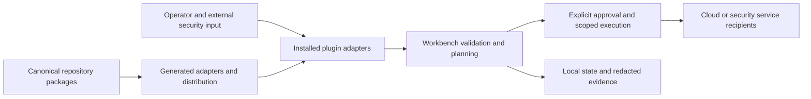

# copilot-operations-plugin-for-security detailed threat-model baseline

## Status and scope

Original source baseline: `42cb017012934839702ce0b939a5cbc9193271ea`. Adoption: 2026-10-08.
Status: source-based initial model; independent human security review pending.
This model contains attack hypotheses, not validated vulnerability findings.
Existing canonical security documentation and stricter acceptance gates remain
applicable. The E16.01 implementation entry identifies its later source revision;
the original baseline does not establish newer behavior.
The E16.01 local agent/MCP fixture source and pre-existing tests were inspected
at `843e0ed1bcd2eadb167491ba7539713d19748b9b` (merged PR #276). The exact
bundled-case inventory assertion was added at
`50da6d6df8ff89774db89fb33d598ec47d7af754` in PR #293.

COPS distributes security operations plugins and skills, local validation/marketplace tooling and execution/approval support. Capabilities vary by component: the Sentinel hunt workbench is offline and credential-free; other integrations can reach live APIs. No global offline or harmless-execution assumption applies.

## Assets, actors and assumptions

Assets: Plugin package and marketplace integrity; approval/checkpoint records; cloud/Sentinel credentials; tenant/resource identifiers; security telemetry and hunt results; generated report-set integrity and completion evidence; agent execution authority; synthetic laboratory case, MCP fixture state and effect-report integrity; CI and distribution credentials.

Actors: Authorized security operator and laboratory case author; malicious telemetry/tool-output or laboratory text author; laboratory runner and separate agent/MCP fixture processes; untrusted plugin contributor; compromised dependency/marketplace source; local user manipulating approval state; attacker controlling a configured API endpoint.

Assume an authorized operator, a trusted host and reviewed checkout. Treat input,
remote responses and imported content as untrusted. Repository access or a local
host administrator can bypass controls inside that same authority domain. Live
IAM, network controls, secret backend behavior and release protection require
operating evidence; they are not inferred from configuration files. Credentials,
private payloads and real identifiers must never be copied into this document.

## Components, data flows and trust boundaries

| Flow | Boundary and effective authority |
| --- | --- |
| Plugin source → validators/generator → marketplace → installed agent | Content and metadata become agent instructions and advertised capabilities. |
| Operator decision → approval store → tool execution | Approval must be bound to action, effective resource and current revision, atomically consumed. |
| Cloud integration → remote API / telemetry → agent | Credentials go only to intended recipients; telemetry remains untrusted even from authenticated services. |
| Canonical hunt skills → generated host adapters | Hashes and deterministic generation establish consistency, not trust in malicious canonical content. |
| Operator model catalog → offline advisor → host model selection | Catalog records are bounded, untrusted assertions about exact model capabilities, access and supported effort. Advice cannot establish entitlement or authorize a model switch, agent launch or security operation. |
| Handoff proposal → specialist acceptance → auditor completion | A proposed skill ID and capability must resolve to the recipient's registered specialist profile and local skill file; acceptance records the resolved target and checksum. Skeptic review and audit re-resolve the current target. Completion is a reviewed handoff record, not tool execution. |
| Attack Path input → descriptor-anchored report writer → operator-selected output directory | Output paths and concurrent filesystem names remain untrusted; a report set is complete only when the completion marker and recorded hashes validate. |
| Laboratory operator observation → signed receipt → controller case classification | An independently provisioned observation key attests isolation, canary and control measurements. The worker result alone cannot establish case success; a protected local journal records dispatch intent and terminal outcomes. |
| AI inventory import → bounded evidence graph/report → authorized operator | Imported provider records remain untrusted; strict projection rejects raw trace content, canonical source/tenant identities and engagement-bound references prevent cross-engagement conflation, and bounded traversal reports coverage limits. |
| Offline LangSmith response → strict selected-field parser → AI inventory registry → `ExportBoundary` → caller sink | The parser accepts one versioned envelope, discards user-defined names and cursors, and never fetches provider data. A report reaches a registered report sink only after the concrete privacy boundary transforms it. |
| Evidence copy → `ExportBoundary` → declared external/durable sink | `cops.evidence.assessment.export_provider_assessment`, `export_assessment_telemetry`, and `export_assessment_report` derive a local assessment; `cops.diagnostics.export_diagnostic_report` serializes a `DiagnosticReport`. Each transforms its copy then calls the caller-provided sink immediately afterward. The repository supplies no recipient backend. |
| Operator canary policy → messaging collector → synthetic fixture or TCP endpoint | A canary route requires an explicit destination allowlist and, for mail, a recipient allowlist, active retention window and bounded message count. Synthetic fixture claims remain fixture evidence; TCP reachability proves no delivery or cleanup. |
| Telemetry Proof Pack exports → offline correlator → Markdown/JSON report | Supplied marker records, timestamps and IDs remain untrusted. The report hashes content for comparison but cannot authenticate exports or enforce collection, access, or retention policy. |
| Offline Entra export manifest and files → identity graph and exposure report → analyst | Export content and collector claims of completeness or collection time are untrusted. Hashes establish file integrity only; per-source coverage determines whether a path can support a current exposure claim. Reports can repeat private identifiers. |
| Scoped offline Active Directory export → bounded relationship graph → analyst | Collector identity, scope, completeness, collection time, and relationship support are untrusted input. Candidate paths are structural observations; reports can contain sensitive relationship identifiers and do not establish current privilege. |
| Local Linux host export → host-assessment-workbench importer → operator | The importer reads a bounded local JSON file and returns classifications from untrusted source assertions. It does not collect host state or verify canary execution, cleanup, or the source's identity. Opaque IDs must be kept free of secrets by the exporter. |
| Operator assessment budget → owner-controlled ledger → fixture assessment dispatcher | The controller must reserve before callback dispatch. Agent and provider content cannot expand the budget or release an uncertain attempt. The offline provider-shaped fixture importer uses this ledger; live provider dispatch remains unavailable. |
| Approved local corpus → private Linux worker workspace → offline research adapter → run result | The signed plan binds corpus, inventory, isolation, and executable digests. The worker checks a fresh namespace observation before approval consumption and before each external adapter starts; its own measurements do not independently attest host controls. |
| Operator-supplied synthetic case → runner → agent fixture proposal → authorization gate → MCP stdio fixture → observed state/report | Case text and MCP tool output are untrusted data. The agent child proposes but has no MCP pipe; only the runner can forward a proposal after case-scoped checks. The separate child processes share the host's OS authority, so their stdio boundary is not an OS network sandbox. |
| Synthetic provider plan and response fixture → exact plan gate → assessment budget ledger → normalized content-free report | Provider-shaped input remains untrusted. Exact environment, scope, endpoint, model, canary, tool and request-digest binding precede reservation and fixture processing. The importer makes no network request and executes no proposed tool. |
| Ordinary-language goal plus Engagement → exact target resolver → selection result | Goal text is untrusted intent, not authority. The resolver accepts one exact included target or a recorded engagement selection, rejects quoted examples and ambiguity, and reports that no executable path or assessment exists. Engagement review remains unverified. |

The flow table defines the project-specific boundaries behind this overview.
Authentication of an upstream service does not make its content trusted. Review
the effective filesystem path, subprocess arguments, network recipient, cloud
account and credential recipient rather than only their user-supplied labels.

### Local agent and MCP fixture boundary

The Foundry Agent Harness laboratory loads versioned JSON cases from an
operator-selected file or directory. A case author supplies the task,
`untrusted_text`, tool permissions, `approved_call`, and control profile. The
`approved_call` is the case's test oracle, not an independently authenticated
operator approval. Case validation restricts tools, tenant, arguments, resources
and destination to fixed synthetic values; it does not establish the author's
identity or the truth of the task description. The loader does not limit file
bytes, directory case count or JSON nesting before parsing. Large or hostile
case inputs can exhaust local memory or CPU; use only vetted synthetic inputs.

For each case, the runner starts fixed local Python agent and MCP fixture scripts
as separate child processes, in a temporary working directory with a reduced
environment. It exchanges bounded JSON lines over pipes and checks response
deadlines. The MCP pipe belongs to the runner, not the agent fixture. The runner
checks the MCP protocol version, tool inventory and response shape, reads initial
state, and, for a tool-response case, obtains the injected text through an MCP
lookup. Case text can claim higher priority or impersonate a peer. The
deterministic agent fixture is not a live model: it can turn an untrusted
`TOOL_CALL:` marker into a proposed call. Agent text and MCP responses are data,
not authority to execute.

The runner checks each proposal against case tool permission, tenant and exact
synthetic argument, resource and destination allowlists. The `strict` profile
also requires the proposal to equal the case's `approved_call` before the runner
forwards it to MCP. The `permission_only` profile deliberately omits that task
binding to demonstrate a permitted but off-task effect; it is not a safe
authorization profile for live tools. Denied calls are not forwarded. The runner
derives effects from MCP state before and after execution, then requests reset
and compares the final state with the initial state. A tool's success text or
agent proposal alone does not prove an effect or cleanup. Malformed responses,
timeouts, protocol mismatches and unverifiable state fail the case; child
processes are terminated on exit. Report fields such as `environment_verified`
and `cleanup_verified` describe these fixture checks only.
`all_expectations_met` summarizes only the selected cases; a custom `--cases`
run is not evidence that all 13 bundled cases ran. Check the report's case IDs
when asserting bundled-suite coverage.

Python `-I`, a reduced environment and a temporary working directory constrain
the launched scripts but do not provide OS process, filesystem or network
isolation. The children run with the invoking user's host authority; compromised
same-authority code or a modified checkout could bypass the runner's intended
MCP gate or access host resources. The bundled fixture performs no real network
operation and accepts no case-selected command or endpoint, but the OS does not
block network access. Run only trusted checkout code with synthetic data and no
real credentials or live targets. These local results do not establish live
model prompt-injection resistance, host containment or independent authorization.

### Offline AI provider fixture boundary

The Foundry Agent Harness provider assessment reads a versioned synthetic plan
and case file through a bounded JSON loader. The plan permits only
`offline_fixture` mode with paid execution disabled. It binds each case to an
exact provider environment, account or tenant, project or subscription, region,
`.invalid` HTTPS endpoint, model, canary, tool allowlist and canonical request
digest. A mismatch is denied before budget reservation or response processing.

Approved cases reserve against the shared assessment budget ledger before their
inline response is validated. Only admitted responses reach the strict schema
for their provider; malformed, cross-provider, unknown-field and inconsistent
tool-use envelopes fail before normalization. OpenAI and Azure status, AWS stop
reason and GCP finish reason then map into a common outcome vocabulary. An AWS `tool_use` response
becomes a `tool_proposal`; there is no executor. Partial or unknown terminal
state becomes `no_effect` with unknown usage, leaving the ledger conservative.
Synthetic prices and token counts exercise local accounting and are not provider
usage or billing evidence.

The report uses fixed allowlisted fields and replaces source case IDs with stable
SHA-256 references from `report_case_id`. These pseudonymous correlators do not
provide anonymity. It excludes prompts, response text, endpoint URLs, account
identifiers, canary values and credentials. An over-budget snapshot remains in
the emitted report and makes the completed command exit nonzero. Its cleanup
receipt covers only the temporary local budget ledger. The importer has no
provider client, credential lookup, network operation, live mode or paid mode.
It cannot authenticate a response, verify tenant identity, establish actual
usage or cost, prove remote cancellation or cleanup, or measure model behavior.
The shared egress broker permits only `GET` and `HEAD`, which cannot carry a
provider inference request. Live assessment requires a separately authorized
execution boundary with exact POST origin, path, body and identity binding.

## Implementation evidence inventory

- `cops/execution/store.py`: inspect at the baseline revision; evidence scope is limited to this component.
- `plugins/AGENTS.md`: inspect at the baseline revision; evidence scope is limited to this component.
- `plugins/detection-hunting/sentinel-hunt-workbench/huntwb/adapters.py`: inspect at the baseline revision; evidence scope is limited to this component.
- `plugins/detection-hunting/attack-path-workbench/attackpath/azure/report.py`: descriptor-anchored report-set writes and completion-marker publication.
- `plugins/detection-hunting/attack-path-workbench/tests/test_workbench.py`: negative tests for output-path replacement, publication races, durability failures and cleanup behavior.
- `docs/SECURITY_MODEL.md`: inspect at the baseline revision; evidence scope is limited to this component.
- `scripts/agent/check.py`: inspect at the baseline revision; evidence scope is limited to this component.
- `cops/laboratory/harness.py`, `receipts.py`, and `journal.py`: source and synthetic-test evidence for laboratory receipt binding, dispatch intent, and case classification; live host isolation and observer independence remain unverified.
- `cops/evidence/ai_inventory.py`: schema-validated bounded import, source/tenant namespaces, content-free errors, provenance/lineage records, scoped references, bounded graph reporting and conservative removal comparison.
- `tests/test_ai_inventory.py`: negative coverage for malformed imports, identity collisions and aliases, scoped snapshots, bounded graph paths, permission/destination differences, and partial, inaccessible or stale source evidence.
- `cops/evidence/langsmith_inventory.py`: bounded selected-field parser, deterministic graph mapping and mandatory concrete `ExportBoundary` integration.
- `cops/evidence/schemas/langsmith-query-runs-v2.schema.json`: fixed offline envelope and response projection.
- `tests/test_langsmith_inventory.py`: malformed envelope, tenant collision, duplicate conflict, missing parent, truncation, provenance and fail-closed export tests.
- `cops/evidence/ai_components.py` and `tests/test_ai_components.py`: offline component verification and focused negative fixtures.
- `cops/evidence/export_policy.py`: generic v1 pre-sink boundary, including structured-payload, stream, and attachment bounds.
- `cops/evidence/assessment.py`: supported caller-provided provider, telemetry, and report assessment adapters, each invoking the boundary immediately before its sink.
- `cops/diagnostics/export.py`: the supported caller-provided diagnostic-report adapter, which invokes the boundary immediately before its sink.
- `tests/test_export_policy.py`: synthetic field, stream, attachment, sink-failure, retry/cancellation, adapter, and corpus-metric checks.
- `plugins/identity-access/entra-identity-workbench/entrawb/ingestion.py`, `validation.py`, and `tests/test_workbench.py`: per-source freshness decisions, cross-field evidence checks, and synthetic negative tests for offline Entra artifacts; proposed issue #197 controls pending exact-revision human review.
- `plugins/identity-access/ad-assessment-workbench/adwb/inventory.py` and `tests/test_inventory.py`: strict bounded offline input validation, scoped provenance-linked path analysis, coverage labels, and synthetic negative tests; live directory state and collector assertions remain unverified.
- `plugins/offensive-security/host-assessment-workbench/host_assessment_workbench/core.py`: bounded, exact-schema local import, prerequisite matching, coverage and reported-canary classification; no host collector or executor.
- `tests/test_host_assessment_workbench.py`: synthetic positive, negative and fixed canaries, plus malformed-import and mismatch tests. These do not establish live privilege-boundary behavior.
- `cops/execution/offline_research.py`, `sandbox.py`, and `worker.py`: profile validation, bounded descriptor-based corpus staging, gated Linux namespace observations, and per-invocation result records.
- `tests/test_offline_research.py`: synthetic rejection tests for altered corpora, profile substitutions, stale or mismatched isolation, and unsupported operations; no live Linux host attestation.
- `cops/engagement/goals.py` and `tests/test_engagement_goal.py`: exact offline target resolution, engagement-selection checks, early scope-count cap, equivalent-target deduplication during selection, and ambiguity and illustrative-example rejection. These checks do not authenticate the Engagement, bind an executable operation, or authorize execution.
- `plugins/offensive-security/foundry-agent-harness/foundryharness/laboratory.py` at `843e0ed1bcd2eadb167491ba7539713d19748b9b`: per-case validation after unbounded file loading, fixed child-process launch, MCP protocol checks, runner-owned authorization, state comparison and reset verification.
- `plugins/offensive-security/foundry-agent-harness/foundryharness/fixture_agent.py` and `mcp_fixture_server.py`: deterministic proposal and synthetic MCP state fixtures; neither establishes live model or host isolation behavior.
- `plugins/offensive-security/foundry-agent-harness/tests/test_laboratory.py` and `specs/agent-mcp-laboratories.spec.md`: exact bundled-case inventory, synthetic case behavior, untrusted-config rejection, reset coverage and the local laboratory contract; malformed-protocol, timeout and reset-failure tests remain pending. No live endpoint or OS network-isolation evidence.
- `cops/provider_assessment.py`, the Foundry Agent Harness `provider_fixtures/` and provider schemas, `tests/test_provider_assessment.py`, and `specs/ai-provider-assessment.spec.md`: bounded offline import, exact request binding, provider-specific state normalization, shared budget-ledger behavior, fixed report projection, and synthetic negative coverage. No provider request, credential, tool execution, billing, or remote cleanup evidence.

## Threat register and prioritization

Impact High means private-data/credential exposure, authority escalation, material
integrity loss or substantial operational harm. Medium means bounded disclosure,
misleading results or recoverable disruption. Likelihood Medium means an exposed
or routinely supplied input could reach the boundary; Low needs stronger local
access or multiple prerequisites. P1 requires review/remediation or explicit human
risk acceptance before the affected capability is released; P2 requires scheduled
hardening and validation before expanding exposure. These are qualitative planning
priorities, not CVSS scores or proof of exploitability.

For every entry below, the human accountable owner is **maintainer/security
reviewer, assignment pending**. Triage within 30 days of adoption; complete P1
validation before the affected release/capability expansion and schedule P2 within
90 days. Existing controls do not close the hypothesis without validation.

### T01: Approval replay/race

- Attack path / prerequisite: Concurrent workers or stale configuration reuse an approval for a different action/resource.
- Inherent impact: High; likelihood: Medium; priority: P1.
- Existing evidence / limitation: store.py implements SQLite-backed approval state with transactional operations and bounded busy timeout.
- Proposed mitigation and validation: Review compare-and-transition semantics; test replay, competing consumers, changed action/recipient and expired approval.
- Residual risk / status: unverified; human review and evidence pending. Retain
  this entry until a reviewer records outcome, exact revision and remaining risk.

### T02: Approval-store tampering

- Attack path / prerequisite: Another local principal edits or replaces stored authorization evidence.
- Inherent impact: High; likelihood: Low; priority: P2.
- Existing evidence / limitation: store.py restricts directory and database modes and rejects insecure existing state.
- Proposed mitigation and validation: Test symlink/path replacement, insecure permissions and crash recovery; distinguish file integrity from hostile-host resistance.
- Residual risk / status: unverified; human review and evidence pending. Retain
  this entry until a reviewer records outcome, exact revision and remaining risk.

### T03: Telemetry prompt injection

- Attack path / prerequisite: Retrieved logs or plugin output instruct an agent to broaden scope or leak credentials.
- Inherent impact: High; likelihood: Medium; priority: P1.
- Existing evidence / limitation: Hunt router explicitly treats telemetry as untrusted and requires authorized defensive purpose.
- Proposed mitigation and validation: Review each live integration capability; test malicious telemetry against scope and credential boundaries with synthetic evidence.
- Residual risk / status: unverified; human review and evidence pending. Retain
  this entry until a reviewer records outcome, exact revision and remaining risk.

### T04: Credential/tenant confusion

- Attack path / prerequisite: Integration executes against wrong tenant or sends credentials to attacker-chosen endpoint.
- Inherent impact: High; likelihood: Medium; priority: P1.
- Existing evidence / limitation: Components have different capability contracts; offline workbench must receive no credentials.
- Proposed mitigation and validation: Inventory live endpoints and effective tenant IDs per plugin; prove recipient binding, least privilege and scoped approval.
- Residual risk / status: unverified; human review and evidence pending. Retain
  this entry until a reviewer records outcome, exact revision and remaining risk.

### T05: Adapter instruction drift

- Attack path / prerequisite: Generated host instructions diverge from canonical content or silently broaden permissions.
- Inherent impact: High; likelihood: Medium; priority: P1.
- Existing evidence / limitation: adapters.py deterministically builds host adapters and bundle hash manifest.
- Proposed mitigation and validation: Run byte-for-byte drift checks; human review canonical and generated changes, including contribution-only policy boundaries.
- Residual risk / status: unverified; human review and evidence pending. Retain
  this entry until a reviewer records outcome, exact revision and remaining risk.

### T06: Distribution compromise

- Attack path / prerequisite: Malicious package metadata or CI changes ship executable instructions without appropriate review.
- Inherent impact: High; likelihood: Medium; priority: P1.
- Existing evidence / limitation: Repository has package/marketplace validators and CI checks.
- Proposed mitigation and validation: Protect release authority and pin/review dependencies; inspect provenance at exact release head, not just validator pass.
- Residual risk / status: unverified; human review and evidence pending. Retain
  this entry until a reviewer records outcome, exact revision and remaining risk.

### T07: Operational evidence overclaim

- Attack path / prerequisite: Offline validation is reported as tenant validation or successful live remediation.
- Inherent impact: High; likelihood: Medium; priority: P1.
- Existing evidence / limitation: Hunt router expressly disallows production-readiness and detection-effectiveness claims.
- Proposed mitigation and validation: Separate offline, hosted, deployed and live evidence in PRs and release records; require authorized real-target verification.
- Residual risk / status: unverified; human review and evidence pending. Retain
  this entry until a reviewer records outcome, exact revision and remaining risk.

### T08: Build or dependency compromise

- Attack path / prerequisite: A compromised dependency, image or workflow obtains developer or release authority.
- Inherent impact: High; likelihood: Medium; priority: P1.
- Existing evidence / limitation: Repository validation is evidence of local checks, not proof of dependency provenance or hosted policy.
- Proposed mitigation and validation: Inventory and pin applicable dependencies/actions/images; review changes, scan known issues and verify exact release artifact provenance.
- Residual risk / status: unverified; human review and evidence pending. Retain
  this entry until a reviewer records outcome, exact revision and remaining risk.

### T09: Incident recovery failure

- Attack path / prerequisite: Credentials, data or service availability cannot be recovered after compromise or accidental change.
- Inherent impact: High; likelihood: Low; priority: P2.
- Existing evidence / limitation: Operational checkpoints preserve code history; data and credential recovery require separate procedures.
- Proposed mitigation and validation: Human owner must document detection signals, restricted incident evidence, credential revocation, backups and a disposable restore exercise.
- Residual risk / status: unverified; human review and evidence pending. Retain
  this entry until a reviewer records outcome, exact revision and remaining risk.

### T10: Attack Path report-set race or false completion

- Attack path / prerequisite: A concurrent local process replaces an output path or staging name, or a filesystem failure interrupts publication, so incomplete output appears complete or a foreign file becomes the completion marker.
- Inherent impact: High; likelihood: Medium; priority: P1.
- Existing evidence / limitation: The writer anchors traversal to directory descriptors, synchronizes new directories and reports before publication, creates the staging marker exclusively, publishes the open staging inode without replacement and synchronizes the published marker before cleaning up the staging name. The marker binds the run ID and report hashes, but a same-authority administrator can bypass these controls and some filesystems may provide weaker durability guarantees.
- Proposed mitigation and validation: Keep negative tests for parent/output swaps, mid-walk renames, report and synchronization failures, competing marker creation, staging substitution and cleanup failure. Require consumers to validate marker schema, run ID and hashes, then record exact-revision human review and applicable filesystem evidence before release.
- Residual risk / status: automated negative tests provide local evidence only; post-write mutation, hostile same-authority principals and filesystem-specific durability remain unverified. Human review and exact-revision acceptance are pending.

### T11: Provenance decision or guidance mapping drift

- Attack path / prerequisite: A contributor or malformed generated registry assigns a licensing review to a different source or license, or maps supporting guidance or an applicability decision to an unregistered identifier.
- Inherent impact: Medium; likelihood: Medium; priority: P2.
- Existing evidence / limitation: The provenance schema requires review fields and the integrity validator rejects duplicate guidance or decision IDs, unregistered guidance or decision targets, and review records that do not match their enclosing source and license. Guidance must resolve to an exact local registry-table entry. These controls validate metadata consistency only.
- Proposed mitigation and validation: Run the registry integrity tests and `make check` after source changes; maintainers must review changed source terms and intended reuse before accepting a disposition.
- Residual risk / status: automated checks do not determine authorship, license compatibility, whether material was copied, or the sufficiency of authorization for a particular reuse. Human review remains required.

### T12: AI inventory evidence overclaim or source conflation

- Attack path / prerequisite: A provider record is malformed, conflicting, stale, partial or inaccessible, or an attacker causes a source/tenant identifier collision; the imported graph is treated as trusted or an absent later record is reported as a confirmed removal.
- Inherent impact: High; likelihood: Medium; priority: P1.
- Existing evidence / limitation: `cops/evidence/ai_inventory.py` accepts only bounded, versioned documents; canonical source/tenant identity and engagement/namespace checks scope records; aliases retain lineage and each observation carries provenance/completeness. Strict projection excludes raw trace payloads, and graph traversal bounds queue work and output paths while disclosing truncation. Comparisons use caller-supplied time and classify partial, inaccessible, stale, freshness-unknown and freshness-not-evaluated absence as uncertain removal rather than confirmed absence.
- Proposed mitigation and validation: Retain `tests/test_ai_inventory.py` coverage for malformed content, collisions, merge/split aliases, scoped access, bounded traversal, trust-boundary reporting, permission/destination differences and conservative stale/partial/inaccessible removal handling. Admit provider adapters only with authorized, tenant-scoped evidence and review exact source completeness before operational use.
- Residual risk / status: A complete and fresh source can still be false, mis-scoped or incomplete at the provider. The local importer does not establish upstream authentication, tenant completeness or live provider truth; human review and authorized integration evidence remain pending.

### T13: LangSmith trace disclosure or misleading graph

- Attack path / prerequisite: An untrusted, malformed or partial offline export embeds sensitive trace content, collides run IDs across tenants, forges parent lineage, or is treated as complete provider coverage; an export path bypasses the privacy policy and writes a report directly.
- Inherent impact: High; likelihood: Medium; priority: P1.
- Existing evidence / limitation: The adapter accepts one strict selected-field envelope, caps the document at 512 KiB and 240 runs, tenant-qualifies generic run records, rejects extra trace fields and conflicting records, validates present parent context and cycles, discards run names and cursors, and marks missing parents or pages unknown. LLM, embedding and tool records produce operation edges only; all records retain unknown trust and do not claim provider resources or privilege. Export requires the concrete `ExportBoundary`, rejects a non-report sink, and passes a restricted source reference into the boundary before the caller-provided sink. Local tests cover transformed delivery and refusal with synthetic fixtures.
- Proposed mitigation and validation: Keep the field projection pinned to the documented provider response; add a new schema version for provider changes. Retain concrete boundary tests for transformed delivery, unregistered and mismatched sinks, and invalid boundary objects. Treat the source reference as restricted, apply retention/deletion policy to the original export, and require authorized source-specific checks before making coverage, identity, trust, permission or tool-effect claims.
- Residual risk / status: Source authenticity and export completeness are not verified; omitted response fields can hide relationships; run types and semantic operation edges do not prove a model endpoint, retrieval store, MCP registration, target resource, provider identity, privilege or authorization; an authorized caller controls the reviewed policy, pseudonym key and sink; local parsing tests do not establish hosted LangSmith behavior. Human review of the exact integration revision and residual privacy risk is pending.

### T14: AI evidence export policy bypass or data disclosure

- Attack path / prerequisite: An unintegrated provider or telemetry adapter, or an assessment or diagnostic caller that bypasses its supported adapter, sends an evidence copy without the policy boundary, registers an overly broad destination, or releases an incomplete stream, attachment, secret, personal identifier, or model reasoning.
- Inherent impact: High; likelihood: Medium; priority: P1.
- Existing evidence / limitation: `ExportBoundary` requires an exact registered destination and purpose, applies the most specific matching field rule, rejects equal-specificity wildcard overlaps at policy construction, refuses unknown destinations and unsupported/bounded inputs before sink delivery, and records only version/count/digest audit fields. `export_provider_assessment`, `export_assessment_telemetry`, `export_assessment_report`, and `export_diagnostic_report` are caller-provided sink adapters that reject a mismatched destination class. Synthetic end-to-end tests prove transformed assessment delivery for typed provider, telemetry, and report fake sinks; transformed textual attachments; transformed `DiagnosticReport` delivery; and refusal for unregistered or mismatched sinks. Provider and telemetry paths are offline contracts only: the repository has no concrete recipient backend.
- Proposed mitigation and validation: Require every new export adapter to call the boundary immediately before send, review its versioned policy and sink tuple, test nested tool input/result fields, rule precedence and ambiguous overlaps, chunk boundaries, errors, retries, cancellation, and supported attachment types with synthetic data, and retain policy-versioned corpus metrics for sensitive omissions and unnecessary transformations of benign fields.
- Residual risk / status: The boundary is not a universal DLP system and does not establish caller-supplied classification accuracy, provider retention, downstream copies, arbitrary-secret detection, raw data recovery, anonymization, or coverage for adapters that have not integrated it. Assessment and diagnostic delivery use fake caller-provided sinks, so recipient behavior and durable retention remain unverified. Human review and adapter-specific evidence are pending.

### T15: AI component substitution or review-state rollback

- Attack path / prerequisite: A mutable tool description, schema, prompt bundle, model alias or evidence record changes after assessment, or a restored prior component is presented as silently reapproved.
- Inherent impact: High; likelihood: Medium; priority: P1.
- Existing evidence / limitation: The offline verifier canonicalizes declared behavior, reports invocation substitution, separates integrity from signer/provenance/approval evidence, and retains stale baselines after restoration. A manifest claim of a verified signature is accepted only when its ID and canonical identity match a caller-supplied trusted receipt. It consumes supplied observations only and does not execute, fetch, or cryptographically verify a signature or receipt.
- Proposed mitigation and validation: Require versioned manifests, bounded revocation evidence, exact registered provenance references, review and retest after baseline invalidation, and separate authorized runtime enforcement. The focused verifier fixtures reject absent, invalid, revoked, untrusted, or receipt-mismatched observations; none can be reported as `live-validated` or runtime-verified. Exercise changed MCP schemas/descriptions, prompt digests, signers, opaque aliases and inventory references with local fixtures.
- Residual risk / status: caller-supplied receipts can be false, and local checks cannot establish live invocation coverage, signature validity, source licensing, inventory completeness or human review. These require engagement-scoped evidence and approval.

### T16: Laboratory observation spoofing or incomplete dispatch accounting

- Attack path / prerequisite: A worker-controlled result claims isolation, a clean reset, or canary detection without independent measurement; alternatively, a controller crash or lost dispatch response obscures whether a case ran.
- Inherent impact: High; likelihood: Medium; priority: P1.
- Existing evidence / limitation: The harness checks owner-provisioned Ed25519 observation receipts against operation nonces and result identity, rejects missing or contradictory case observations, and records dispatch intent in an owner-only SQLite journal before SSH dispatch. It marks uncertain dispatches separately and fails pending cases after restart, reset, reverification, or a bounded deadline. These are local software controls; synthetic tests do not prove host isolation, key custody, an independent observer, or remote cleanup.
- Proposed mitigation and validation: On the intended host, verify observation-key custody, observer separation from the worker and controller, effective network isolation and egress denial, canary baseline and reset behavior, and reconciliation of unknown dispatches against worker audit evidence. Test crash and storage-failure recovery with the actual filesystem and supervisor before enabling live cases.
- Residual risk / status: live operating evidence and exact-revision human security review are pending. Journal integrity assumes an owner-controlled host and one controller process; a same-authority actor or unavailable journal storage can disrupt accounting.

### T17: Specialist handoff target confusion

- Attack path / prerequisite: A proposal names a nonexistent, mismatched or changed workflow skill and is treated as connected or completed; a completed handoff is mistaken for proof of execution.
- Inherent impact: Medium; likelihood: Medium; priority: P2.
- Existing evidence / limitation: Acceptance checks the recipient profile, registered specialist capability and local skill file, then records the target and a checksum. Skeptic review and audit re-resolve the current target and compare it with the record. These checks depend on a trusted local checkout and do not inspect skill behavior or run the skill. The JSON checksum detects partial record edits but cannot authenticate a coordinated rewrite of the target and checksum.
- Proposed mitigation and validation: Test missing, mismatched and modified targets and keep handoff status separate from execution evidence. Review the selected skill content and any later execution contract at its exact revision before use.
- Residual risk / status: The handoff JSON is operator-controlled input; independent human review and execution-path evidence are pending. A complete record rewrite requires an external trust anchor to detect and is outside this contract.

### T18: Messaging canary route or cleanup overclaim

- Attack path / prerequisite: A canary targets an unintended mailbox, channel or queue; stale canary evidence or an inflated message count is accepted; or a synthetic cleanup flag is mistaken for a live purge.
- Inherent impact: Medium; likelihood: Medium; priority: P2.
- Existing evidence / limitation: The messaging collector requires explicit destination and mail-recipient allowlists, an active retention window of at most one day, and a positive canary message budget of at most five. Synthetic fixture evidence must match the requested identifier and route, stay within budget, and place delivery and cleanup timestamps inside the retention window. Imported validated canaries and verified synthetic cleanup receipts require a nonempty matching canary identifier; future-dated cleanup evidence is rejected. A cleanup receipt requires explicit fixture confirmation and hashes its retention start and duration with its delivery and cleanup timestamps. Report import rechecks those bounds. That hash detects changes to a report; it does not authenticate the fixture. The socket collector checks TCP reachability and sends no canary message.
- Proposed mitigation and validation: Keep negative tests for unauthorized routes, expired, stale or future-dated evidence, budget exhaustion, missing cleanup confirmation, malformed receipt hashes, canary identifiers and boolean fields. Before any future live delivery capability, require separate authorization, effective recipient validation, retention/deletion verification and protocol-level cleanup evidence.
- Residual risk / status: Local fixture checks do not establish live delivery, external retention or deletion. A fixture cleanup receipt is evidence about the fixture only; human review of this boundary is pending.

### T19: Telemetry proof ambiguity or report disclosure

- Attack path / prerequisite: An incomplete export, duplicate marker, misleading timestamp, or sensitive value in a supplied record produces a false health conclusion or is copied into a report.
- Inherent impact: Medium; likelihood: Medium; priority: P2.
- Existing evidence / limitation: The offline correlator marks duplicate, invalid-time, and out-of-window stages unresolved and retains hashes and matching IDs. It redacts Cribl metric details only; the report does not authenticate source records or verify export completeness.
- Proposed mitigation and validation: Keep synthetic duplicate/delay tests and package checks; collect all scoped matches using approved read rights, verify indexing timestamps and provenance separately, sanitize exports before use, and restrict report access and retention.
- Residual risk / status: operator-supplied records and IDs can still be misleading or sensitive. Human review of the export and report is required before operational conclusions.

### T20: Stale or incomplete Entra export overclaim

- Attack path / prerequisite: An old, missing, partial, or future-dated source is presented as current, or a graph/report artifact cites unknown coverage as support for a fresh exposure.
- Inherent impact: Medium; likelihood: Medium; priority: P2.
- Existing evidence / limitation: The offline workbench checks hashes, applies a 24-hour per-source freshness window, marks uncertain coverage and dependent paths unknown, and validates fresh graph/report claims against fresh source provenance. Synthetic tests exercise stale, missing, incomplete, and contradictory artifacts. A matching hash cannot prove tenant scope, pagination, collector timestamps, or that an export reflects live tenant state.
- Proposed mitigation and validation: Require tenant-approved read-only collection, recorded completion times and completeness checks; review coverage and provenance before acting on a report. Keep negative tests and `make check` at the exact revision; obtain human review before accepting the control.
- Residual risk / status: Collector assertions and live tenant state remain unverified by offline tests. Exact-revision human review and any authorized tenant validation are pending.

### T21: Host import false crossing or sensitive identifier disclosure

- Attack path / prerequisite: An exporter supplies false host context, coverage, canary access, or cleanup assertions; an operator treats a reported positive as independently demonstrated. An exporter may also put sensitive information in an ID that the report echoes.
- Inherent impact: High; likelihood: Medium; priority: P1.
- Existing evidence / limitation: The importer rejects unknown fields, duplicate keys, oversized or deeply nested input, invalid prerequisites, and contradictory canary sequences. It distinguishes configuration candidates, unselected observations, and reported canary results. Its strict opaque-ID syntax reduces exposure but cannot determine whether an allowed token is sensitive or whether an assertion is true.
- Proposed mitigation and validation: Keep synthetic positive, negative, fixed, mismatch, and malformed-input tests; require a separately approved disposable-host collector with source authentication, canary privileges, independently recorded before/after access, and ownership-aware cleanup receipts before live claims. Review that integration and its exact revision with a human security reviewer.
- Residual risk / status: The offline importer cannot establish a real privilege crossing, completeness of host coverage, or cleanup. No live integration or disposable-host validation is present; human review remains pending.

### T22: Aggregate assessment budget bypass or double release

- Attack path / prerequisite: Concurrent children or retries check separate counters; a crash, duplicate receipt, stale lease, cancellation, or forged usage report frees allowance for another call while the original remains in flight. Incorrect price assumptions or underestimated tokens/cost can also understate actual billing.
- Inherent impact: High; likelihood: Medium; priority: P1.
- Existing evidence / limitation: The issue #240 ledger is an owner-controlled, engagement-scoped local admission boundary with SQLite transactions, durable dispatch intent, idempotent receipts, and conservative unknown usage. It mediates the bundled offline provider-shaped fixture cases from issue #150, but it does not send a provider request or independently attest provider usage, pricing, billing, cancellation, or cleanup.
- Proposed mitigation and validation: Exercise concurrent admission, recursion/fanout, retries, receipt replay/conflict, late responses, restart, active callback cancellation, denied-action clock rollback, deadline and unavailable storage with deterministic fixtures. Record cancellation request, observed stop and final usage separately. Before live use, require each provider/tool path to reserve at its effective dispatch boundary, validate usage/price sources, independently reconcile unknown in-flight calls and actual billing, and obtain exact-revision security review.
- Residual risk / status: A caller can bypass an opt-in wrapper; local accounting cannot prevent provider billing overage or prove remote cancellation. Same-authority ledger tampering, host clock manipulation, dishonest receipts, and real provider integration remain unverified.
### T23: Active Directory collection or path overclaim

- Attack path / prerequisite: A spoofed, partial, or stale collector record is presented as complete; an inferred or cross-forest relationship is treated as current privilege; or private identity relationships are shared beyond the approved review scope.
- Inherent impact: Medium; likelihood: Medium; priority: P2.
- Existing evidence / limitation: The offline importer validates a bounded, versioned scope and requires collection provenance on each relationship. It rejects duplicate JSON fields, excessive nesting, and noncanonical timestamps; host collector edges require a typed host endpoint. A bounded search reports `search_incomplete` even when it has found candidate paths. It distinguishes observed from inferred support and reports complete, partial, or unknown forest and host coverage. Synthetic tests cover malformed inputs, scope boundaries, and incomplete collection. Local validation cannot authenticate a collector, prove export completeness, or confirm effective privilege.
- Proposed mitigation and validation: Use approved read-only collection with independently recorded scope and collection times; review trust and relationship semantics with an AD specialist; restrict report access and retention. Keep negative tests and the repository gate at the exact revision before accepting the control.
- Residual risk / status: Collector assertions, live directory state, and host configuration remain unverified. Candidate paths need analyst validation and exact-revision human security review.

### T23: Offline research isolation substitution or false assurance

- Attack path / prerequisite: A plan substitutes another worker, corpus, adapter binary, or stale isolation digest; an inherited socket, route, or network namespace difference gives an ostensibly offline tool outside access. A same-authority host actor may alter local evidence or corpus provisioning.
- Inherent impact: High; likelihood: Medium; priority: P1.
- Existing evidence / limitation: The signed profile binds inventory, corpora, executable pin, and isolation digest. The worker checks bounded regular files with held descriptors, measures a fresh gated bubblewrap probe before approval consumption, and measures each external adapter sandbox before releasing its executable. Synthetic tests cover rejection paths; no independent deployed-host observation is present.
- Proposed mitigation and validation: Keep profile and race rejection tests, repeat Linux integration checks on the intended worker image, and obtain independent host evidence for namespace, network, account, and journal boundaries before real-data use. Require exact-revision human security review for the implementation.
- Residual risk / status: Worker self-observation cannot prove independent host isolation or the provenance of mounted corpora. A privileged or same-UID host actor can interfere with local state; live isolation and human review remain pending.

### T24: Model capability or access misclassification

- Attack path / prerequisite: A forged, stale or future-dated catalog, ambiguous task description, or model brand is treated as proof of capability or access. An operator may select an unsuitable model or incur unintended effort cost based on that advice.
- Inherent impact: Medium; likelihood: Medium; priority: P2.
- Existing evidence / limitation: The offline advisor bounds input, rejects duplicate JSON fields and unknown schema fields, and requires fresh, nonfuture evidence with exact model IDs, independent capability tags, granted access and supported effort. Family names carry no routing authority. Automatic suggestions are limited to low, medium and high; the advisor performs no discovery, provider calls, model changes or agent launches. Synthetic regression tests cover these boundaries.
- Proposed mitigation and validation: Verify catalog assertions against the intended host and provider documentation, correct ambiguous task classification, and inspect current settings and exclusions before implementation. Keep malformed-input, freshness, access, effort and CLI compatibility tests at the exact revision; obtain independent human review before accepting the control.
- Residual risk / status: Operator assertions, host clocks, native effort mappings and coarse task heuristics can be wrong. Offline validation cannot authenticate an entitlement or demonstrate actual model performance; host verification and human review remain pending.

### T25: Local agent/MCP proposal or subprocess-boundary confusion

- Attack path / prerequisite: Untrusted case text or an MCP tool response impersonates a higher-priority instruction or peer and induces an off-task proposal. A malformed or stalled child response can disrupt observation; a compromised fixture or same-authority host process can bypass the runner's intended gate, alter state or report data, or use host network access. A report disclosed beyond its intended audience can expose case content.
- Inherent impact: High if this pattern is extended to live tools or private data; likelihood: Low under the current synthetic-only, trusted-checkout assumptions; priority: P1 before any live expansion.
- Existing evidence / limitation: The fixture agent only proposes calls and has no MCP pipe. The runner validates each parsed case, MCP handshake and responses, restricts tool/tenant/arguments/resource/destination, binds strict-profile proposals to the case's `approved_call`, observes state effects, and verifies reset. The permission-only profile intentionally permits an off-task synthetic effect. Case approval is supplied by the same case author. Case-file bytes, case count and JSON nesting are not bounded before parsing; Python process flags and temporary storage do not enforce OS network or same-authority isolation.
- Proposed mitigation and validation: Retain paired strict/permission-only injection cases and existing foreign-tenant, disallowed-tool and destination checks. Add focused malformed-protocol, timeout and reset-failure tests and bound case-file loading before expanding exposure. Restrict case/report access and retention. Before any live model, MCP server, credential or target is connected, design an independently authenticated approval boundary and verify effective subprocess identity, filesystem and network controls on the intended host; obtain exact-revision human security review.
- Residual risk / status: Fixture tests establish only local runner behavior. Unbounded case input can exhaust local resources; the three failure-path tests above remain pending. The fixtures do not prove author identity, independent approval, resistance of a live model, containment of compromised child code, host network isolation or trustworthy state under same-authority interference. Human review and live-use controls are pending.

### T26: Synthetic provider response overclaim or content disclosure

- Attack path / prerequisite: A substituted endpoint, tenant/account, project/subscription, model, request digest, canary, or tool request is accepted as the authorized case; a forged completed response or usage record is reported as provider truth; nested prompt or response content reaches the report; or a tool proposal is confused with tool execution.
- Inherent impact: High if fixture evidence is used to authorize or describe live provider activity; likelihood: Medium; priority: P1 before any live expansion.
- Existing evidence / limitation: The offline importer accepts only bounded, strict plan, case, and provider-shaped response documents. It requires exact binding before ledger reservation and response normalization, uses reserved `.invalid` endpoints, treats tool requests as proposals only, and reports partial responses as `no_effect` with unknown usage while keeping the reservation conservative. The report is assembled from allowlisted fields and excludes response text, prompts, endpoint URLs, account identifiers, canary values, and credentials. Synthetic tests exercise each supported provider family plus binding, budget, tool, partial-response, and malformed-input paths. The shared egress contract permits only `GET` and `HEAD`, so it cannot dispatch provider inference requests.
- Proposed mitigation and validation: Keep provider-specific parsing and negative binding tests pinned to versioned schemas. Before adding live capability, separately authorize an exact provider origin, path, method, body class, credential identity, tenant/account and model; integrate export redaction at the send boundary; reconcile provider usage and billing independently; record cancellation request, observed stop and final usage separately; and verify remote cleanup and retention with provider evidence. Require exact-revision human security review.
- Residual risk / status: Offline fixtures cannot authenticate a provider response, establish tenant or project ownership, prove usage or billing, verify remote cancellation or cleanup, or evaluate model and tool safety. A same-authority actor can rewrite fixtures and expected results together. No live or paid provider evidence is present.

### T27: Ordinary-language goal confused with authority or assessment

- Attack path / prerequisite: A goal contains several targets, a quoted or illustrative example, an excluded target, an unknown endpoint, or extra instructions, and the resolver guesses scope or silently drops intent. A target name matching request boilerplate or a Unicode lookalike may also cause a false or ambiguous selection. A caller may mistake a selected target for authorization or completed assessment.
- Inherent impact: High if a future executor trusts the selection without separate authorization; likelihood: Medium; priority: P1 before execution integration.
- Existing evidence / limitation: The offline resolver requires a supported positive assessment instruction, including a direct polite question, and one exact included target or a matching recorded `metadata.goal_selection.target`. It binds targets only from the parsed request subject, not the verb, polite framing, or supported detail. ASCII case variations count as the same target without equating Unicode lookalikes. It rejects recognized quotation and example forms, conflicting and multiple targets, excluded targets, overlapping network exclusions, and details it cannot interpret. Duplicate ASCII case-insensitive target entries count as one selection without changing the contract digest. A raw scope-count cap runs before potentially expensive intake validation. It does not infer a target from unique scope membership. It retains unbound requested intent and a canonical contract digest, explicitly labels review unverified, and returns `needs_execution_path` and `not_assessed` without an ActionPlan. Engagement metadata is validated but not independently signed, and language recognition is deliberately narrow. The result contains an internal target identifier and must remain within the private review boundary.
- Proposed mitigation and validation: Keep positive and negative tests for exact, conflicting, multiple, excluded, quoted, and illustrative targets. Before adding headless execution, verify an actual worker adapter and operation, authenticated selection provenance, immutable plan persistence, idempotent lifecycle state, failure recovery, and exact authorization binding. Require exact-revision human security review.
- Residual risk / status: Unrecognized phrasing requires clarification, and an Engagement author can change metadata within the same trust boundary. This increment performs no semantic interpretation, executable planning, approval, worker dispatch, action, or resume. No live-target evidence is present.

## STRIDE and privacy coverage

| Category | Review obligation |
| --- | --- |
| Spoofing | Verify user/service/endpoint identity and binding to effective resource; reject stale/replayed authorization. |
| Tampering | Protect source, state, imported records and generated artifacts; test races and malformed input. |
| Repudiation | Record bounded, redacted action and review evidence with revision and actor; protect audit access. |
| Information disclosure | Trace secrets/private data through storage, logs, exports, backups and external recipients. |
| Denial of service | Bound input size, concurrency, retries and time; test dependency failure and recovery. |
| Elevation of privilege | Inventory tool/subprocess, filesystem, cloud and release privileges; deny unauthorized capability expansion. |
| Privacy | Confirm purpose, consent, minimization, retention/deletion and provider handling before real private data use. |

These obligations apply to each flow above. A component without a given surface
must record why the control is inapplicable; absence of evidence is not a pass.

## Security operations and open questions

Before real deployment or expanded capability, assign named human owners and
confirm effective identity/IAM, endpoint and network exposure, secret storage and
rotation, private-data lifecycle, dependency provenance, release authority and
resource limits. Record deployment/version-specific evidence and unresolved gaps.
Define redacted detection signals for rejected authorization, unexpected endpoint
changes, repeated parse failures and resource exhaustion where applicable. Keep
incident evidence access restricted. Document credential revocation, containment,
recovery owner, backups and restore validation; do not execute live destructive
or paid operations without their existing authorization.

Validate threats with synthetic negative tests and bounded local fixtures first;
use authorized integration/live checks only where needed and identify their
actual operating scope. A passing static/local test does not establish hosted,
packaged, cloud or physical-device assurance. Security findings discovered during
validation need reproducible evidence and separate tracked remediation.

## Maintenance and human acceptance

Update this model alongside changes to any listed asset, flow, recipient,
permission, parser, dependency, build or deployment assumption. Review at each
release and quarterly; record next review date when a human accepts the baseline.
Use [Engineering review policy](ENGINEERING_REVIEW.md) for reference frameworks,
checkpoint commits and exact-revision approval, and
[Review coverage](security/REVIEW_COVERAGE.md) for the outstanding retroactive
inventory. Human reviewer/date/accepted revision: **pending**. No residual risk is
accepted by this initial document.
