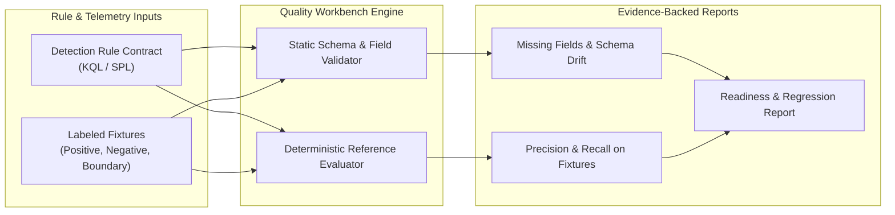

# Detection Quality & Regression Workbench

A deterministic testing and validation workbench for Microsoft Sentinel KQL and Splunk SPL detection rules.

## Why This Workbench Exists

In modern enterprise Security Operations Centers (SOCs), detection rules are the frontline defense against sophisticated attacks. However, detection engineering often suffers from critical quality challenges:

1. **Alert Fatigue and False Positives**: Rules tested only against theoretical queries frequently overwhelm analysts with thousands of false alerts when applied to live operational logs.
2. **Silent Telemetry Failures**: An upstream ingestion change (such as an agent update dropping a field like `IPAddress` or `ScriptBlockText`) causes detection rules to silently fail without throwing visible errors.
3. **Regression Blindness**: When engineers modify a query to catch a new adversary bypass, they often unintentionally break existing coverage or re-introduce noise.
4. **Lack of Test Fixtures**: Unlike traditional software engineering, detection rules are rarely accompanied by unit tests with labeled positive and negative test cases.

The **Detection Quality & Regression Workbench** (`detection-quality-workbench`) bridges this gap by bringing automated software testing standards to detection engineering:
- **Contract-First Rule Specifications**: Explicitly declare required vs. optional fields, data sources, time windows, and expected signals.
- **Labeled Telemetry Fixture Suites**: Validate rules against repeatable test cases representing verified attacks (true positives), benign baseline noise (true negatives), and boundary edge-cases (missing fields, schema drift, string collisions).
- **Deterministic Reference Evaluator**: Computes objective precision and recall baselines on labeled test cases before deployment.



## Key Capabilities

1. **Dual-Platform Support**: Supports both **Microsoft Sentinel KQL** (Log Analytics, Advanced Hunting) and **Splunk SPL** (Search Processing Language) contracts.
2. **Precision & Recall on Labeled Fixtures**:
   - **True Positives (TP)**: Target adversary techniques correctly caught.
   - **False Positives (FP)**: Benign administrative activity incorrectly flagged.
   - **True Negatives (TN)**: Expected baseline operations correctly ignored.
   - **False Negatives (FN)**: Target attacks missed by strict query conditions.
   - **Schema Error Cases**: Cases with missing or null required telemetry are counted separately. Precision and recall are `N/A` while any such case is present.
3. **Telemetry Dependency & Schema Drift Analysis**: Scans telemetry records to verify all required fields are present. Flags missing fields and schema changes before rules are pushed to production SIEMs.
4. **Automated Regression Baselines**: Enables automated test-suite runs in CI/CD pipelines to ensure rule revisions never degrade existing detection coverage.

> [!IMPORTANT]
> **Precision and recall are measured strictly on labeled test fixtures.** They provide vital regression baselines and identify filter bugs, but do not prove production scheduled alert firing rates.

## Directory Structure

```
detection-quality-workbench/
├── .claude-plugin/plugin.json             # Claude marketplace manifest
├── .codex-plugin/plugin.json              # Codex marketplace manifest
├── org.cops/prerequisites.json     # Copilot Studio configuration
├── package.json                           # Canonical package descriptor
├── plugin.json                            # Universal plugin manifest
├── README.md                              # Primary overview and usage documentation
├── docs/
│   └── PLAYBOOK.md                        # Step-by-step detection engineer playbook
├── detectionquality/                      # Standard-library runtime engine
│   ├── __init__.py                        # Package exports
│   ├── cli.py                             # Operator CLI commands
│   ├── evaluator.py                       # Deterministic reference evaluator
│   ├── models.py                          # Typed immutable dataclasses
│   ├── reporting.py                       # Markdown and JSON report generators
│   └── static_analysis.py                 # Telemetry field and schema validator
├── rules/                                 # Standardized detection rule contracts
│   ├── RULE-KQL-ENTRA-ANOMALOUS-SIGNIN.json
│   └── RULE-SPL-DEFENDER-POWERSHELL-EXEC.json
├── fixtures/                              # Labeled positive and negative test suites
│   ├── RULE-KQL-ENTRA-ANOMALOUS-SIGNIN.json
│   └── RULE-SPL-DEFENDER-POWERSHELL-EXEC.json
├── schemas/                               # Strict JSON schemas
│   ├── fixture.schema.json
│   ├── report.schema.json
│   └── rule.schema.json
├── scripts/
│   ├── run_demo.py                        # Executable offline demo runner
│   └── validate_package.py                # Package integrity gate
├── skills/
│   └── detection-quality-review/          # Contributor and agent skill definition
│       └── SKILL.md
└── tests/
    ├── test_workbench.py                  # Automated unit test suite
    └── test_edge_cases.py                 # Edge-case acceptance checks
```

## Quick Start

### 1. Run the Demonstration

Run the automated evaluation across all bundled Sentinel KQL and Splunk SPL rules:

```bash
python3 plugins/detection-hunting/detection-quality-workbench/scripts/run_demo.py
```

### 2. Validate Rule Contracts via CLI

Verify that all rule definitions follow strict schema requirements:

```bash
python3 plugins/detection-hunting/detection-quality-workbench/detectionquality/cli.py validate \
  --rules-dir plugins/detection-hunting/detection-quality-workbench/rules
```

### 3. Evaluate a Rule Against Test Fixtures

Generate a Markdown quality and readiness report:

```bash
python3 plugins/detection-hunting/detection-quality-workbench/detectionquality/cli.py evaluate \
  --rule plugins/detection-hunting/detection-quality-workbench/rules/RULE-KQL-ENTRA-ANOMALOUS-SIGNIN.json \
  --fixtures plugins/detection-hunting/detection-quality-workbench/fixtures/RULE-KQL-ENTRA-ANOMALOUS-SIGNIN.json
```

To export structured JSON for automated CI/CD gating:

```bash
python3 plugins/detection-hunting/detection-quality-workbench/detectionquality/cli.py evaluate \
  --rule plugins/detection-hunting/detection-quality-workbench/rules/RULE-KQL-ENTRA-ANOMALOUS-SIGNIN.json \
  --fixtures plugins/detection-hunting/detection-quality-workbench/fixtures/RULE-KQL-ENTRA-ANOMALOUS-SIGNIN.json \
  --json \
  --output report.json
```

### 4. Run the Full Quality Test Suite

Run regression evaluation across all rules in one command:

```bash
python3 plugins/detection-hunting/detection-quality-workbench/detectionquality/cli.py test-suite \
  --rules-dir plugins/detection-hunting/detection-quality-workbench/rules \
  --fixtures-dir plugins/detection-hunting/detection-quality-workbench/fixtures
```

The bundled suites include deliberate missing-field cases. `test-suite` displays their count and returns success when they are expected negative outcomes and no false positive or false negative occurs. A missing required field in an expected positive case requires review. Precision and recall remain `N/A` until the schema-error cases are resolved or evaluated in a separate complete-telemetry suite.

## Boundaries & Operational Integrity

- **Offline Analysis**: The workbench operates completely offline with standard-library Python. It requires no live cloud credentials or search cluster connections.
- **Reference Evaluation vs. Production Firing**: Syntactic validity and fixture matching do not guarantee that a scheduled query fired in production. Ingestion delays and query timeouts must be monitored separately.

### Fixture edge-case semantics

The reference evaluator applies these rules to each labeled fixture case:

- A `source` marker identifies a primary or secondary row. When a rule declares `join_keys`, every primary row matches only if a declared secondary source has equal, non-null values for every key. An unmarked row is treated as primary and must satisfy the same join. The synthetic join fixture under `tests/fixtures` uses both `TenantId` and `CorrelationId`, so a matching correlation ID in another tenant cannot join. The bundled Sentinel rule is single-source; its query and firing behavior are unchanged. The metadata check does not execute KQL.
- A missing or `null` required field is reported as `missing_field_error` and cannot satisfy the predicate. Dependency checks inspect primary rows, not secondary rows.
- An optional `evaluation_time` anchors the rule's `time_window`. Both endpoints of `[evaluation_time - time_window, evaluation_time]` are included; later and older events cannot match. Times must be ISO 8601 with a timezone offset. Without an anchor, the evaluator retains the existing fixture behavior and does not filter by time.
- A `prior_alerts` entry suppresses a matching event when both have the same non-empty tenant ID and its timestamp lies within the inclusive `suppression_window` ending at the event time. For `identity_scope: user` or `host`, the identity must also match. `identity_scope: global` is tenant-wide; other scope values are rejected. This models fixture outcomes; it does not query alert history.
- The bundled Splunk PowerShell source has no `TenantId`, so its rule sets `suppression_window: none`. A prior alert for the same host does not suppress that rule. Enable suppression only after the source and alert history provide a tenant-scoped contract.
- Repeated event rows count once because metrics are computed per labeled case. A case matches if any eligible, unsuppressed primary event satisfies the reference predicate.
- `total_cases = evaluated_cases + schema_error_cases`. The confusion-matrix counts sum to `evaluated_cases`; schema-error cases are excluded. Precision and recall are `null` in JSON and `N/A` in Markdown and CLI output if any schema-error case is present. This report change uses `cops.detection-quality-report/v2`; consumers of v1 must handle the new counts and nullable metrics.

These checks are minimum reference semantics for the bundled rules and a synthetic join contract. Validate query execution, real joins, alert suppression, and source data in the target SIEM separately.
