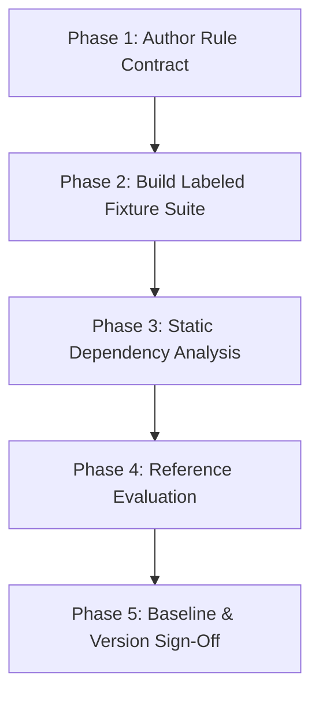
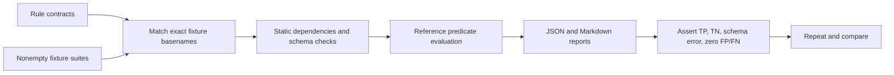

# Detection Engineer Playbook: Detection Quality & Regression Review

This playbook guides detection engineers, SIEM administrators, and threat hunters through authoring, testing, and validating detection rules using the **Detection Quality & Regression Workbench**.

---

## 1. Objectives & Overview

In high-volume enterprise environments, deploying an untested detection rule is a recipe for operational headaches. A rule that generates excessive false positives burns out SOC analysts, while a rule that depends on unindexed or missing telemetry silently misses intrusions.

The **Detection Quality & Regression Workbench** treats detection rules as version-controlled software artifacts. By combining contract specifications with labeled test fixtures, engineers can:
- Check the bundled reference predicates against repeatable telemetry examples.
- Find missing required fields in fixtures before live validation.
- Measure fixture-only precision and recall on modeled attack cases.
- Prevent regression bugs when tuning existing rules.

---

## 2. The 5-Phase Detection Quality Lifecycle



### Phase 1: Author the Rule Contract

Every detection rule begins with a contract file in `rules/` matching `schemas/rule.schema.json`.

1. **Specify Platforms and Sources**:
   - `platform`: `sentinel_kql` or `splunk_spl`.
   - `source_data`: Declare primary tables (e.g., `SigninLogs`, `DeviceProcessEvents`) or indexes/sourcetypes. For source-marked fixtures, `join_keys` lists all fields that must match between primary and secondary rows; include the tenant key when the join is tenant-scoped.
2. **Declare Field Dependencies**:
   - `required_fields`: Critical attributes without which the rule cannot evaluate (e.g., `TimeGenerated`, `UserPrincipalName`, `IPAddress`).
   - `optional_fields`: Contextual attributes that enhance the alert if present (e.g., `DeviceDetail`, `Location`).
3. **Define Operational Constraints**:
   - `time_window`: Lookback interval used by anchored fixture cases (e.g., `1h`, `15m`).
   - `suppression_window`: Deduplication interval, or `none` when source telemetry cannot establish a tenant. The bundled Splunk PowerShell rule uses `none` because its declared event source has no `TenantId`.
   - `identity_scope`: `user` or `host` compares the alert identity within one tenant; `global` suppresses tenant-wide. Other values are invalid.
   - `mitre_attack`: Linked technique IDs (e.g., `T1078.004`).

---

### Phase 2: Build Labeled Fixture Suites

A detection rule cannot be validated without representative test data. Create a matching fixture file in `fixtures/` with at least three categories of test cases:

1. **True Positive Cases (`positive`)**:
   - Telemetry events that accurately model attacker behavior.
   - Example: A successful login to Azure Portal from an external IP with a high identity risk score.
   - `expected_match`: `true`.

2. **True Negative Cases (`negative`)**:
   - Telemetry events representing routine corporate activity.
   - Example: An administrator logging into Azure Portal from a verified corporate VPN IP (10.x.x.x).
   - `expected_match`: `false`.

3. **Boundary & Edge Cases (`boundary`)**:
   - Events testing edge conditions: boundary timestamps, missing optional fields, failed logins, or substrings that resemble keywords but are harmless.
   - Deliberately removed fields: An event missing `IPAddress` to verify that schema drift is detected and handled cleanly.

Include cases for cross-tenant joins, a `null` required field, events exactly on and outside the time-window boundary, duplicate rows, and a recent alert suppressed for the same identity and tenant. Use `evaluation_time` to anchor time-window cases and `prior_alerts` to model suppression. The synthetic `tests/fixtures/tenant_join.json` suite expects a cross-tenant join to remain unmatched and a same-tenant join to match. The bundled single-source Sentinel suite expects a null required field to produce `missing_field_error`, a lower-bound event to match, an older event to remain unmatched, duplicate rows to produce one case result, and a suppressed alert to remain unmatched. See the README for the exact reference semantics.

---

### Phase 3: Run Static Dependency Analysis

Run static checks to verify telemetry completeness before evaluating logic:

```bash
python3 plugins/detection-hunting/detection-quality-workbench/detectionquality/cli.py evaluate \
  --rule plugins/detection-hunting/detection-quality-workbench/rules/RULE-KQL-ENTRA-ANOMALOUS-SIGNIN.json \
  --fixtures plugins/detection-hunting/detection-quality-workbench/fixtures/RULE-KQL-ENTRA-ANOMALOUS-SIGNIN.json
```

Inspect the **Static Dependency & Schema Checks** section:
- If **Missing Required Fields** lists any attributes, one or more fixture primary rows lack those required values. Investigate whether this reflects source telemetry, fixture construction, or an incorrect contract.
- Fix the underlying field availability or contract, then validate against the target SIEM before making a production claim.

---

### Phase 4: Reference Evaluation & Tuning

Review the quality metrics generated on labeled fixtures:

| Finding | Interpretation | Remediation Action |
| :--- | :--- | :--- |
| **False Positive (FP > 0)** | A benign fixture matched the reference predicate. | Inspect scope and filters, then test the actual query in the target SIEM. |
| **False Negative (FN > 0)** | A target fixture did not match the reference predicate. | Check join keys, time boundaries, suppression, and predicate conditions. |
| **Missing Field Error** | A primary fixture row lacked a required value. | Verify the fixture and source schema; correct the contract or telemetry. |

Reports use schema `cops.detection-quality-report/v2`. `total_cases` is the sum of `evaluated_cases` and `schema_error_cases`; TP, FP, TN, and FN sum to evaluated cases. A deliberately incomplete negative fixture proves schema-drift handling, but it is excluded from the confusion matrix. Precision and recall are `null` in JSON and `N/A` in rendered output while any schema-error case remains. Evaluate a complete-telemetry suite before using those rates as a regression baseline.

---

### Phase 5: Baseline & Version Sign-Off

Before promoting a rule to production:

Validate actual query compilation, execution, joins, suppression, and production log availability in the target SIEM. This offline workbench cannot establish those outcomes.

1. **Run the Full Test Suite**:
   Ensure all rules in the repository pass their quality checks. The bundled suites include expected negative schema-drift cases; their error counts remain visible, but they do not fail the suite. A missing field in an expected positive case requires review:
   ```bash
   python3 plugins/detection-hunting/detection-quality-workbench/detectionquality/cli.py test-suite \
     --rules-dir plugins/detection-hunting/detection-quality-workbench/rules \
     --fixtures-dir plugins/detection-hunting/detection-quality-workbench/fixtures
   ```
2. **Export Baseline JSON**:
   Save a versioned baseline report for audit records:
   ```bash
   python3 plugins/detection-hunting/detection-quality-workbench/detectionquality/cli.py evaluate \
     --rule path/to/rule.json \
     --fixtures path/to/fixtures.json \
     --json \
     --output baseline-v2.json
   ```

---

## 3. Engineering Review Checklist

Before signing off on a detection rule change:

- [ ] All declared `required_fields` are verified present in production log sources.
- [ ] Labeled fixtures include at least 2 positive cases, 2 negative cases, and 1 boundary case.
- [ ] No false positives occurred on the synthetic benign fixtures.
- [ ] Schema drift test case successfully flags missing required attributes.
- [ ] Rule version was incremented following semantic versioning guidelines.
- [ ] Precision and recall on test fixtures are documented with the mandatory disclaimer alert.

## 4. Offline End-to-End Playback

### Purpose, audience, and prerequisites

Detection engineers, SIEM administrators, and reviewers use this playback to
verify the complete packaged rule-to-fixture workflow. Run it from the COPS
repository root with Python 3.11 or later. It uses standard-library Python,
synthetic fixtures, and no provider credentials or network access.

Run the manifest demo:

```bash
python3 -m cops demo detection-quality-workbench
```

The default output is a mode-`0700` temporary directory. Retain the reports in a
private review directory when needed:

```bash
out_dir="$(mktemp -d "${TMPDIR:-/tmp}/detection-quality-playback.XXXXXX")"
python3 plugins/detection-hunting/detection-quality-workbench/scripts/run_demo.py \
  --out-dir "$out_dir"
python3 -m json.tool "$out_dir/playback-summary.json"
```

### Data flow and decisions



The playback rejects empty rule or fixture directories, empty suites, and
unpaired rule or fixture files. Each packaged platform must exercise a true
positive, true negative, and schema-error path, including an actual
`missing_field_error`, with zero false positives and zero false negatives. The
second pass must produce the same result.

### Artifact contract

| Artifact | Purpose and key fields | Producer to consumer | Version and validation |
| :--- | :--- | :--- | :--- |
| `playback-summary.json` | Overall decision; `status`, `rules`, per-rule metrics, `rerun_equivalent` | demo runner to operator or CI | `cops.detection-quality-playback/v1`; validates pair coverage, required paths, zero FP/FN, report presence, and rerun |
| `rules/<fixture-stem>/report.json` | Case results and metrics; `rule`, `metrics`, `static_analysis`, `case_results` | evaluator to automation or reviewer | `cops.detection-quality-report/v2`; parsed and asserted by the runner |
| `rules/<fixture-stem>/report.md` | Human-readable dependency, metric, and case review | report renderer to detection engineer | Derived from the v2 JSON report; existence and nonempty content are required |

The summary is defined by this shape:

```json
{
  "schema_version": "cops.detection-quality-playback/v1",
  "status": "passed",
  "rules": [
    {
      "rule_id": "RULE-KQL-ENTRA-ANOMALOUS-SIGNIN",
      "platform": "sentinel_kql",
      "metrics": {
        "true_positives": 4,
        "true_negatives": 5,
        "false_positives": 0,
        "false_negatives": 0,
        "schema_error_cases": 2
      },
      "json_report": "rules/kql-entra-anomalous-signin/report.json",
      "markdown_report": "rules/kql-entra-anomalous-signin/report.md",
      "passed": true
    }
  ],
  "rerun_equivalent": true
}
```

### Failure, resume, rerun, and cleanup

The runner exits `0` only when every packaged pair, required behavior path,
report artifact, and rerun assertion passes. A missing, extra, empty, malformed,
or mismatched rule or fixture set; missing required behavior; FP/FN; missing
report; or rerun difference exits `2`. Partial output is diagnostic evidence.
Repair the input or package, then rerun the whole command into the retained
directory; fixed report names are replaced.

For troubleshooting, confirm Python 3.11 or later, compare rule and fixture
basenames, validate each JSON document, and inspect `case_results` for
`missing_field_error`, false-positive, or false-negative outcomes. Do not remove
the intentional schema-drift fixture merely to produce numeric precision and
recall.

After review, remove a disposable retained directory with `rm -rf "$out_dir"`.
Keep retained artifacts under the organization's evidence access and retention
controls.

### Evidence limits

This playback evaluates Python reference predicates over labeled synthetic
fixtures. It does not parse, compile, or execute KQL or SPL in a native engine;
query a Microsoft or Splunk service; inspect real telemetry; or prove scheduled
rule firing, suppression, production precision, recall, latency, or
availability. Validate those properties separately in an authorized test
environment.
