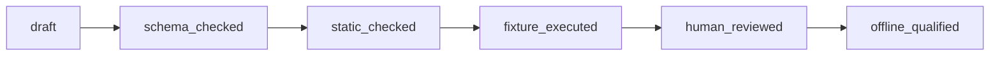

# Sentinel Hunt Workbench

The **Sentinel Hunt Workbench** gives threat hunters and detection engineers a safe, structured environment to design, test, and refine advanced Kusto Query Language (KQL) threat hunts offline.

In enterprise security, running unoptimized or unverified queries across terabytes of production logs can lead to expensive compute bills, slow query performance, or false alarms. The Sentinel Hunt Workbench packages **twelve hunt definitions (H01–H12)**, synthetic event fixtures, and declared surface profiles (Microsoft Sentinel, Microsoft Defender XDR, and Azure Data Lake) that you can render and reference-check locally using pure standard-library Python before running a query in your live tenant.

---

Follow the [end-to-end verification playbook](docs/VERIFICATION.md) to qualify this
package's documented workflow and prepare evidence for a maturity review.

## Defensive-Use Boundary

This package is intended exclusively for authorized defensive engineering, threat hunting, and security research on systems you own or have explicit permission to defend. It must never be used for unauthorized access, surveillance evasion, or disruptive activities. Log payloads, command lines, and query comments are treated strictly as untrusted data.

---

## When to Use & Threat Hunter Playbook

For end-to-end hunting methodologies, hypothesis design, and surface tuning, see the complete [Threat Hunter & Detection Engineer Playbook](docs/PLAYBOOK.md).

Use this workbench when:
- **Developing new threat hunts**: Translating adversary tradecraft (MITRE ATT&CK) into parameterized, efficient KQL queries.
- **Porting queries across surfaces**: Adapting queries between Microsoft Defender XDR, Sentinel Analytics, and Sentinel Data Lake without syntax errors.
- **Reference-checking detection intent**: Evaluating declared invariants against synthetic benign and malicious event streams offline before deployment.
- **Qualifying hunting packages**: Validating query schemas, join safety, and evidence contracts for enterprise release.

---

## Core Capabilities Included

- **Twelve Gold-Contract Hunts (`H01`–`H12`)**: Structured hunting queries covering key adversary techniques (e.g., OAuth abuse, suspicious token issuance, cross-tenant lateral movement).
- **Surface Profiles**: Explicit compatibility declarations and parameter rendering for Sentinel Analytics, Defender Advanced Hunting, and Azure Data Lake.
- **Six Portable Agent Skills**: Modular skills for planning, authoring, adapting, validating, testing, and reviewing hunts.
- **Strict Typed Parameter Binding**: Eliminates raw KQL string concatenation and prevents query injection vulnerabilities.
- **Synthetic Test Corpora**: Realistic offline datasets containing both benign background noise and positive attack signals.
- **Deterministic Host Adapters**: Ready-to-use discovery layers for GitHub Copilot, Claude Code, and OpenAI Codex.

---

## Quick Start from the COPS Root

Explore the workbench and run its safe offline demo right from the repository root:

```bash
# Check repository health and inspect the workbench
python3 -m cops doctor
python3 -m cops info sentinel-hunt-workbench

# Run the safe offline demonstration
python3 -m cops demo sentinel-hunt-workbench

# Run full package validation
python3 -m cops check sentinel-hunt-workbench
```

### What to look for
The demo renders every supported surface for all twelve hunts, evaluates
malicious, benign, and insufficient-evidence fixtures for H01, H02, and H10,
runs the library qualification and semantic-mutation checks, and repeats the
evaluation to prove the result is stable. It writes artifacts to a private
temporary directory by default. Retain a review copy when needed:

```bash
python3 plugins/detection-hunting/sentinel-hunt-workbench/scripts/run_demo.py \
  --out-dir /path/to/private-review-directory
```

The result is offline fixture evidence. It does not contact Microsoft APIs,
execute KQL in a native engine, or validate a tenant.

---

## Package-Local Commands

You can also run commands directly from the workbench directory:

```bash
# List all 12 packaged hunts
python3 scripts/huntwb.py list

# Inspect hunt H01 (hypothesis, parameters, tables)
python3 scripts/huntwb.py explain H01

# Check compatibility of hunt H09 across surfaces
python3 scripts/huntwb.py compatibility H09

# Validate schemas and run fixture tests offline
python3 scripts/huntwb.py validate library
python3 scripts/huntwb.py test library --seed 20260916

# Verify that host adapters are in sync
python3 scripts/huntwb.py verify-adapters
```

### Rendering KQL Queries
To render a hunt query with custom parameters for a specific Microsoft surface:

```bash
python3 scripts/huntwb.py render H01 \
  --surface sentinel_analytics \
  --params examples/h01-parameters.json
```

---

## The Qualification Lifecycle

To ensure hunts are thoroughly vetted before reaching production, each hunt progresses through an explicit lifecycle:



- `draft`: Initial hunt idea under development.
- `schema_checked`: Verified against declared table and column schemas.
- `static_checked`: Validated for join safety, time window constraints, and parameter typing.
- `fixture_executed`: Tested against synthetic positive and negative event streams.
- `human_reviewed`: Inspected and approved by a detection engineer.
- `offline_qualified`: Meets all packaging, evaluation, and documentation standards.

---

## Data contracts and flow

The workbench keeps hunt intent, surface rendering, and fixture evaluation as
separate contracts. This lets a reviewer identify whether a failure belongs to
the hunt definition, a surface mapping, or the synthetic reference evaluator.

| Contract or artifact | Purpose | Key fields | Producer | Consumer | Validation | Example |
| --- | --- | --- | --- | --- | --- | --- |
| Hunt definition | Describe a hypothesis and its required telemetry | Hunt ID, hypothesis, tables, parameters, supported surfaces | Package author | Renderer, evaluator, and analyst | Hunt schema and catalog checks | H01 anomalous sign-in hunt |
| Surface profile and rendered query | Bind a hunt to a supported Sentinel surface | Surface, table mappings, parameters, KQL text | Renderer | Analyst or authorized tenant workflow | Compatibility and required-parameter checks | H09 rendered for Log Analytics |
| Synthetic fixture corpus | Supply labeled offline observations | Hunt ID, case ID, input records, expected result | Package maintainer | Reference evaluator | Fixture schema and expected-outcome checks | Positive and benign H01 cases |
| Qualification result | Record reference-evaluator outcomes | Hunt, case, matched observations, expectation status | Offline evaluator | Playback and reviewer | Every fixture must meet its declared outcome | H01 positive case matches |
| Playback summary | Prove catalog coverage and deterministic reruns | Hunt counts, surface counts, failure-path result, digest | `scripts/run_demo.py` | Maintainer | Semantic assertions and rerun equality | All 12 hunts evaluated with a rejected malformed fixture |

## Architecture & Supplementary Docs

- [Threat Hunter Playbook](docs/PLAYBOOK.md): Step-by-step methodologies and real-world hunt scenarios.
- [Cross-Platform Guide](docs/CROSS_PLATFORM.md): How host discovery adapters work across assistants.
- [Workbench Architecture](docs/ARCHITECTURE.md): Component breakdown, evaluation protocols, and KQL design.
- [Operational Guide](docs/OPERATIONS.md): Enterprise deployment, scheduled rules, and telemetry monitoring.
- [Source Provenance](SOURCE_PROVENANCE.md): Attribution and licensing origins for all hunt definitions.
- [Evaluation Protocol](evaluations/EVALUATION_PROTOCOL.md): Evaluation criteria for AI assistant model tasks.
- [Walkthrough](walkthrough.md): Guide to release artifacts and integrity checks.

---

## Evidence & Practical Boundaries

The reference evaluator applies declarative checks to synthetic event fixtures. It is not a Kusto compiler, live Kusto cluster, or Sentinel emulator. Local passes demonstrate that the package contracts, fixtures, and declared parameters are internally consistent; they do not establish native query validity, real-world cloud query costs, data ingestion latency, or compatibility with custom tenant table schemas. Test queries in an authorized test workspace before deploying them as production analytics rules.

### License
Offered under the [PolyForm Noncommercial License 1.0.0](LICENSE).
