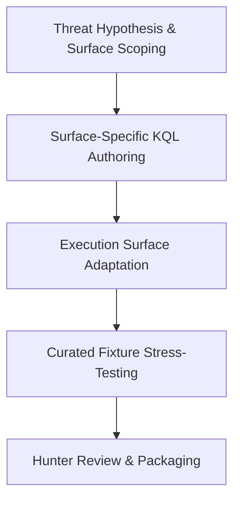
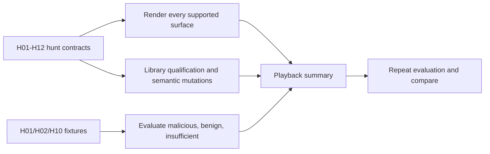

# Sentinel Hunt Workbench Threat Hunter & Detection Engineer Playbook

## 1. Overview & Intended Personas

The **COPS Sentinel Hunt Workbench** is an offline, deterministic development and qualification environment for authoring, adapting, stress-testing, and reviewing defensive threat hunts in Microsoft Sentinel, Defender XDR, and Azure Data Lake.

- **Primary Personas**:
  - **Threat Hunters**: Formulating hypothesis-driven hunts against adversary tactics, techniques, and procedures (MITRE ATT&CK).
  - **Detection Engineers**: Developing robust KQL detection logic with explicit parameterization, project-away safeguards, and performance boundaries.
  - **SIEM / SOC Content Leads**: Qualifying hunting content against synthetic event streams offline before deploying to production workspaces.



---

## 2. When to Use This Plugin

Invoke this workbench under the following concrete triggers:

| Trigger Scenario | Operational Objective | Primary Skills Invoked |
| :--- | :--- | :--- |
| **New Threat Intelligence / ATT&CK Technique** | Author a proactive hunt query targeting newly reported adversary tradecraft. | `plan-sentinel-hunt`, `author-sentinel-kql` |
| **Cross-Surface Query Porting** | Translate an existing hunt between Defender XDR (`DeviceProcessEvents`), Sentinel (`SecurityEvent`), and Data Lake. | `adapt-sentinel-hunt` |
| **Pre-Production Reference Evaluation** | Evaluate declared hunt invariants against synthetic benign and malicious fixtures before native runtime testing. | `test-sentinel-hunt`, `validate-sentinel-hunt` |
| **Offline Hunting Content Qualification** | Verify query syntax, table contracts, and parameters without requiring access to live customer tenants. | `validate-sentinel-hunt`, `review-sentinel-hunt` |

### Operational Boundaries & Safety Guarantees
- **Offline Qualification Only**: The workbench **never connects to live Microsoft APIs**, tenants, or subscription credentials.
- **Assurance Definition**: An `offline_qualified` finding means the structured hunt contract and reference-fixture checks passed. The workbench does not compile or execute KQL, so this result does not establish native query validity, production latency, ingestion cost, or detection efficacy in a live tenant.
- **Defensive Use Mandate**: All hunts must be designed strictly for defensive security operations, incident response, or detection engineering.

---

## 3. Five-Phase Engineering Playbook

### Phase 1: Threat Hypothesis & Surface Scoping
**Skill**: [`plan-sentinel-hunt`](../skills/plan-sentinel-hunt/SKILL.md)

1. **Define Hunting Hypothesis**:
   - State the attacker goal (e.g., adversary abusing OAuth permissions, scheduled task persistence, or LSASS memory dumping).
   - Map technique to MITRE ATT&CK ID (e.g., `T1053.005`, `T1098.005`).
2. **Select Target Execution Surface**:
   - `defender_advanced_hunting`: Endpoint/identity-centric telemetry with 30-day retention.
   - `sentinel_analytics`: Multi-source event correlation with alerting thresholds.
   - `sentinel_data_lake`: High-volume raw telemetry in Azure Data Lake / ADX.
3. **Verify Data Table Requirements**:
   - Confirm required tables (e.g., `SigninLogs`, `AADServicePrincipalSignInLogs`, `SecurityEvent`, `DeviceProcessEvents`).

### Phase 2: Schema-Aware KQL Authoring
**Skill**: [`author-sentinel-kql`](../skills/author-sentinel-kql/SKILL.md)

1. **Implement Mandatory Safeguards**:
   - Include bounded time filters (e.g., `where TimeGenerated between (_StartTime .. _EndTime)`).
   - Use `project` or `project-away` to omit high-overhead unstructured columns.
   - Avoid unbounded `search` or wildcards across entire workspaces.
2. **Parameterize Query**:
   - Externalize configurable thresholds: lookback window, failure count threshold, known-good IP allowlists.

### Phase 3: Execution Surface Adaptation
**Skill**: [`adapt-sentinel-hunt`](../skills/adapt-sentinel-hunt/SKILL.md)

1. **Map Cross-Surface Schema Differences**:
   - Defender `DeviceId` $\leftrightarrow$ Sentinel `Computer` / `_ResourceId`.
   - Defender `AccountUpn` $\leftrightarrow$ Sentinel `TargetUserName` / `UserPrincipalName`.
2. **Adjust Operators for Engine Nuances**:
   - Handle case-sensitivity nuances (`=~` vs `==`).
   - Translate nested JSON unpacks (`parse_json()` vs Defender native bag-unpacking).

### Phase 4: Curated Fixture Stress-Testing & Validation
**Skills**: [`test-sentinel-hunt`](../skills/test-sentinel-hunt/SKILL.md), [`validate-sentinel-hunt`](../skills/validate-sentinel-hunt/SKILL.md)

1. **Evaluate Benign Noise Fixtures**:
   - Run query against baseline benign fixtures to measure noise and false-positive tendency.
2. **Evaluate Attack Fixtures**:
   - Run query against curated malicious events to verify trigger condition matches expected threat behavior.
3. **Validate Package Consistency**:
   ```bash
   python3 plugins/detection-hunting/sentinel-hunt-workbench/scripts/validate_package.py
   python3 plugins/detection-hunting/sentinel-hunt-workbench/scripts/stress_test.py
   ```

### Phase 5: Hunter Review & Package Release
**Skill**: [`review-sentinel-hunt`](../skills/review-sentinel-hunt/SKILL.md)

1. **Author Hunter Triage Guidance**:
   - Document step-by-step triage actions when a hit is generated.
   - Identify common false-positive drivers (e.g., vulnerability scanners, administrative batch jobs).
2. **Build Release Artifacts**:
   - Compile release summary with evidence receipts:
     ```bash
     python3 plugins/detection-hunting/sentinel-hunt-workbench/scripts/build_release_artifacts.py
     ```
3. **Document Evidence Limits**:
   - Explicitly note in release notes that offline pass does not guarantee production performance or live tenant telemetry availability.

---

## 4. Verification & Gate Checks

Execute the standard validation path before releasing content:

```bash
# Full offline package check
python3 plugins/detection-hunting/sentinel-hunt-workbench/scripts/validate_package.py

# Offline unit tests
python3 -m unittest discover -s plugins/detection-hunting/sentinel-hunt-workbench/tests -v
```

## 5. Offline End-to-End Playback

### Purpose, audience, and prerequisites

Threat hunters, detection engineers, and reviewers use this playback to prove
that the packaged hunts can be rendered and evaluated consistently before a
tenant test. Run it from the COPS repository root with Python 3.11 or later. It
needs only the checked-out package and writes no network traffic. Do not place
production telemetry or credentials in its fixture or output directories.

Run the manifest demo:

```bash
python3 -m cops demo sentinel-hunt-workbench
```

The default output is a mode-`0700` temporary directory. To retain the artifacts,
choose a private directory and run the package runner directly:

```bash
out_dir="$(mktemp -d "${TMPDIR:-/tmp}/sentinel-hunt-playback.XXXXXX")"
python3 plugins/detection-hunting/sentinel-hunt-workbench/scripts/run_demo.py \
  --out-dir "$out_dir"
python3 -m json.tool "$out_dir/playback-summary.json"
```

### Data flow and decisions



The playback requires every advertised supported rendering for H01-H12. For
H01, H02, and H10 it requires `match` for malicious evidence,
`no_escalation` for benign evidence, and `insufficient_evidence` when required
evidence is absent. It also requires the library qualification checks to catch
all required semantic mutations. The repeated evaluation must be equivalent.

### Artifact contract

| Artifact | Purpose and key fields | Producer to consumer | Version and validation |
| :--- | :--- | :--- | :--- |
| `playback-summary.json` | Overall decision; `status`, `rendered_artifact_count`, `rendered_artifacts`, `rerun_equivalent` | runner to operator or CI | `huntwb.playback-summary/v1`; success requires all assertions and an equivalent rerun |
| `evaluation-summary.json` | H01/H02/H10 fixture decisions; `evaluator`, `evidence_scope`, `live_service_validation`, `hunts.<id>.<category>` | reference evaluator to SOC reviewer | `huntwb.playback-evaluation/v1`; each category records the fixture qualification contract, expected and actual playback outcome, reason, and `passed` |
| `qualification-report.json` | Full-library deterministic gates; `status`, mutation results, limitations | workbench to release reviewer | `huntwb.qualification/v1`; validated by the workbench release contract |
| `compatibility-report.json` | Supported and unsupported surface declarations for every hunt; `hunts` | renderer to portability reviewer | `huntwb.playback-compatibility/v1`; every advertised supported surface must have an artifact |
| `rendered/Hxx/<surface>.json` | Bound query artifact; `hunt_id`, `surface`, `query`, parameter and provenance fields | renderer to detection engineer | `huntwb.rendered-hunt/v1` with artifact schema version `1`; validated during rendering |

The evaluation summary definition is:

```json
{
  "schema_version": "huntwb.playback-evaluation/v1",
  "status": "passed",
  "evaluator": "reference_invariant_evaluator",
  "evidence_scope": "synthetic_contract_and_reference_semantics_only",
  "live_service_validation": "not_performed",
  "hunts": {
    "H01": {
      "malicious": {
        "scenario_id": "H01-true_positive-01",
        "fixture_category": "true_positive",
        "fixture_expected_qualification_outcome": "match",
        "expected_outcome": "match",
        "actual_outcome": "match",
        "reason": "reference_invariants_satisfied",
        "passed": true
      }
    }
  }
}
```

### Failure, resume, rerun, and cleanup

The runner exits `0` only after every rendering, fixture decision,
qualification check, artifact check, and rerun comparison passes. Missing or
malformed fixtures, unsupported content advertised as supported, a failed
mutation gate, an outcome mismatch, or a rerun mismatch exits `2`. Treat any
partial output as diagnostic evidence. Repair the input or package and rerun the
entire command into the same retained directory; fixed artifact names are
replaced while source fixtures remain unchanged.

If the command fails, inspect its final error, confirm Python is 3.11 or later,
run `huntwb.py validate library`, and verify that the selected output directory
is writable and private. An unknown table, field, surface, or parameter is a
content error, not a reason to weaken validation.

After review, remove a disposable retained directory with `rm -rf "$out_dir"`.
Keep any required artifacts under the organization's access and retention
controls.

### Evidence limits

The playback uses a Python reference evaluator and synthetic fixture semantics.
It does not compile or execute KQL in Kusto, query Sentinel or Defender, verify
native runtime behavior, inspect provider data, or establish production
detection efficacy, cost, latency, or availability. Validate those properties
separately in an authorized test tenant.

<!-- BEGIN COPS GENERATED OFFLINE ASSESSMENT LINKS -->
## Generated offline assessment

- [Machine-readable playbook](../playbooks/offline-assessment.json)
- [Runnable offline walkthrough](../walkthroughs/offline-assessment.md)
<!-- END COPS GENERATED OFFLINE ASSESSMENT LINKS -->
