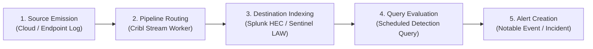

# COPS Telemetry-to-Detection Proof Pack

Supply a run manifest and a directory of JSON evidence records to the **Telemetry-to-Detection Proof Pack**. It correlates a synthetic marker across source, routing, indexing, rule execution, and alert records. It does not collect evidence or verify a live service by itself.

When an expected alert is absent, use the report to identify missing or unresolved stage evidence before assigning a cause.

---

Follow the [end-to-end verification playbook](docs/VERIFICATION.md) to qualify this
package's documented workflow and prepare evidence for a maturity review.

## When to Use This Plugin

Use this plugin when you need to:
- **Examine New Ingestion Routes**: Compare source, Cribl Stream, and destination records for the same synthetic run.
- **Investigate Missing Alerts**: See which records were supplied and which stages still need collection or investigation.
- **Flag Tenant Mismatches**: Compare the source record's tenant ID with the manifest's expected ID; review other boundaries separately.
- **Retain Review Evidence**: Generate Markdown and JSON reports with hashes of the supplied stage records.

---

## The 5 Lifecycle Stages



1. **Source Emission**: Matches a supplied source record containing the marker (`SYN-...`).
2. **Pipeline Routing**: Matches a supplied Cribl route record and checks its drop/filter flags.
3. **Destination Indexing**: Matches a supplied Splunk index or Sentinel table record.
4. **Query Evaluation**: Matches a supplied scheduled query execution record and checks its match count.
5. **Alert Creation**: Matches a supplied notable event or incident record.

---

## Understanding Pipeline Health

The correlation engine reports three health states based on the supplied evidence. These states describe the records for that run, not current service availability:

| Health Status | Description | Action Required |
| :--- | :--- | :--- |
| **`healthy`** | One in-window marker record was supplied for each stage and all five stage checks passed. | Review provenance and repeat collection as needed. |
| **`degraded`** | A destination marker record was supplied, but at least one stage is missing or unresolved. | Inspect duplicate records, collection timing, query matches, and alert evidence. |
| **`broken`** | No destination marker record was supplied. | Check export coverage and then investigate routing or indexing. |

Each stage accepts one record object or a `{"records": [...]}` envelope. More than one matching record at a stage, an absent or invalid timestamp, or a timestamp outside the manifest window plus `clock_skew_seconds` makes that stage `unresolved`. The report retains its evidence ID, hash, details, and the other stages' observations. A missing export is a collection gap; it does not establish that the service failed. See the `fixtures/failures/duplicate-marker` and `fixtures/failures/delayed-indexing` scenarios in the source repository.

For offline rule logic and labeled fixture precision/recall, use the Detection Quality & Regression Workbench (`plugins/detection-hunting/detection-quality-workbench`). Its fixture results and this pack's operational stage correlation answer different questions; neither alone establishes a production detection rate.

---

## Quick Start

### Run the Demo

See healthy, degraded, and broken proof pack traces in action:

```bash
python3 plugins/logging-telemetry/telemetry-proof-pack/scripts/run_demo.py
```

### Trace a Pipeline Run

Generate a human-readable Markdown report from a manifest and evidence directory:

```bash
python3 plugins/logging-telemetry/telemetry-proof-pack/proofpack/cli.py trace \
  --manifest plugins/logging-telemetry/telemetry-proof-pack/fixtures/routes/cribl-splunk-route/manifest.json \
  --evidence-dir plugins/logging-telemetry/telemetry-proof-pack/fixtures/routes/cribl-splunk-route
```

### Validate a Manifest

Check that a run manifest follows the proof pack specification:

```bash
python3 plugins/logging-telemetry/telemetry-proof-pack/proofpack/cli.py validate \
  --manifest plugins/logging-telemetry/telemetry-proof-pack/fixtures/routes/cribl-splunk-route/manifest.json
```

---

## Evidence and Privacy Boundaries

- Use authorized, non-sensitive synthetic identifiers and sanitize source exports before running the tool.
- The offline correlator makes no live service calls. It redacts only Cribl metric details; other IDs and details can appear in reports. Operators must control evidence access and retention.
- Confirm the manifest's tenant, destination, rule, capture window, and clock skew against the exports. See the playbook for collection permissions and platform limits.

For full operational step-by-step procedures, refer to the [Operational Playbook](docs/PLAYBOOK.md).
