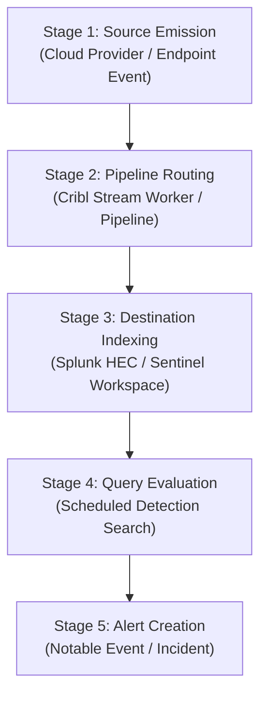
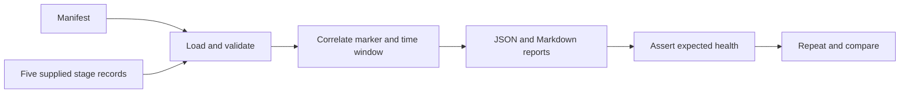

# Detection & Pipeline Engineer Playbook: Telemetry-to-Detection Proof Tracing

This playbook guides detection engineers, pipeline operators, and SIEM administrators through tracing synthetic test markers across data collection, stream routing, SIEM indexing, and detection evaluation using the **Telemetry-to-Detection Proof Pack**.

---

## 1. Objectives & Overview

In modern enterprise security architectures, telemetry rarely travels directly from an endpoint or cloud service into a SIEM. It passes through intermediate routing engines (such as Cribl Stream), transformation pipelines, and regional buffering clusters before arriving in Splunk or Microsoft Sentinel.

When an alert doesn't fire as expected, engineers often waste hours debugging detection queries when the data was never indexed in the first place. Conversely, engineers might assume a logging pipeline is working perfectly when subtle schema changes cause SIEM searches to return zero rows.

The **Telemetry-to-Detection Proof Pack** correlates supplied records for a synthetic marker. It identifies missing or ambiguous stage evidence for investigation and records SHA-256 hashes so reviewers can compare exported content. A hash does not authenticate the export or prove that a live pipeline worked. The source tenant check flags a mismatch with the manifest; it does not enforce tenant isolation.

---

## 2. The 5-Stage Verification Lifecycle



---

## 3. Step-by-Step Operator Procedures

### Step 1: Define the Run Manifest

Create a `manifest.json` describing the run parameters, target destination, detection rule, and retention policies.

```json
{
  "schema_version": "cops.proof-manifest/v1",
  "run_id": "RUN-SPLUNK-PROVE-01",
  "authorized_environment": "staging-telemetry-cluster",
  "synthetic_marker": "SYN-SPLUNK-TRACE-101",
  "source_event_type": "Microsoft.Entra.UserSignin",
  "pipeline_route": "cribl_to_splunk",
  "destination": {
    "platform": "splunk",
    "target_container": "index=endpoint",
    "tenant_or_workspace_id": "corp-tenant-01"
  },
  "detection_rule": {
    "rule_id": "RULE-SPL-DEFENDER-POWERSHELL-EXEC",
    "rule_name": "Suspicious PowerShell Execution",
    "rule_version": "1.0.0"
  },
  "time_window": {
    "start_time": "2026-10-01T12:00:00Z",
    "end_time": "2026-10-01T13:00:00Z",
    "clock_skew_seconds": 120
  },
  "evidence_capture_policy": {
    "retention_days": 30,
    "redaction_required": true,
    "allowed_stages": [
      "source_emission",
      "pipeline_routing",
      "destination_indexing",
      "query_evaluation",
      "alert_creation"
    ]
  }
}
```

### Step 2: Prepare a Scoped Synthetic Run

- Use standard marker prefixes: `SYN-[PLATFORM]-[PURPOSE]-[ID]`.
- Use an approved test event and a non-sensitive field that reaches each intended stage. Do not alter an identity field such as `userPrincipalName` just to carry a marker.
- Record the authorized environment, expected tenant or workspace, route, rule ID, time window, timezone, and allowed clock skew in the manifest.
- Do not include passwords, live tokens, personal identifiers, or other private data in the marker or evidence export.

### Step 3: Collect and Sanitize Evidence Files

Use approved read/export access for the relevant source logs, Cribl route or worker data, destination index or workspace, scheduled rule execution, and alert or incident records. Minimize each export to the authorized run and time window. Keep the original capture provenance separately, sanitize copies before giving them to this tool, and apply your access and retention controls to both exports and reports. The manifest's retention setting is descriptive; the tool does not delete files.

Place sanitized stage records in a dedicated run directory. Each file may contain one JSON record or `{"records": [record, ...]}`; export **every** matching record in the scoped window so duplicate markers are visible:

- `source_event.json`: An authorized source audit, sign-in, or endpoint event that actually contains the marker. Source log availability and export rights vary; an absent file is not proof that no event was emitted.
- `cribl_route.json`: A marker-bearing route or worker record. Aggregate metrics without the marker cannot prove the route of one event, and drop/filter flags need operator review.
- `destination_indexing.json`: A marker-bearing Splunk indexed search result or Sentinel Log Analytics table row. Splunk HEC acceptance alone does not prove indexing. Sentinel `TimeGenerated` may describe event time rather than indexing time, so use a verified `indexed_time` when measuring collection delay.
- `query_evaluation.json`: A marker-bearing scheduled search or analytics execution record with `matched_count`. Confirm the rule ID, schedule, lookback, and any later run that could include a delayed event.
- `alert_creation.json`: A marker-bearing notable event or incident record. Alert grouping, suppression, and incident creation can occur on a different schedule from the query.

Collection may require separate rights for Microsoft Entra audit/sign-in exports, Cribl operational records, Splunk index/search/alert records, or Sentinel workspace/analytics/incident records. Use the least privilege available and record inaccessible stages as evidence gaps. This offline tool neither queries those services nor validates a user's permissions.

### Step 4: Run Multi-Stage Correlation

Execute the proof pack correlation engine:

```bash
python3 plugins/logging-telemetry/telemetry-proof-pack/proofpack/cli.py trace \
  --manifest path/to/manifest.json \
  --evidence-dir path/to/evidence_dir
```

Review each stage alongside the overall status:
- **`HEALTHY`**: One in-window marker record was supplied for every stage and all five stage checks passed.
- **`DEGRADED`**: A destination marker record was supplied, but at least one stage is missing or unresolved.
- **`BROKEN`**: No destination marker record was supplied. Check export coverage before diagnosing an outage.

The capture window includes `clock_skew_seconds` on both ends. A stage with multiple matching records, an invalid or missing timestamp, or a timestamp outside that window is `UNRESOLVED`; its matching IDs and evidence hash remain in the report. Query `matched_count` must be a nonnegative integer; invalid values leave that stage unresolved. Other stages keep their own observations. See the `fixtures/failures/duplicate-marker` and `fixtures/failures/delayed-indexing` scenarios in the source repository.

---

## 4. Troubleshooting Common Failures

### Case A: Degraded Pipeline (Indexed but Detection Missed)

**Symptoms**:
- `destination_indexing` is `OBSERVED`.
- `query_evaluation` is `UNRESOLVED` (`matched_count: 0`) and `alert_creation` is `MISSING`.

**Remediation Steps**:
1. Check the detection query syntax against the raw indexed event in Splunk or Sentinel.
2. Confirm field name casing (e.g. `UserPrincipalName` vs `user_principal_name`).
3. Check the rule lookback window. If data indexing latency exceeded the rule's query interval, the event fell outside the search window.
4. Verify alert throttling and suppression rules. Was an identical alert triggered recently?

---

### Case B: Broken Pipeline (Event Dropped in Stream Routing)

**Symptoms**:
- `source_emission` is `OBSERVED`.
- `pipeline_routing` is `UNRESOLVED` (`status: dropped` or `filtered_out: true`).
- `destination_indexing` is `MISSING`.

**Remediation Steps**:
1. Inspect Cribl Stream pipeline filter conditions and drop regex patterns.
2. Check if a sampling rule or volume-reduction filter unexpectedly matched the event.
3. Review worker group health, outbound backpressure, and destination HEC token validity.

---

### Case C: Cross-Tenant Collision

**Symptoms**:
- `source_emission` is `UNRESOLVED` (`Cross-tenant collision`).

**Remediation Steps**:
1. Verify the source event's tenant ID against the manifest's expected workspace/tenant ID.
2. Check intermediate Cribl routes to ensure cross-tenant traffic isn't merging into a shared pipeline without tenant tagging.
3. Isolate tenant streams using dedicated Cribl worker pipelines or separate HEC tokens.

---

### Case D: Duplicate Marker or Delayed Indexing

**Symptoms**:
- A stage is `UNRESOLVED` with multiple matching evidence IDs or an out-of-window timestamp.
- Other stages may still be `OBSERVED`, and an alert record may be present.

**Remediation Steps**:
1. Inspect all matching records and their run IDs; repeat with a unique marker if multiple events cannot be attributed to one run.
2. Compare source event time, actual indexing time, export time, query schedule, and the manifest window. Do not treat a source event timestamp as an indexing timestamp.
3. After a documented collection delay, recollect within a justified window and rerun. Retain the original report for comparison.

---

## 5. Review and Retention

Before promoting new detection rules or pipeline routes to production:
1. Run `python3 plugins/logging-telemetry/telemetry-proof-pack/scripts/validate_package.py`.
2. Generate a JSON proof report using `--json --output evidence/proof-report.json`.
3. Review the stage evidence, collection gaps, source permissions, and capture window before using the report in a change review. Keep exports and reports only under your organization's access and retention controls.

For rule behavior against labeled positive and negative fixtures, use the Detection Quality & Regression Workbench (`plugins/detection-hunting/detection-quality-workbench`). That workbench measures fixture precision and recall; this pack correlates supplied operational stage records. Neither alone measures production detection rates.

## 6. Offline End-to-End Playback

### Purpose, audience, and prerequisites

Pipeline engineers, detection engineers, and reviewers use this playback to
exercise complete supplied-evidence traces without querying a provider. Run it
from the COPS repository root with Python 3.11 or later. It needs no service
credentials or network access and uses only synthetic package fixtures.

Run the manifest demo:

```bash
python3 -m cops demo telemetry-proof-pack
```

The default output is a mode-`0700` temporary directory. Retain reports in a
controlled directory when a reviewer needs them:

```bash
out_dir="$(mktemp -d "${TMPDIR:-/tmp}/telemetry-proof-playback.XXXXXX")"
python3 plugins/logging-telemetry/telemetry-proof-pack/scripts/run_demo.py \
  --out-dir "$out_dir"
python3 -m json.tool "$out_dir/playback-summary.json"
```

### Data flow and decisions



The playback requires two `healthy` routes
(`cribl-splunk-route`, `cribl-sentinel-route`), one `degraded` rule-miss trace
(`hec-indexed-rule-missed`), and two `broken` traces
(`missing-cribl-stage`, `cross-tenant-collision`). Those health labels describe
the supplied files. They do not diagnose a live service. The second pass must
produce the same substantive report content.

### Artifact contract

| Artifact | Purpose and key fields | Producer to consumer | Version and validation |
| :--- | :--- | :--- | :--- |
| `playback-summary.json` | Overall decision; `status`, `scenarios`, `rerun_equivalent` | demo runner to operator or CI | `cops.telemetry-proof-playback/v1`; validates the exact scenario set, expected health, reports, and rerun |
| `scenarios/<scenario>/report.json` | Machine-readable trace; `pipeline_health`, `stages_breakdown`, `summary`, `synthetic_marker`, evidence hashes | correlator to automation or reviewer | `cops.proof-report/v1`; parsed and asserted by the runner |
| `scenarios/<scenario>/report.md` | Human-readable stage interpretation and evidence limitations | report renderer to engineer | Derived from the validated JSON report; existence and nonempty content are required |

Example summary entry:

```json
{
  "schema_version": "cops.telemetry-proof-playback/v1",
  "status": "passed",
  "scenarios": [
    {
      "scenario": "cribl-splunk-route",
      "expected_health": "healthy",
      "actual_health": "healthy",
      "observed_stages": 5,
      "json_report": "scenarios/cribl-splunk-route/report.json",
      "markdown_report": "scenarios/cribl-splunk-route/report.md",
      "passed": true
    }
  ],
  "rerun_equivalent": true
}
```

### Failure, resume, rerun, and cleanup

Missing manifests or evidence directories fail closed with exit `2`; they are
never reported as an empty success. Malformed evidence, an unexpected health
state, a missing or empty report, or a rerun mismatch also exits `2`. Treat any
partial directory as diagnostic evidence. Correct the fixture or package and
rerun the full command into the retained directory; the fixed report names are
replaced.

For troubleshooting, confirm Python 3.11 or later, inspect the named scenario's
manifest and evidence files, and compare marker, tenant or workspace, capture
window, clock skew, and record timestamps. A missing export is still an evidence
gap. Do not infer a provider outage from it.

After review, remove a disposable retained directory with `rm -rf "$out_dir"`.
Store retained reports and source exports only under the applicable access and
retention controls.

### Evidence limits

This playback correlates offline JSON fixtures. It makes no Cribl, Splunk, or
Microsoft API call, does not run a scheduled query, and cannot authenticate an
export or prove collection completeness, native runtime behavior, service
availability, or a production alert rate. Collect and validate those facts
separately through authorized provider workflows.
