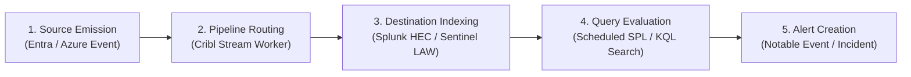

# Telemetry-to-Detection Proof Tracing Workflow

Use this skill to correlate offline evidence for synthetic markers from source emission through Cribl Stream, Splunk or Microsoft Sentinel indexing, scheduled query evaluation, and alert creation. The tool does not collect live evidence.

## Architecture and Pipeline Lifecycle



### Stage Definitions and Classifications

Each lifecycle stage receives one of three clear classifications:
- **`observed`**: One marker-bearing record was supplied with a valid timestamp inside the manifest capture window, and stage checks passed.
- **`missing`**: No supplied record for this stage contained the marker. Investigate export coverage before inferring a service failure.
- **`unresolved`**: The supplied records were ambiguous or failed a stage check, including duplicate markers, timestamp bounds, a tenant mismatch, a dropped route flag, or zero query matches.

### Pipeline Health States

- **`healthy`**: All five supplied stage records are observed.
- **`degraded`**: A destination marker record was supplied, but the trace is incomplete or unresolved.
- **`broken`**: No destination marker record was supplied.

> [!IMPORTANT]
> Use authorized, non-sensitive markers (e.g. `SYN-SPLUNK-TRACE-101`) and sanitize exports before analysis. Only Cribl metric details receive built-in redaction; source evidence and report IDs may contain sensitive data. See the [operator playbook](../../docs/PLAYBOOK.md) for permissions, collection limits, and retention.

## Operator CLI Commands

### 1. Validate a Run Manifest

Verify the schema and scope parameters of a proof pack manifest:

```bash
python3 plugins/logging-telemetry/telemetry-proof-pack/proofpack/cli.py validate \
  --manifest plugins/logging-telemetry/telemetry-proof-pack/fixtures/routes/cribl-splunk-route/manifest.json
```

### 2. Trace Pipeline Evidence (Markdown Report)

Correlate evidence files against the manifest and output a human-friendly Markdown report:

```bash
python3 plugins/logging-telemetry/telemetry-proof-pack/proofpack/cli.py trace \
  --manifest plugins/logging-telemetry/telemetry-proof-pack/fixtures/routes/cribl-splunk-route/manifest.json \
  --evidence-dir plugins/logging-telemetry/telemetry-proof-pack/fixtures/routes/cribl-splunk-route
```

### 3. Trace Pipeline Evidence (JSON Output)

Generate structured machine-readable JSON for automated CI/CD gating:

```bash
python3 plugins/logging-telemetry/telemetry-proof-pack/proofpack/cli.py trace \
  --manifest plugins/logging-telemetry/telemetry-proof-pack/fixtures/routes/cribl-sentinel-route/manifest.json \
  --evidence-dir plugins/logging-telemetry/telemetry-proof-pack/fixtures/routes/cribl-sentinel-route \
  --json
```
