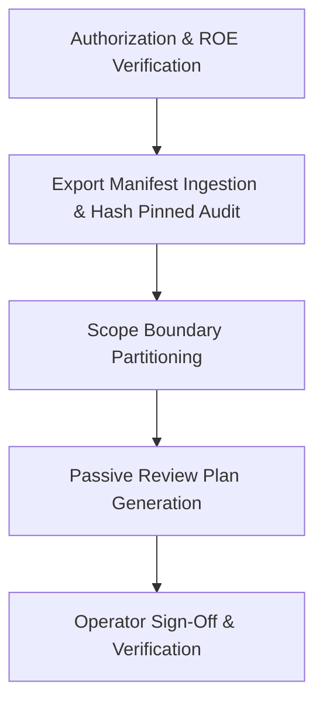

# Attack Surface Planner Offensive Engineer & Red Teamer Playbook

## 1. Overview & Intended Personas

The **COPS Attack Surface Planner** builds passive, offline attack surface review plans from human-approved rules-of-engagement scopes and pinned local export manifests. It enforces rigorous scope discipline, partitions assets into in-scope, excluded, and unresolved buckets, and requires explicit operator sign-off before any active operations.

- **Primary Personas**:
  - **Offensive Security Engineers & Red Teamers**: Scoping authorized security assessments and building structured testing plans against verified enterprise assets.
  - **Penetration Testers**: Ensuring complex multi-tenant environments have strict, auditable boundary controls separating client assets from out-of-scope third parties.
  - **Attack Surface Management (ASM) Analysts**: Reconciling cloud/Entra tenant exports with formal rules-of-engagement contracts.



---

## 2. When to Use This Plugin

Invoke this planner under the following concrete triggers:

| Trigger Scenario | Operational Objective | Primary Skills Invoked |
| :--- | :--- | :--- |
| **Assessment Scoping & Kickoff** | Formalize approved rules of engagement (ROE) and map assets before starting an authorized offensive assessment. | `authorized-attack-surface-planning` |
| **Multi-Tenant Azure/Entra Boundary Review** | Reconcile complex tenant inventories, subscription IDs, and custom domains to prevent testing out-of-scope infrastructure. | `authorized-attack-surface-planning` |
| **Passive Discovery Planning** | Plan non-intrusive observation and reconnaissance methods without making unreviewed network or tenant calls. | `authorized-attack-surface-planning` |
| **Active Network & Service Identification** | Conduct rate-limited, resumable port and TLS identification across approved boundaries. | `network-active-discovery` |
| **Infrastructure & Identity Services Assessment** | Assess protocol exposure (DNS, SNMP, NTP, RPC, LDAP, Kerberos), validate boundaries with canaries, and hand off identity attack paths. | `network-infrastructure-services` |
| **Audit & Engagement Compliance** | Document explicit boundary justifications, excluded scopes, and remaining uncertainties for compliance review. | `authorized-attack-surface-planning` |

### Operational Boundaries & Safety Guarantees
- **Strict Authorization Prerequisite**: Planning requires an explicit, human-signed rules-of-engagement (ROE) document. Authorization is **never inferred** from source code or discovery artifacts.
- **Passive & Offline Execution**: The planner makes **zero network requests** and executes **zero active exploitation**. All planning operates against offline JSON manifests.
- **Fail-Closed Scope Boundaries**: Any asset whose ownership or scope cannot be definitively proven is classified as `unresolved` and excluded from testing.
- **Data Privacy**: Export data and customer resource identifiers are treated as untrusted and confidential data.

---

## 3. Five-Phase Offensive Engineer Playbook

### Phase 1: Authorization & Rules of Engagement Verification
**Skill**: [`authorized-attack-surface-planning`](../skills/authorized-attack-surface-planning/SKILL.md)

1. **Verify Human Authorization**:
   - Confirm existence of signed ROE document specifying start time, end time, emergency contact, and permitted testing methods.
2. **Define Operator & Engagement Metadata**:
   - Record engagement ID, lead assessor, target client name, and authorized communication channels.

### Phase 2: Export Manifest Ingestion & Hash-Pinned Audit
1. **Gather Local Inventory Exports**:
   - Collect offline JSON exports of target cloud resources, domains, IP ranges, or Entra tenant objects.
2. **Record SHA-256 Checksums**:
   - Pin every input file with a cryptographic hash to ensure the review plan is auditable and repeatable.
3. **Execute Ingestion CLI**:
   ```bash
   python3 plugins/offensive-security/attack-surface-planner/scripts/plan.py <path-to-scope.json>
   ```

### Phase 2b: Multi-Source Telemetry Normalization & Scope Quarantine
**Skill**: [`network-passive-discovery`](../skills/network-passive-discovery/SKILL.md)

1. **Normalize Telemetry**:
   - Ingest raw DNS, certificate, IP allocation, endpoint, and cloud export records using `python3 -m cops discovery normalize <file> --type <type>`.
2. **Deduplicate Multi-Source Observations**:
   - Merge overlapping observations while retaining full cryptographic provenance chains: `python3 -m cops discovery merge <inv1> <inv2> ...`.
3. **Reconcile Scope Quarantine**:
   - Reconcile discoveries against engagement boundaries: `python3 -m cops discovery reconcile <inventory.json> --scope <scope.json>`.
   - Quarantine assets exhibiting conflicting ownership, stale records, or missing provenance so discovery cannot expand the engagement.

### Phase 2c: Bounded Active Discovery & Service Identification
**Skill**: [`network-active-discovery`](../skills/network-active-discovery/SKILL.md)

1. **Plan Authorized Assessment**:
   - Configure approved targets, ports, protocol, and TLS assessment with explicit vantage and rate limits: `python3 -m cops discovery active plan ...`.
2. **Execute Resumable Probes**:
   - Execute bounded probes with checkpointing: `python3 -m cops discovery active scan ...`.
   - Resuming skips completed probes without repeating side effects: `python3 -m cops discovery active resume ...`.
   - Live TLS handshakes require TLS 1.2 or newer; this dispatcher does not negotiate TLS 1.0 or 1.1.
3. **Calibrate Fingerprint Uncertainty**:
   - Distinguish observed configurations from inferred fingerprints with explicit confidence and visible uncertainty reasons.
4. **Enforce Boundary & DNS Rebind Defense**:
   - Detect dynamic DNS changes or out-of-scope shifts; halt probes and quarantine immediately.
5. **Verify Remediated Exposures**:
   - Evaluate remediation delta between baseline and re-test sessions: `python3 -m cops discovery active diff ...`.

#### Service entry-point handoff

`cops.discovery.prepare_session_service_handoffs` turns a recorded active scan session into offline service-validation candidates. The coordinator must supply exact approved endpoints from validated engagement scope; the scan checkpoint is evidence, not scope authority. The handoff requires a completed probe in the named session and matching native scan provenance, including the scope reference, probe key, timestamp, and assessment digest. Each completed probe key must map to exactly one recorded assessment; duplicate records make the checkpoint ambiguous and fail closed before routing. This digest detects mismatches within the checkpoint; it is not an independent attestation of the scan. The handoff preserves host, resolved IP, port, transport, and vantage, carries forward resolution quarantines, and routes only a recognized protocol response to a registered specialist and skill. A port-derived fingerprint or TLS certificate without a protocol response leaves the service unverified. The current live socket dispatcher generally records reachability and TLS metadata without a service banner, so its output usually needs a separately authorized identification action before specialist routing.

Each candidate includes a digest-bound proposal for `cops-pentest-specialist` and its matching service skill, expected proof, rollback, and stop conditions. Preparing it sends no traffic and grants no execution authority or budget. The coordinator must bind the proposal to the approved run, recheck scope and target identity, then authorize and account for each executed action and retry. Observed HTTP responses route to [`web-api-inventory-and-replay`](https://github.com/sodejm/copilot-operation-plugin-for-security/blob/main/plugins/offensive-security/web-api-assessment-workbench/skills/web-api-inventory-and-replay/SKILL.md) in the separately installed API workbench; UDP and unrecognized service responses remain unverified. An open port is exposure; a routed candidate is neither a verified weakness nor a successful use. Report unavailable, conflicting, unsupported, and unverified services as such. The [repository service validation playbook](https://github.com/sodejm/copilot-operation-plugin-for-security/blob/main/docs/SERVICE_VALIDATION_PLAYBOOK.md) provides a disposable loopback acceptance journey, including separately authorized controlled proof. This handoff does not provide a plain-language command, headless specialist execution, native external-target service validation, or production proof acceptance.

### Phase 2d: Infrastructure & Identity Services Assessment
**Skill**: [`network-infrastructure-services`](../skills/network-infrastructure-services/SKILL.md)

1. **Protocol-Specific Infrastructure Probing**:
   - Assess exposure of DNS, mDNS, SNMP, NTP, RPC endpoint mapper, LDAP, and Kerberos across approved targets: `python3 -m cops discovery infrastructure assess ...`.
2. **Strict Inaccessible != Secure Grounding**:
   - Unreachable, timed out, or connection-refused services are strictly classified as `inaccessible` (with `auth_prerequisite: unknown`). Never assume an inaccessible service is secure or hardened.
3. **Canary Records and Controlled Identities**:
   - Use benign canary domain queries (`canary.corp.internal`) and synthetic account names (`canary-user@CORP.INTERNAL`) to validate access barriers non-destructively.
4. **Extract Identity Attack-Path Candidates**:
   - Extract candidate attack paths (`ldap_anonymous_reconnaissance`, `asrep_roasting`, `rpc_endpoint_enumeration`, `snmp_credential_leak`, `open_dns_recursion`, `ntp_mode6_amplification`) for Active Directory and lateral movement specialist handoff: `python3 -m cops discovery infrastructure candidates ...`.

### Phase 2e: Remote Administration, File Sharing, and Printing Services Assessment
**Skill**: [`network-remote-and-file-services`](../skills/network-remote-and-file-services/SKILL.md)

1. **Protocol-Specific Remote, File, and Printing Probing**:
   - Assess exposure of remote administration (SSH, Telnet, RDP, VNC, WinRM, X11), file sharing (SMB, NFS, FTP/TFTP, rsync, AFP), and printing services (LPD, IPP, Raw/JetDirect) across approved targets: `python3 -m cops remote-services assess ...`.
2. **Strict Inaccessible != Secure Grounding**:
   - Filtered, closed, or timed out services are strictly classified as `inaccessible` (with `auth_prerequisite: unknown`). Never report an inaccessible service as secure or hardened.
3. **Canary Validation and Verifiable Cleanup Receipts**:
   - Validate access controls and write boundaries using benign canary files or synthetic print jobs.
   - Emit verified `CleanupReceipt` records confirming rollback and artifact removal: `python3 -m cops remote-services cleanup ...`.
4. **Extract Host Privilege Candidates**:
   - Extract candidate attack paths (`smb_v1_enabled`, `smb_signing_disabled`, `smb_unauthenticated_share`, `telnet_plaintext_exposure`, `rdp_nla_disabled`, `vnc_no_auth`, `winrm_http_unencrypted`, `x11_open_display`, `nfs_no_root_squash`, `ftp_anonymous_login`, `rsync_open_module`, `unauthenticated_printer_queue`) for offensive and lateral movement specialist handoff: `python3 -m cops remote-services candidates ...`.

### Phase 2f: Database, Cache, and Search Services Assessment
**Skill**: [`network-data-services`](../skills/network-data-services/SKILL.md)

1. **Protocol-Specific Database, Cache, and Search Probing**:
   - Assess exposure of relational databases (MySQL, Postgres, MSSQL, Oracle), NoSQL/document stores (MongoDB, CouchDB, Cassandra), caches (Redis, Memcached), and search/analytics engines (Elasticsearch, InfluxDB, Kibana, Splunk) across approved targets: `python3 -m cops data-services assess ...`.
2. **Bounded Query Budgets & Zero Bulk Extraction**:
   - Enforce bounded query budgets (default 5 rows/documents) to verify schema and access controls; prohibit and block bulk data extraction.
3. **Strict Inaccessible != Secure Grounding**:
   - Filtered, closed, or timed out services are strictly classified as `inaccessible` (with `auth_prerequisite: unknown`). Never assume an inaccessible service is secure or hardened.
4. **Canary Validation and Verifiable Cleanup Receipts**:
   - Validate access controls using benign canary identifiers (`canary_audit_table`, `canary_cache_key`).
   - Emit verified `CleanupReceipt` records confirming rollback and artifact removal: `python3 -m cops data-services cleanup ...`.
5. **Extract Data Privilege Candidates**:
   - Extract candidate findings (`redis_no_auth`, `redis_config_set`, `elasticsearch_open_cluster`, `mongodb_no_auth`, `memcached_no_auth`, `mysql_no_auth`, `postgres_trust_auth`, `mssql_blank_sa`, `couchdb_admin_party`, `cassandra_default_superuser`, `influxdb_no_auth`, `kibana_no_auth`, `splunk_default_creds`) for lateral movement and database takeover handoff: `python3 -m cops data-services candidates ...`.

### Phase 2g: Mail, Messaging, and Message Broker Services Assessment
**Skill**: [`network-messaging-services`](../skills/network-messaging-services/SKILL.md)

1. **Protocol-Specific Mail, Chat, and Broker Probing**:
   - Assess TCP reachability for mail services (SMTP, POP3, IMAP), chat (IRC), and brokers (RabbitMQ/AMQP, NATS, IBM MQ, Kafka, MQTT) across approved targets: `python3 -m cops messaging-services assess ...`. Configuration findings require supplied synthetic fixture data; the socket collector does not send protocol messages.
2. **Bounded Message Budgets & Zero Mass Outbound Relaying**:
   - Require allowlisted canary destinations and mail recipients, an active retention window of at most 86400 seconds, and a positive message budget of at most 5. This bounds accepted synthetic fixture evidence; neither collector sends messages.
3. **Strict Inaccessible != Secure Grounding**:
   - Filtered, closed, or timed out services are strictly classified as `inaccessible` (with `auth_prerequisite: unknown`). Never assume an inaccessible service is secure or hardened.
4. **Canary Validation and Verifiable Cleanup Receipts**:
   - Validate synthetic fixture delivery only when identifier, route, recipient, time, and count match the authorized request.
   - Export hashed `CleanupReceipt` records only for matching fixture cleanup evidence within retention: `python3 -m cops messaging-services cleanup ...`. Report import rechecks the hash-bound retention start, duration, delivery, and cleanup timestamps. A receipt does not confirm a live purge or authenticate the fixture.
5. **Extract Messaging Privilege Candidates**:
   - Extract candidate findings (`smtp_open_relay`, `smtp_user_enumeration`, `pop3_plaintext_auth`, `imap_anonymous_login`, `irc_unauthenticated_operator`, `rabbitmq_guest_default_creds`, `rabbitmq_open_management`, `nats_unauthenticated_cluster`, `ibmmq_blank_channel`, `kafka_unauthenticated_broker`, `mqtt_anonymous_read_write`) for unauthorized relay or broker takeover handoff: `python3 -m cops messaging-services candidates ...`.

### Phase 2h: Developer and Runtime Interfaces Assessment
**Skill**: [`network-developer-interfaces`](../skills/network-developer-interfaces/SKILL.md)

1. **Protocol-Specific Developer & Debugging Interface Probing**:
   - Assess exposure of container runtimes (Docker API, Docker Registry), debugging ports (Java RMI, JDWP, Erlang EPMD, ADB), distributed build tools (distcc, SVN), and gateway interfaces (AJP, FastCGI) across approved targets: `python3 -m cops developer-services assess ...`.
2. **Execution Effect Classification & Plan Binding**:
   - Declare `ExecutionEffect`: `read_only`, `non_destructive`, `state_change`, `code_execution`.
   - Operations that execute code or modify state require explicit authorization (`--allow-code-execution`, `--allow-state-change`) bound to the active plan.
3. **Application vs Infrastructure Specialist Routing**:
   - Route application-layer findings to web specialists (`cops-web-specialist`), orchestrator paths to cloud specialists (`cops-cloud-specialist`), and code execution / breakout findings to pentest specialists (`cops-pentest-specialist`). Before a cluster handoff, validate the allowed cluster, current Kubernetes context, and API hostname with `python3 -m cops developer-services handoff --kind cluster ...`; this is an offline metadata check.
4. **Strict Inaccessible != Secure Grounding**:
   - Filtered, closed, or timed-out endpoints are strictly classified as `inaccessible` (with `auth_prerequisite: unknown`). Never assume an inaccessible service is secure or hardened.
5. **Canary Validation and Verifiable Cleanup Receipts**:
   - Validate access controls using benign canary identifiers (`canary_docker_probe`, `canary_debug_probe`).
   - Emit verified `CleanupReceipt` records confirming rollback and artifact removal: `python3 -m cops developer-services cleanup ...`.
6. **Extract Developer Privilege Candidates**:
   - Extract candidate findings (`docker_socket_rce`, `docker_registry_leak`, `rmi_code_execution`, `jdwp_code_execution`, `erlang_epmd_rce`, `adb_shell_rce`, `distcc_rce`, `svn_anonymous_checkout`, `ajp_ghostcat_rce`, `fastcgi_rce`) for code execution or breakout handoff: `python3 -m cops developer-services candidates ...`.

### Phase 2i: Legacy Enterprise, Management, and Proxy Services Assessment
**Skill**: [`network-legacy-and-proxy-services`](../skills/network-legacy-and-proxy-services/SKILL.md)

1. **Nine offline service models**:
   - The NDMP, iSCSI, IPMI, Cisco Smart Install, TACACS+, IKEv1, PPTP, SOCKS, and Squid models exercise fixture-defined conditions with the default `--mode synthetic` and supplied `--offline-targets`. `--mode live` uses the socket collector, which checks TCP connection or UDP send reachability only. A reachable socket is `unconfirmed`; it does not establish protocol behavior, authentication, or vulnerability.
2. **Proxy egress boundary**:
   - SOCKS and Squid fixtures can set `proxy_egress_tested` and `proxy_egress_restricted` from fixture data. The socket collector does not send traffic through a proxy or test destination restrictions.
3. **Execution effect classification**:
   - `ExecutionEffect` describes possible effects in a model. Authorization flags enable fixture branches; the socket collector does not execute code or modify remote state.
4. **Inaccessible remains uncertain**:
   - Filtered, closed, or timed-out endpoints are `inaccessible` with unknown authentication prerequisites. Do not treat that result as evidence of hardening.
5. **Synthetic canary and cleanup data**:
   - Offline fixtures can produce canary and `CleanupReceipt` records for serialization tests. They do not create or remove remote artifacts. The socket collector produces no such receipt; `python3 -m cops legacy-services cleanup ...` exports only records already in a report.
6. **Fixture candidate routing**:
   - `python3 -m cops legacy-services candidates ...` exports candidates derived from fixture conditions. Socket reachability alone yields no privilege candidates. Confirm any operational finding in an authorized environment before handoff.

The repository's `docs/PROTOCOL_TOPIC_RECONCILIATION.md` records coverage and version or environment limits for all 70 historical topics.

### Phase 3: Scope Boundary Partitioning
Systematically classify every discovered entity into one of three strict partitions:

1. **In-Scope (`in_scope`)**:
   - Explicitly listed in the signed ROE, verified to belong to target client ownership.
2. **Excluded (`excluded`)**:
   - Explicitly forbidden: shared third-party SaaS, production payment processors, emergency response infrastructure, partner tenants.
3. **Unresolved (`unresolved`)**:
   - Assets with ambiguous ownership, disputed DNS records, or shared multi-tenant endpoints. Fail-closed: marked as untestable until confirmed in writing.

### Phase 4: Passive Review Plan Generation
For each in-scope asset, author a passive, bounded evaluation step:

- **Target Identifier**: FQDN, tenant ID, or IP range.
- **Observation Technique**: Passive DNS historical lookup, Certificate Transparency log inspection, public header review.
- **Expected Telemetry**: What logs should the client's SOC observe?
- **Stop Condition**: Immediate halt condition if sensitive customer data or system degradation is detected.
- **Cleanup & Rollback**: Confirm no persistence or residual artifacts remain.

### Phase 5: Operator Review & Plan Sign-Off
1. **Review Boundary Report**:
   - Verify summary counts: in-scope, excluded, and unresolved assets.
2. **Present Plan to Client / Engagement Lead**:
   - Walk through proposed passive observation steps. Confirm written sign-off before initiating any separate execution phase.
3. **Export Engagement Record**:
   - Archive the immutable approved plan JSON alongside the signed ROE and active Engagement record.
4. **Prepare a Separate Execution Handoff**:
   - If an authorized execution phase follows, issue an authenticated authorization for the full approved plan snapshot and expected worker. Supply verifier trust, Engagement, and an owner-only worker capability inventory produced independently from a trusted host measurement or deployment process; never copy signing secret bytes into handoff artifacts or imply that COPS discovers installed executables at runtime.
   - Follow the repository [Authenticated Execution Guide](AUTHENTICATED_EXECUTION.md). The planner itself remains offline and does not mint or consume execution authority.

---

## 4. Verification & Gate Checks

Validate the package implementation and test reproducibility:

```bash
# Repository smoke demo
python3 -m cops demo attack-surface-planner

# Package validation gate
python3 plugins/offensive-security/attack-surface-planner/scripts/validate-package.py

# Offline unit tests
python3 -m unittest discover -s plugins/offensive-security/attack-surface-planner/tests -v
```

## Deterministic manifest playback

### Purpose and prerequisites

`scripts/run_playback.py` is the runnable acceptance example for the offline planner. It requires only Python 3 and the package files. It does not need cloud credentials, tenant access, DNS access, or a network connection. Run it from the package root with `python3 scripts/run_playback.py`; pass `--manifest PATH` only when validating a compatible playback contract.

### Design and data flow

The manifest pins the synthetic scope manifest and expected semantics. The runner reads that scope manifest through the planner's bounded regular-file gate. It then reads only the four declared source paths through the planner's traversal, symlink, file-type, and size gates and writes those validated bytes into a disposable private directory. Unrelated sibling files and directories are not inspected or staged. The runner invokes `scripts/plan.py` twice, parses both reports, and checks the results. Data flows from four operator-supplied JSON exports through the scope gate to the source ledger, surface map, passive test proposals, and final JSON report. No output is used as execution authority.

| Purpose | Key fields | Producer | Consumer | Definition | Validation | Example |
| --- | --- | --- | --- | --- | --- | --- |
| Playback contract (`scripts/playback/manifest.json`) | `schema_version`, `scope_manifest`, `expected` | Maintainer | Playback runner | Pins fixture and semantic assertions | Required keys load as JSON | `cops.attack-surface-playback/v1` |
| Source ledger | `kind`, `file`, `sha256`, `record_count` | Planner | Reviewer | Provenance for each passive export | Four ordered source kinds and hashes | `dns_ct` |
| Boundary decision | `asset_id`, `decision`, `reason`, `evidence` | Planner | Reviewer and proposal builder | Classifies every record | Counts are 4 in scope, 3 excluded, 1 unresolved | `unresolved` |
| Passive proposal | `method`, `hypothesis`, `stop_condition`, `cleanup` | Planner | Engagement reviewer | Review step for an in-scope record | Four proposals; each method begins `passive-review` | `passive-review of ...` |
| Final report | `summary`, `test_plan`, `network_requests` | Planner | Playback runner | Canonical bounded result | Reruns equal and network requests equal zero | `network_requests: 0` |

### Interpretation, failures, and reruns

A `status` of `passed` means the current implementation reproduced the manifest's expected fixture semantics. It does not prove that an external asset exists or is exploitable. Excluded and unresolved entries remain quarantined from the proposal list. The negative case must return code 2 and an `input gate` error for active mode. Declared FIFOs, symlinks, traversal paths, and oversized files fail before staging; unrelated files beside the declared inputs are outside the playback input set. JSON parse errors, changed counts, changed ordering, non-passive methods, or unequal reruns fail the playback with a nonzero exit.

Reruns create fresh temporary directories and do not reuse prior output. The standard temporary-directory cleanup runs on success and exceptions. If a process is forcibly terminated, remove any `cops-planner-playback-*` directory left in the operating system temporary directory. The playback covers pinned local exports and planner semantics only; it does not validate export freshness, ownership assertions, live systems, or authorization outside the fixture.

<!-- BEGIN COPS GENERATED OFFLINE ASSESSMENT LINKS -->
## Generated offline assessment

- [Machine-readable playbook](../playbooks/offline-assessment.json)
- [Runnable offline walkthrough](../walkthroughs/offline-assessment.md)
<!-- END COPS GENERATED OFFLINE ASSESSMENT LINKS -->
