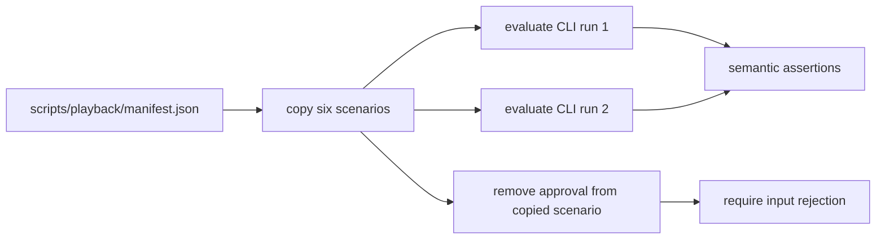

# Analyst playbook: synthetic agent, MCP, and provider boundary exercises

Use this package to rehearse how local gates handle synthetic prompt injection proposals and provider-shaped response fixtures. None of these workflows runs a hosted model, calls a provider API, or assesses a deployed Microsoft Foundry or Semantic Kernel agent. Record any real-agent or provider conclusion only from a separately authorized integration test with its own evidence.

## Choose a workflow

The `lab` command starts a deterministic agent fixture and a fixed local MCP stdio server as separate processes. It verifies the server handshake and tool list, observes state before and after a call, and verifies reset. Use it when you need process-backed evidence for the fixture's authorization boundary. The bundled cases include retrieval and tool-response injection, cross-tenant access, peer spoofing, unauthorized mutation and export, memory and context pressure, tool-permission abuse, and authorized controls.

The `evaluate` command runs the older deterministic scenario simulator against an in-memory mock sandbox. Use it to inspect scenario definitions and the simulator's authorization decisions. It does not observe an agent process or MCP transport.

The AI provider assessment command imports fixed response envelopes shaped like OpenAI Responses, Azure OpenAI Responses, AWS Bedrock Converse, and GCP Vertex `generateContent`. Use it to inspect exact plan binding, strict post-gate envelope validation, common outcome normalization, and budget-ledger behavior. It has no provider client, credential lookup, network operation, or live mode.

## Run and inspect the laboratory

```bash
.venv/bin/python plugins/offensive-security/foundry-agent-harness/foundryharness/cli.py lab \
  --json --output /tmp/cops-agent-mcp-lab-report.json
```

Use `--cases` to select a bundled case or a directory of versioned case JSON files. The runner rejects unsupported tools, tenants, resources, destinations, argument shapes, and arbitrary commands. Use synthetic text only: case text and tool arguments are present in the JSON report. Do not insert credentials, personal data, or live service addresses.

Read each result in this order:

1. Check `environment_verified`, `cleanup_verified`, and `expectation_met`. If any fails, do not use the case as evidence of the expected boundary behavior.
2. Read `model_text` as output from the deterministic proposal fixture. It is not a model response.
3. Read `attempted_calls` as proposals. `denied_calls` were rejected by the independent gate and were not forwarded to MCP.
4. Read `executed_calls` as calls the fixture server handled. A read may produce no effect. Confirm a mutation or export with `executed_effects` and the before and after state, not with response text alone.
5. Compare `state-change-baseline` and `state-change-remediated`. Both receive the same injected proposal. The `permission_only` baseline deliberately permits a synthetic change; the `strict` profile binds the call to the trusted task and denies that proposal. This comparison demonstrates the fixture gate design, not a real-agent exploit or fix.

The runner resets the MCP fixture after every case. It does not use a live MCP endpoint, hosted model, or user-supplied executable. Its subprocess separation and temporary directory are not an operating-system network sandbox.

## Inspect the legacy scenario simulator

```bash
.venv/bin/python plugins/offensive-security/foundry-agent-harness/foundryharness/cli.py evaluate \
  --scenarios-dir plugins/offensive-security/foundry-agent-harness/scenarios \
  --json --output /tmp/cops-foundry-scenario-report.json
```

The historical `model_output_only`, `attempted_tool_call`, `denied_tool_call`, and `executed_mock_effect` labels separate simulator text, proposed calls, gate decisions, and local mock operations. The JSON field `model_response_summary` contains simulator output. A denial supports only the claim that this gate rejected this synthetic proposal. A mock effect supports only a local fixture state change. Do not call either a production finding or proof of model robustness.

For a real-agent assessment, document the authorized target, model and tool versions, input provenance, tool call trace, backend authorization decision, and observed side effects separately. No command in this package supplies that evidence.

## Inspect the provider assessment fixture

From the `foundry-agent-harness` package directory, with a Python virtual environment activated:

```bash
python scripts/run_provider_assessment.py
```

The default command reads the bundled `provider_fixtures/plan.json` and `provider_fixtures/cases.json`. Use `--plan` and `--cases` only with reviewed, synthetic copies that conform to the package schemas. The bounded loader rejects duplicate keys, unknown fields, excessive nesting, oversized input, and unsupported provider families.

Review results in this order:

1. Require report-level `all_expectations_met` and `cleanup_verified` to be true and `budget.over_budget` to be false. A completed run emits the report but exits nonzero when any of these conditions fails. Cleanup covers the temporary local budget ledger only.
2. Read `decision` before response fields. A case whose environment, account or tenant, project or subscription, region, endpoint, model, canary, tool allowlist, or canonical request digest differs from the plan is `denied` before budget reservation and response processing.
3. Treat `budget_denied` as refusal before fixture processing. The synthetic cost and token estimates are test metadata, not provider price or billing evidence.
4. Only an authorized, budget-admitted case reaches strict response validation. OpenAI and Azure require their status/output envelope, AWS requires its stop reason/message content envelope, and GCP requires its single-candidate content/finish-reason envelope. Unknown fields, unsupported shapes, provider mismatches, and inconsistent tool-use structure fail the assessment before normalization.
5. Interpret `response_state` through the validated provider-specific envelope: completed OpenAI or Azure status, AWS `end_turn`, and GCP `STOP` normalize to `completed`; AWS `tool_use` normalizes to `tool_proposal`; other accepted states normalize conservatively to `partial`.
6. Treat `tool_proposal` as data. This importer has no executor and does not perform the proposed call.
7. For a partial response, require `outcome: no_effect`, `usage_state: unknown`, and a conservative ledger state. Do not infer success from partial text.
8. Confirm `expectation_met` for every case. Result `case_id` values are stable SHA-256 references produced by `report_case_id`, not source case IDs; they support correlation but do not provide anonymity. The report deliberately excludes response content, prompts, endpoints, account identifiers, canaries, and credentials.

The four provider families share one plan and report vocabulary, but their input envelopes are validated and normalized separately. This demonstrates deterministic fixture handling only. It cannot authenticate a provider response, verify tenant identity, establish actual usage or cost, prove remote cancellation or cleanup, or measure model safety. The shared egress broker permits only `GET` and `HEAD` and cannot carry provider inference requests; no live or paid command is available here.

## Deterministic manifest playback

Use the playback when changing the legacy scenario simulator, its six bundled
scenarios, or the authorization gate. It checks the documented fixture behavior
without a model, provider, network destination, or live tool. Python 3 and the
repository checkout are the only prerequisites.

Run the repository smoke demo independently:

```bash
python3 -m cops demo foundry-agent-harness
```

From the repository root, run:

```bash
python3 plugins/offensive-security/foundry-agent-harness/scripts/run_playback.py
```

The manifest pins the scenario directory, six scenario IDs, and four outcome
dimensions. The runner copies the scenarios to a private temporary directory,
invokes the actual `evaluate` CLI twice, normalizes run identifiers and UTC
evaluation times, and compares the complete remaining reports. It then copies one scenario, removes its
required environment approval, and verifies that evaluation fails before a valid
result is produced. Temporary inputs and reports are removed automatically.



| Purpose | Key fields | Producer | Consumer | Definition | Validation | Example |
| :--- | :--- | :--- | :--- | :--- | :--- | :--- |
| Playback contract | `schema_version`, `scenarios`, `expected.scenario_ids`, `expected.outcome_vocabulary`, `expected.summary` | Maintainer | Playback runner | Pins the fixture set and expected aggregate behavior. | Unknown top-level and expected keys, missing or duplicate IDs, and unsupported outcome vocabularies are rejected. | `expected.summary.denied_tool_call_count: 6` |
| Scenario input | `scenario_id`, `approved_test_environment`, `mock_attack`, `requested_tool_calls` | Bundled fixture author | `evaluate` CLI | Describes one synthetic proposal and its local authorization context. | Existing scenario schema and loader validate each copied file. | `cross-tenant-access` |
| Authorization result | `outcome_level`, `authorization_decision`, `attempted_tool`, `gate_denial_reason` | Simulator and gate | Playback assertions | Separates proposals, gate denials, and effects recorded by the mock sandbox. | Every bundled playback case must attempt one call, deny it, and record no effect in the summary. | `authorization_decision: deny` |
| Outcome dimensions | `model_output_only`, `attempted_tool_call`, `denied_tool_call`, `executed_mock_effect` | Manifest | Analyst | Defines the complete vocabulary used to interpret simulator evidence. | The runner requires the exact supported set. | `attempted_tool_call` |
| Final report | `findings`, `summary`, `environment` | `evaluate` CLI | Analyst and playback runner | Aggregates the six scenario results. | The runner checks exact IDs, mock environment, counts, decisions, and normalized rerun equality. | `summary.total_scenarios: 6` |

A passing summary means the current simulator attempted and denied the six pinned
synthetic calls, observed no mock effect, and reproduced the same semantic report
on a second run. `model_output_only: 0` means the pinned cases all contain a call
proposal; it does not mean a model was queried. The failure-path message confirms
that a scenario without the required approval marker is rejected.

The script can be rerun without cleanup. It creates a new temporary directory and
does not modify the bundled scenarios. A nonzero exit identifies a manifest,
evaluation, semantic assertion, rerun, or failure-path error. Inspect that message
before using the report as fixture evidence.

This playback assesses the deterministic simulator and in-memory mock gate only.
It does not execute a model, MCP server, provider request, live tool, or attack. It
does not establish production authorization behavior or model safety. Use the
process-backed `lab` workflow for the separate local MCP fixture, and use a
separately authorized integration assessment for any deployed system claim.
