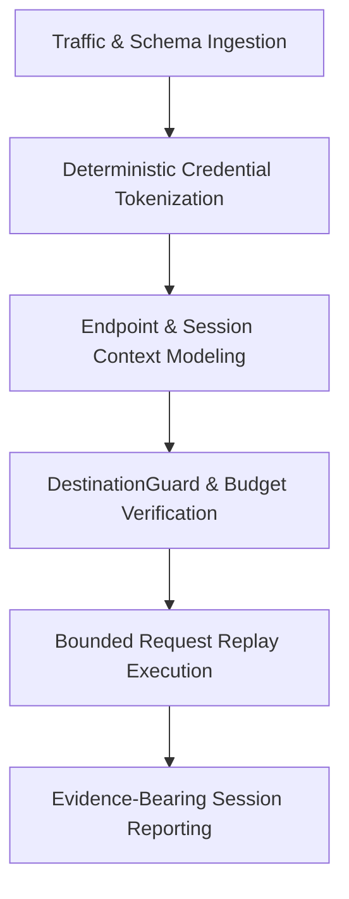

# Web API Assessment Workbench Playbook

## 1. Overview & Intended Personas

The **COPS Web API Assessment Workbench** provides structured API ingestion, endpoint modeling, session isolation, and bounded request replay under strict authorization, egress, and operational budget controls.

- **Primary Personas**:
  - **Offensive Security Engineers & Red Teamers**: Scoping web applications, microservices, GraphQL endpoints, and WebSocket inventory, then testing supported HTTP behavior against authorized targets.
  - **Application Security (AppSec) Engineers**: Auditing API definitions, reviewing authorization models, and evaluating endpoint visibility without leaking credentials into logs or LLM prompts.
  - **Penetration Testers**: Preparing bounded HTTP request replays to verify object authorization and request-rate controls on explicitly authorized targets.



---

## 2. When to Use This Plugin

| Trigger Scenario | Operational Objective | Primary Tool / Skill |
| :--- | :--- | :--- |
| **API Intake & Asset Discovery** | Import and sanitize HTTP traffic captures (HAR 1.2), OpenAPI 3.x, Swagger 2.0, Postman 2.0/2.1, or raw HTTP transcripts. | `python3 -m cops web-api inventory` |
| **Credential Sanitization Review** | Verify that tokens, cookies, and passwords are tokenized as truncated hashes (`[REDACTED:<hash>]`). | `python3 -m cops web-api inspect` |
| **Authorization & Role Isolation** | Model distinct user sessions (`user`, `admin`, `anonymous`) to prepare for cross-role authorization checks. | `cops.web_api.models.SessionContext` |
| **Bounded Endpoint Replay** | Preview or synthetically replay HTTP and GraphQL requests within a destination allowlist; use the approved Python execution path for live HTTP. | `python3 -m cops web-api replay` |
| **Object Authorization Assessment** | Compare owner, other-user, and anonymous REST and GraphQL observations. | `assess_object_authorization` |
| **Request-Rate Assessment** | Evaluate bounded request sequences for enforced, missing, or inconclusive rate limiting. | `assess_rate_limit` |

### Operational Boundaries & Safety Guarantees
- **Strict Destination Allowlists**: Every request destination URL is evaluated against `DestinationGuard`. Out-of-scope targets trigger an immediate `403 Forbidden` response and count toward `destination_violations`.
- **Zero Plaintext Credentials**: All Authorization headers, session cookies, and sensitive query/body parameters are irreversibly hashed before storage or display.
- **Fail-Closed Budget Limits**: Replay sessions terminate immediately once request budgets or hop limits are reached.
- **Execution Authorization Boundary**: Live HTTP requires an exact `ActionPlan` snapshot, approval verification, a ready worker boundary, and a `ScopeGuard`. Preview does not dispatch requests or invoke authorization, worker, session, or output-state changes.
- **Isolation Limitation**: The worker boundary coordinates readiness and execution state; it does not establish OS or network isolation.
- **Protocol Transparency**: Unsupported protocol features (e.g. binary streaming, SSE) are formally flagged in `unsupported_features` rather than silently bypassed.

---

## 3. Step-by-Step Assessment Workflow

### Step 1: Ingest API Definitions or Traffic Captures
Collect OpenAPI definitions, Postman collections, HAR exports, or raw HTTP transcripts from authorized application environments:
```bash
python3 -m cops web-api inventory --openapi api-spec.json -o inventory.json
```

### Step 2: Inspect Sanitized Inventory
Verify that all endpoints, auth mechanisms, and parameters were captured with tokens redacted:
```bash
python3 -m cops web-api inspect inventory.json
```

### Step 3: Configure Destination Guard and Budget
Determine allowable target hosts and operational bounds:
- Allowed target: `api.target.internal`
- Max requests: `50`
- Rate limit: `10.0` RPS
- Max redirect hops: `3`

### Step 4: Preview or Execute Bounded Replay
Preview first. This reports exact destinations, request budget, expected evidence, and effects without dispatching a request or writing the replay output:
```bash
python3 -m cops web-api replay \
  -i inventory.json \
  --allow-destination api.target.internal \
  --max-requests 50 \
  --rate-limit 10.0 \
  --mode live \
  --dry-run \
  --json
```

The package CLI performs offline synthetic replay:
```bash
python3 -m cops web-api replay \
  -i inventory.json \
  --allow-destination api.target.internal \
  --max-requests 50 \
  --rate-limit 10.0 \
  --mode offline \
  -o replay_report.json
```

Live HTTP replay is available only through `execute_authorized_replay_session(...)`. Build the immutable operation with `build_replay_action_plan(...)`, obtain an approval that matches that exact plan, then supply the repository worker and scope controls. The package CLI rejects `--mode live` after preview unless those dependencies are supplied through the approved Python integration.

### Step 5: Assess Authorization and Rate Controls
Collect bounded evidence for every required authorization case: REST and GraphQL as the object owner, another authenticated user, and an anonymous caller. `assess_object_authorization(...)` returns:

- `pass` when the owner is allowed and both non-owner cases are denied for each protocol;
- `fail` when a non-owner reaches the protected object or the owner is denied; or
- `insufficient_evidence` when a required case is missing or the response cannot establish allow/deny behavior.

For rate limiting, `assess_rate_limit(...)` treats a bounded sequence containing `429` and retry guidance as enforced, an all-success sequence as failed, and too few attempts or transport/server errors as insufficient evidence.

### Step 6: Deliver Structured Audit Evidence
Review `replay_report.json` for status distributions, latency benchmarks, and destination compliance.

## Limitations

- Live replay supports HTTP/HTTPS and a bounded WS/WSS text subset through the approved Python integration. WebSocket messages, sessions, destinations and frame/byte/time budgets require exact approval; the CLI still rejects live dispatch. Binary frames, fragmentation, compression, extensions, subprotocols, WebSocket redirects and SSE execution are unsupported. See [bounded WebSocket replay](BOUNDED_WEBSOCKET_REPLAY.md) for stopping and recovery.
- The disposable `WebApiAssessmentLaboratory` exercises vulnerable and corrected behavior through real loopback HTTP requests. Its role cases cover owner, other-user, and anonymous REST and GraphQL access, and its rate cases cover failure, correction, and insufficient evidence.
- The local worker contract does not provide OS or network isolation, so isolation remains blocked even when the loopback assessment passes.
- Production-provider validation remains incomplete until the same approved workflow runs against an authorized provider target.
- Inventory import reads HAR 1.2, OpenAPI 3.x, Swagger 2.0, Postman 2.0/2.1, and raw HTTP without rewriting the source artifact.

Run the package demo independently before an engagement:

```bash
python3 -m cops demo web-api-assessment-workbench
```

Use [VERIFICATION.md](VERIFICATION.md) for the complete evidence contract, acceptance criteria, recovery procedure, and host exercise.

<!-- BEGIN COPS GENERATED OFFLINE ASSESSMENT LINKS -->
## Generated offline assessment

- [Machine-readable playbook](../playbooks/offline-assessment.json)
- [Runnable offline walkthrough](../walkthroughs/offline-assessment.md)
<!-- END COPS GENERATED OFFLINE ASSESSMENT LINKS -->

## Worker integration and recovery

The [worker qualification contract](../../../../specs/issue-100-worker-qualification.md)
describes the required approval, credential resolution, destination and egress
boundaries. For a cancelled or uncertain post-dispatch outcome, reconcile remote
effects and cleanup before requesting a fresh authorization; do not automatically
retry the consumed approval. Worker integration qualification is pending.
