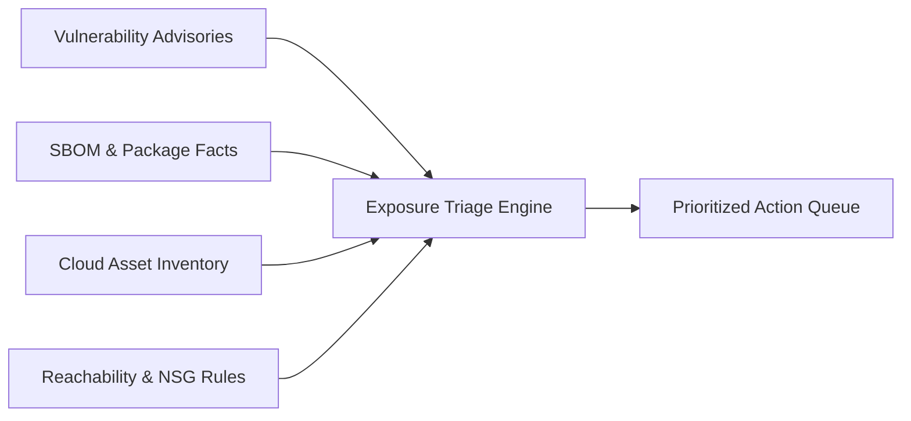

# Exposure Triage Workflow

Use this skill to evaluate and prioritize vulnerability alerts using multi-source evidence rather than relying solely on raw CVSS scores.

## Workflow Overview



1. **Ingest Verified Facts**:
   Combine vulnerability advisory specs (CVE IDs, vulnerable version clauses, CVSS), local asset inventories (subscriptions, resource types, owners, criticality), package component manifests (installed versions, file paths, SHA-256 hashes), and network reachability records (public routes, internal endpoints, NSG rules).

2. **Evaluate Contextual Exposure**:
   - Compare installed versions against advisory ranges to distinguish `confirmed_vulnerable`, `confirmed_unaffected`, and `unknown_version`.
   - Reconcile network route boundaries to distinguish `public_internet`, `internal_lateral`, `isolated`, and `contradictory`.
   - Inspect inventory timestamps to flag stale evidence (>30 days).

3. **Generate Actionable Triage Queue**:
   Rank items into transparent priority tiers:
   - **P1 (Critical)**: Confirmed vulnerable version on public-facing crown jewel or high-criticality assets.
   - **P2 (High)**: Confirmed vulnerable version on public-facing standard assets or internal crown jewel assets.
   - **P3 (Medium)**: Confirmed vulnerable version on internal lateral assets.
   - **P4 (Low)**: Confirmed unaffected/patched versions or isolated environments.
   - **Investigation Required**: Items with unknown installed versions or contradictory reachability evidence.

## Quick Execution

For a plain-language triage request, identify the authorized local bundle and its scope, then run validation and triage into a new private directory. If the bundle or target scope is ambiguous, request that information before processing. The workflow reads local evidence only; it does not probe assets or remediate them. Give the user a concise priority summary with evidence gaps and the private report location, without copying raw asset identifiers or credentials into the conversation.

Resolve the installed package root from this skill file: it is the parent of the `skills/` directory and contains `exposuretriage/`. Run the commands below from any directory, setting `P` to that resolved package root and replacing the bundle path with an authorized local input:

```bash
P=/absolute/path/to/installed/exposure-triage-workbench
COPS_EXPOSURE_RUN=$(mktemp -d)
PYTHONPATH="$P" python3 -m exposuretriage.cli validate --input path/to/triage-bundle.json
PYTHONPATH="$P" python3 -m exposuretriage.cli triage --input path/to/triage-bundle.json --json --output "$COPS_EXPOSURE_RUN/report.json"
```

Keep the input and output directory private. The CLI creates the report with mode `0600` on POSIX and refuses an existing file or symlink; choose a fresh destination for a rerun. On Windows, use a private parent directory with an appropriate ACL. Do not paste raw reports, stream real data to stdout, or store reports in a shared workspace. The `--stdout` option is only for synthetic or sanitized data.

Validation checks the supported bundle version, bundle ID, and required fields in records that are present. An absent evidence collection can pass intake; missing cross-source facts may instead produce an investigation item. The published JSON Schema is not enforced at runtime, and passing validation does not prove inventory completeness or exploitability.
